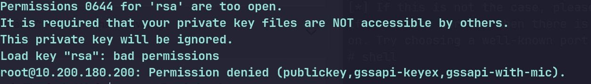
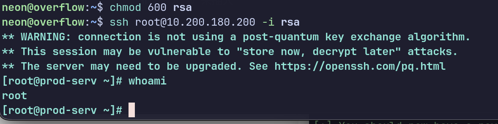

## 1.不能用nmap的-O参数来查看操作系统具体发行版,需要扫http的响应头,hearders,即扫80端口,-sV


## 2.利用python的虚拟环境下载一个漏洞利用脚本

```bash
python -m venv 虚拟环境名字 #创建虚拟环境
source 虚拟环境名字/bin/active #初始化虚拟环境
pip install -r requirements.txt #下载脚本依赖
deactive #清除虚拟环境配置,不过需要手动清除目录
```



##### 用窃取到的密钥ssh登录目标主机,需要先给私钥600权限,不然就会出现上面那个报错,



### 在自己机器开http服务时候,要在下载的软件的那个目开,不要在敏感目录开,会暴露被攻击的风险,以后会,


#### 反弹shell回来要端口放行,光监听还不行一定要做端口放行,用ufw

### http开服务也是要做端口放行,不然别人连不进来


##### 用curl下载 无法递归目录下载,否则返回301重定向,就是下载目录时候想下载子目录的东西,不能省事直接下载父目录,无法把整个文件夹下载过来,只能下载单一文件,-o参数要放最后


