## DMZ (隔离区)概念：

#### 为什么要创建 DMZ？

假设一家公司有两类服务器：

- 对外服务：官网、邮件网关、VPN 入口。

- 内部服务：员工文件、数据库、管理后台。

如果把它们全部放在同一个网络里，攻击者一旦攻陷官网，就可能直接接触数据库和内部管理系统。

因此，企业会将对外服务放到 DMZ，把内部业务系统放到内部网络，并通过防火墙限制两个区域之间的通信。

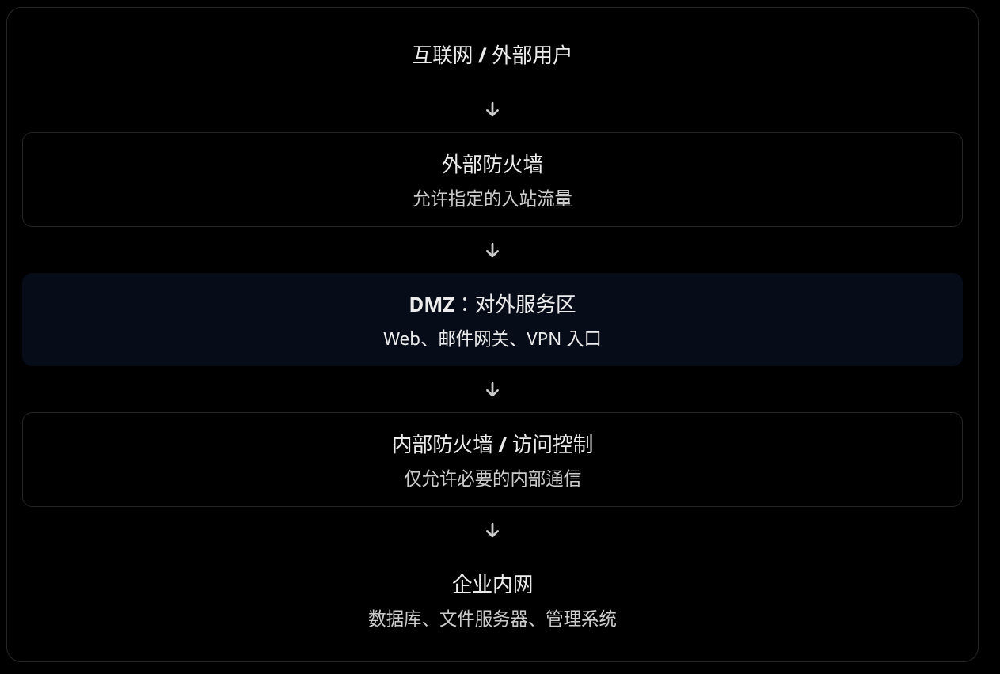

###### 看靶场所在docker网段

```bash
docker network ls
```

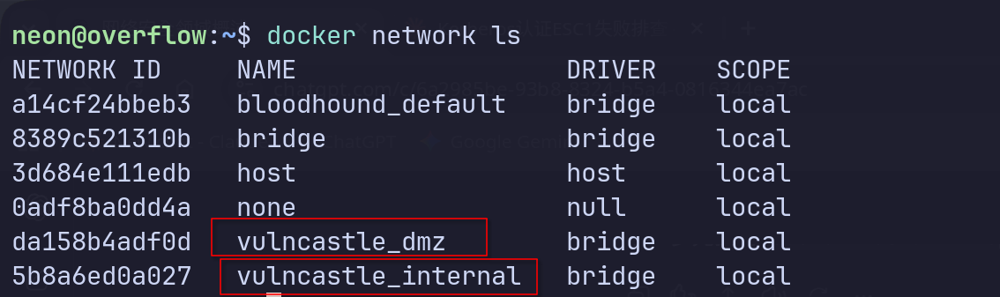

#### 可以发现dmz和内部网段

###### 查看dmz详细网络配置

```bash
docker network inspect vulncastle_dmz
```

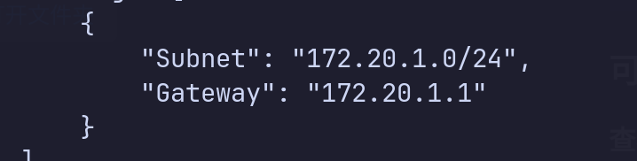

- `Subnet`：DMZ 的 IP 地址范围。

- `Gateway`：宿主机在这个 Docker 网络中的网关地址。

- `Containers`：这个网段里的所有容器

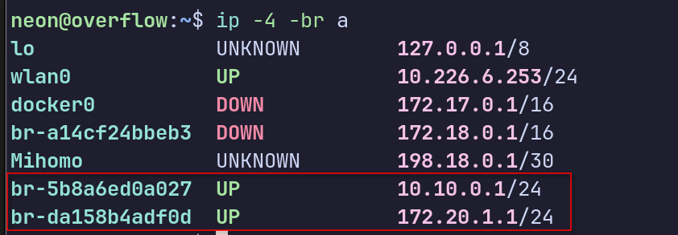

##### 也能看到dmz和内部网络的网段

#### DMZ主机发现，有3台机子，.1是宿主机

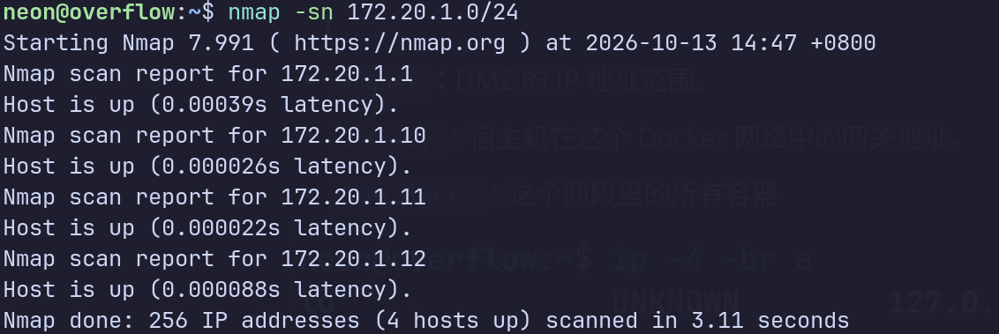

##### 看web,   `-i` 发GET请求，返回hander和body

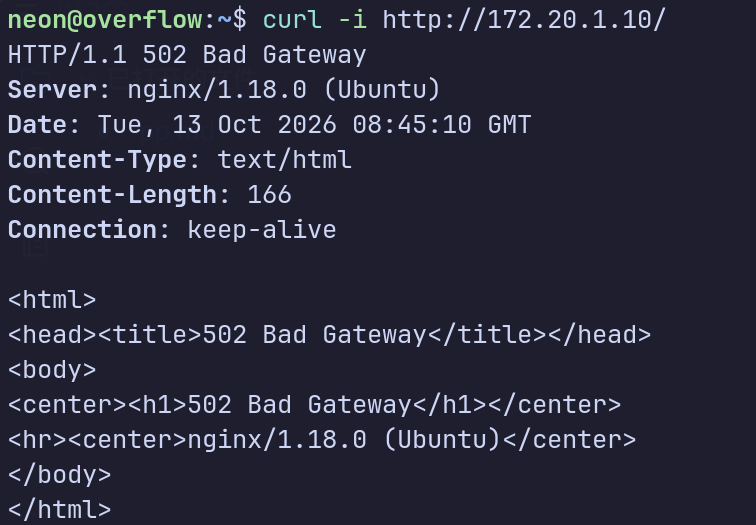

-I 发HEAD请求，只返回hander

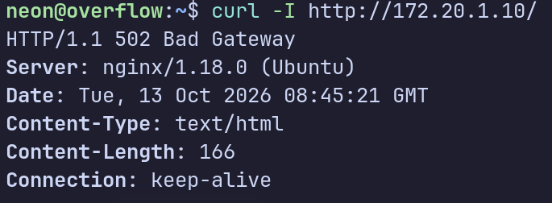

##### 单纯看页面内容（body）,无需带参数

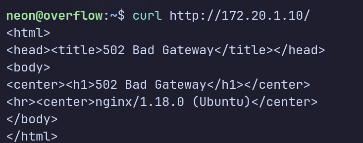

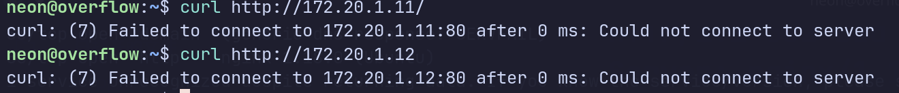

#### 11和12 这两台机子都没web

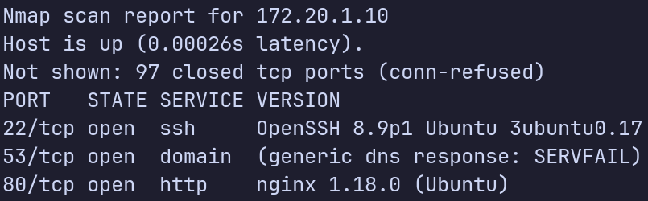

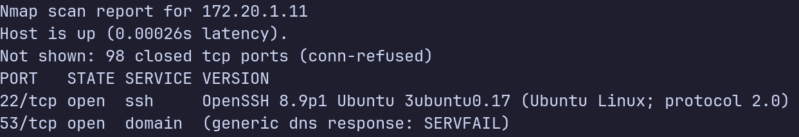

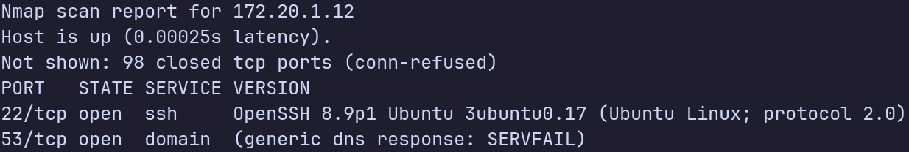

#### 前面看到172.20.1.10的web状态码为502,说明后端服务没起来

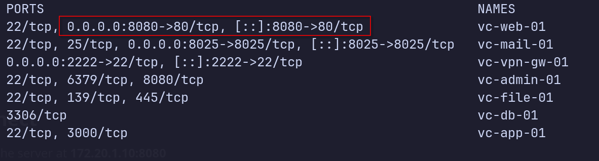

##### 看到docker的端口映射是8080对应的80，还可以用127.0.0.1：8080这个访问

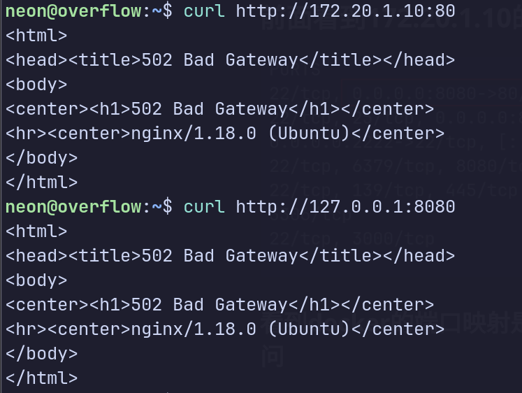

#### 返回结果相同

### 目录扫描

```bash
gobuster dir -u http://172.20.1.10 -w Desktop/common.txt
```

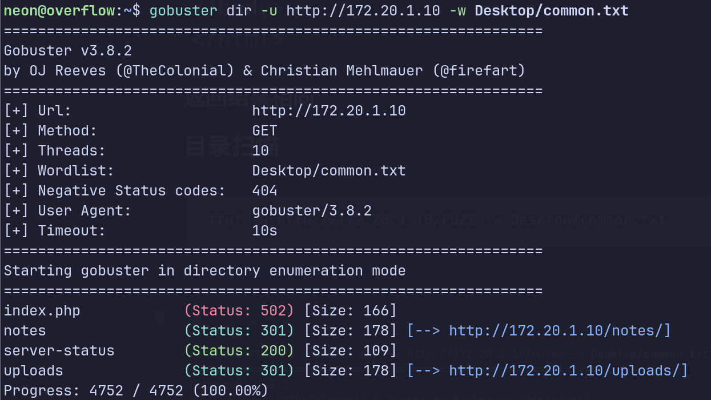

##### 进notes和uploads目录再扫描

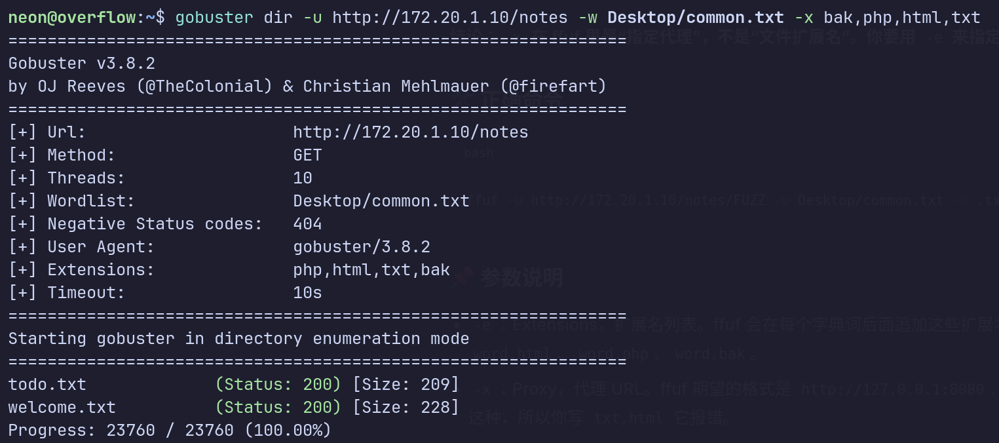

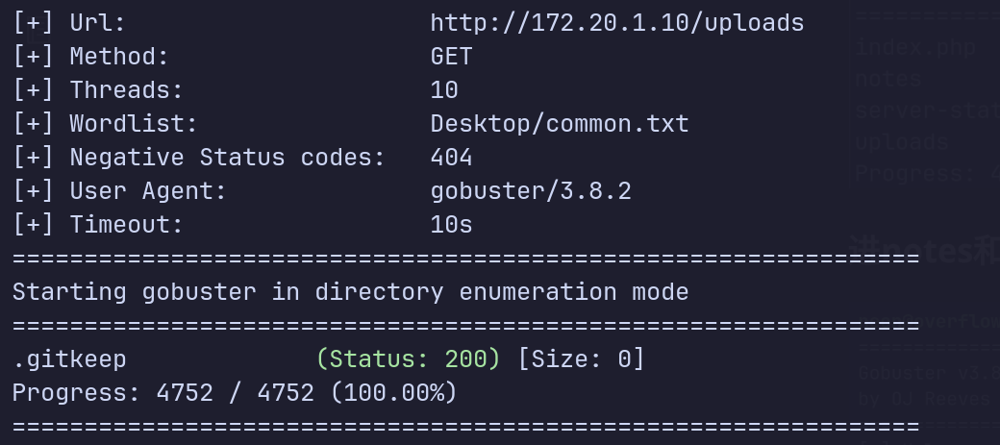

### 泄漏的敏感信息

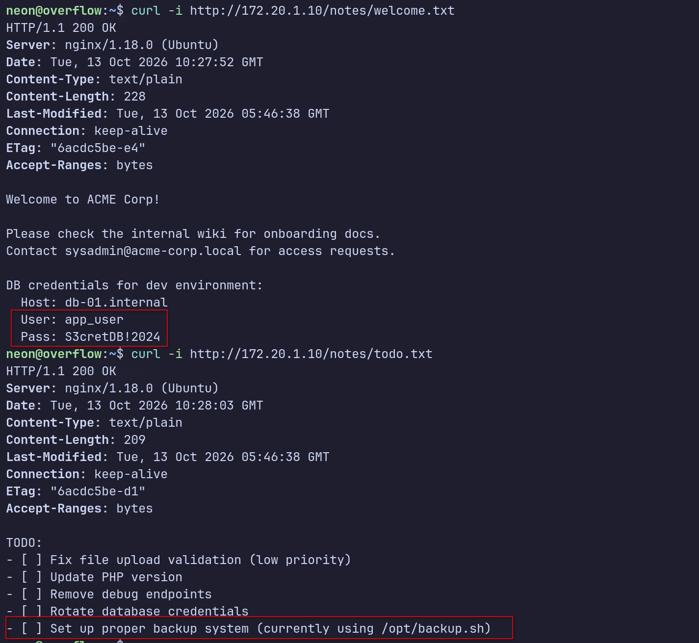

#### todo.txt  意义如这个名字，要做的事，但是前面方框里一个勾都没有，所以这些留下的入口点，都没有被清理掉，都可以成为我们的攻击面

#### 上面还暴露了数据库crendential和主机名，这个应该是内部网络才能访问的主机

### 向172.20.1.10这个主机的53端口发送dns查询刚才找的域名

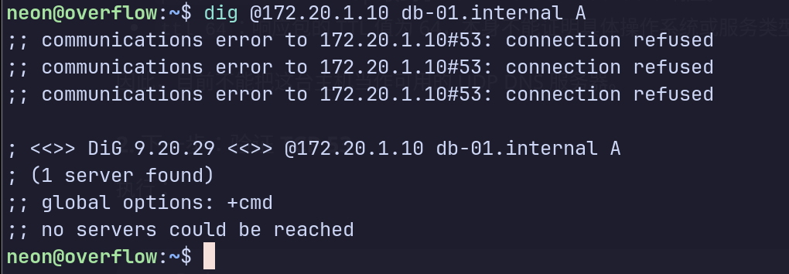

### 没发现

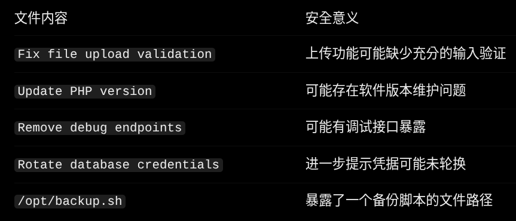

##### 

### 加扩展名扫根目录

```bash
gobuster dir -u http://172.20.1.10 -w Desktop/common.txt -x bak,php,html,txt
```

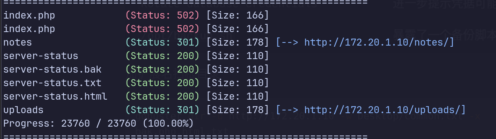

#### 上传口没找到，那就做ssh爆破吧，先看ssh认证方式

```bash
sudo nmap -sT -Pn -n -p 22 -sV --script ssh-auth-methods 172.20.1.10
```

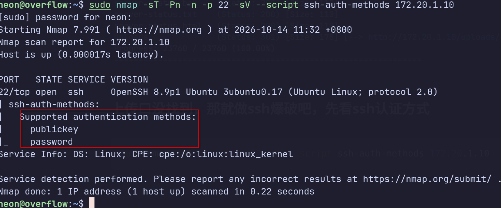

#### 支持密码认证

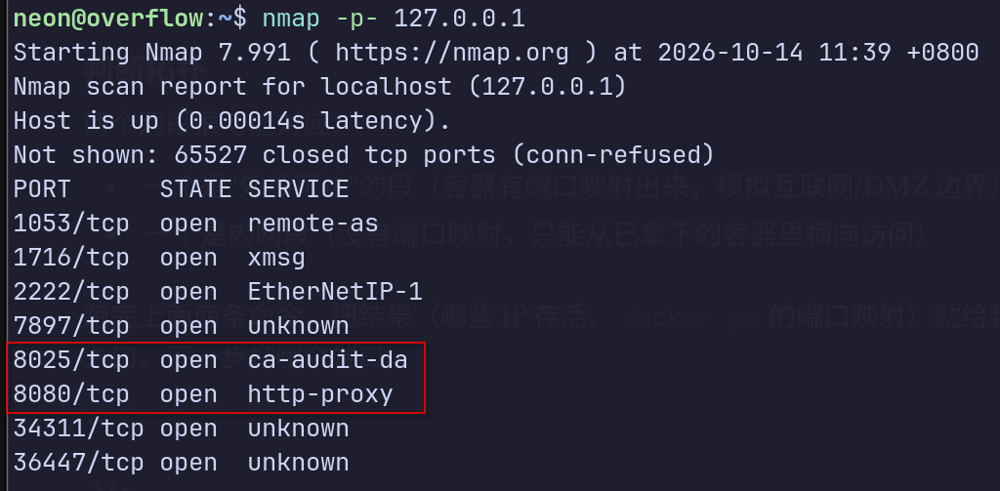

##### 发现新的web服务

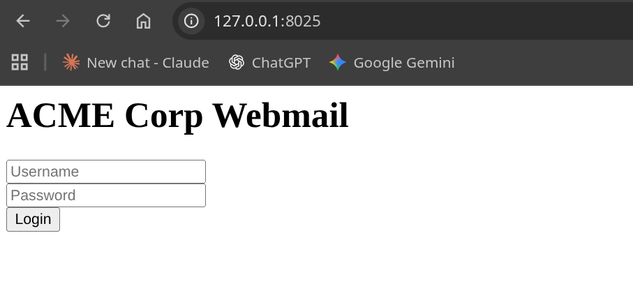

#### 是个表单

##### 也爆破目录一下

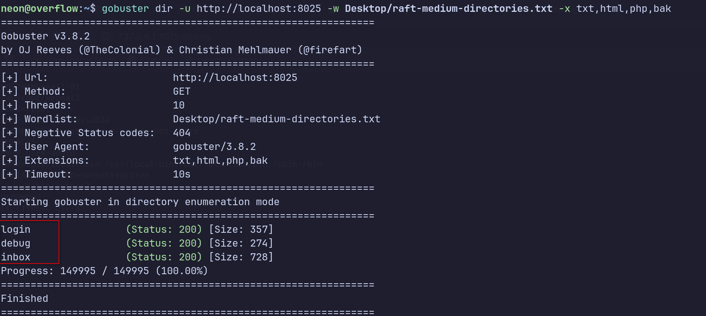

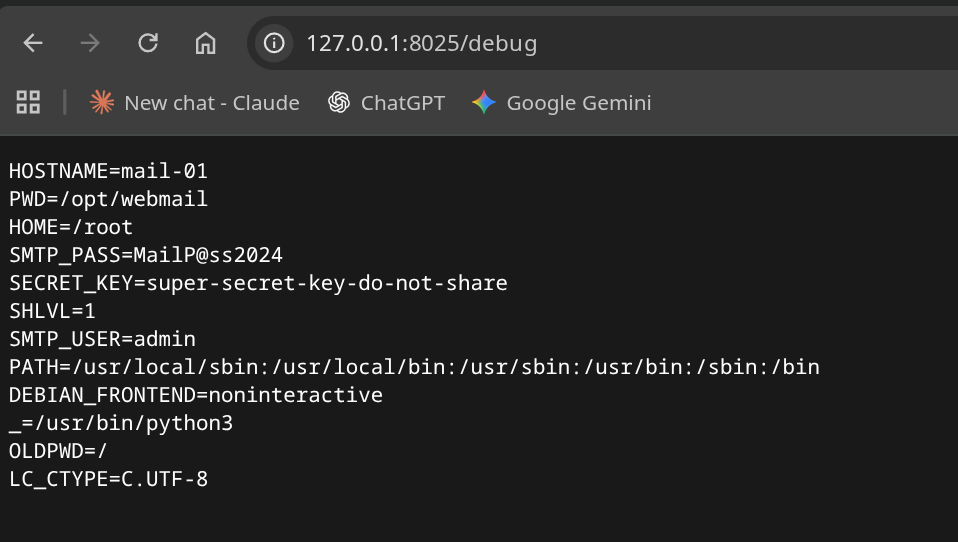

**用户名** `admin` / **密码** `MailP@ss2024`

###### 登录表单看一下

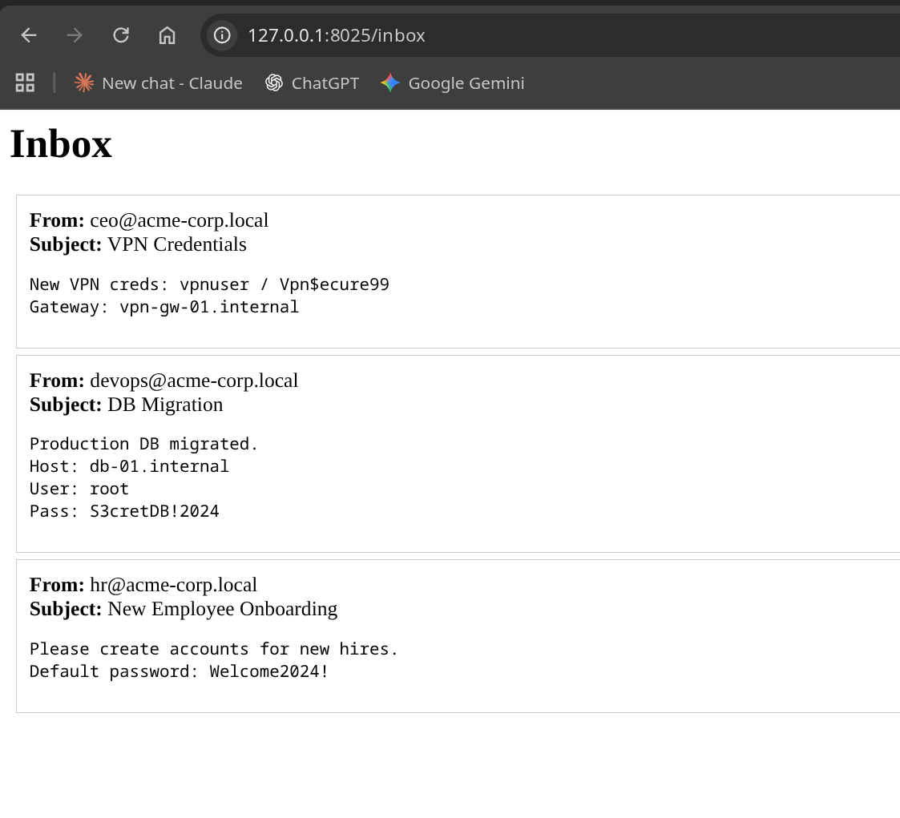

#### 成功了

### 其实直接进/inobx也是可以,都不需要认证


